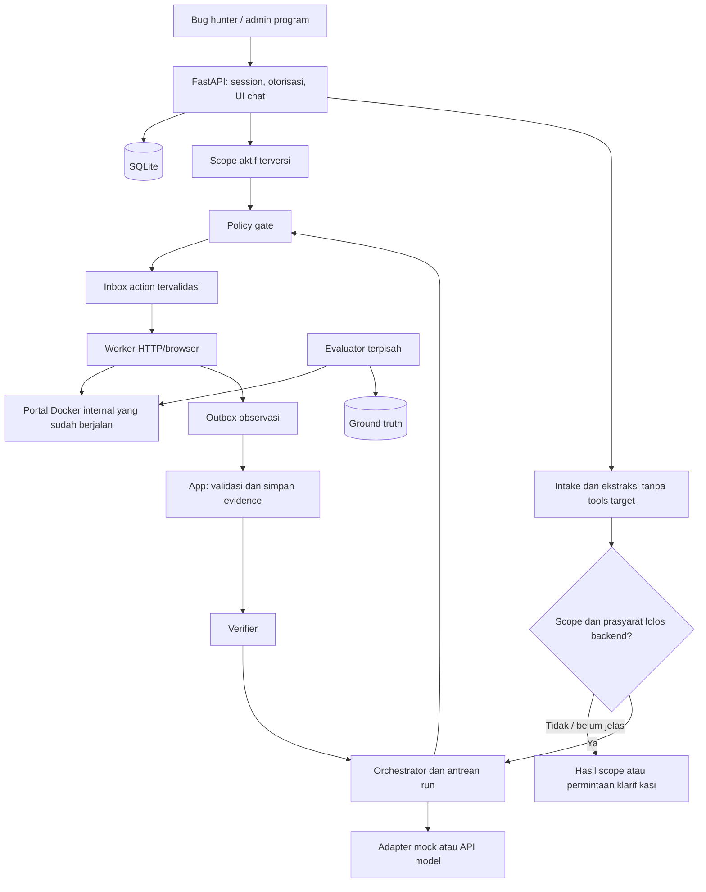

# Arsitektur dan kontrak implementasi

**Update kontrak13 November2026:** hasil triage-v2 dapat menyiapkan Claim melalui `POST /api/triages/{triage_id}/validation-draft`; konfirmasi owner melalui snapshot membawa source_triage_id dan diaudit. Endpoint persiapan tidak membuat job atau memberi izin; scope, readiness, policy per aksi dan verifier tetap otoritas backend. Runtime teks4096 output; planner mock lama1024 terpisah. Prioritas OpenRouter/Azure dipilih operator tanpa fallback otomatis. [Kontrak/bukti terbaru](ai-validation-integration.md), [setup provider](provider-setup.md). Bagian historis di bawah yang menyebut saran belum mengisi klaim digantikan jalur konfirmasi ini.

**Audit aktual 13 November 2026:** [backend-flow.md](backend-flow.md) memetakan jalur triage teks, snapshot/claim, gate, antrean/worker/verifier dan review/publikasi berdasarkan source. Triage live tidak membuat run dan planner LAB masih deterministik/mock. Snapshot schema FE: [api/openapi.json](api/openapi.json). Temuan schema/routing/cap provider dan hasil smoke berada di [audit BE](backend-audit-2026-11-13.md), bukan klaim seluruh kontrak sudah lolos.

**Rancangan role 13 November 2026:** kebutuhan fitur bug hunter/admin dan matriks hak akses berada di [roles.md](roles.md). Admin mengelola scope serta dapat memasukkan laporan sendiri/kanal eksternal; hunter mengelola laporan sendiri. Atribusi pelapor eksternal tidak memberi kepemilikan akun. Fitur tambahan pada dokumen role masih usulan; belum mengubah schema/API atau membuktikan implementasi.

**Pembaruan Azure7 November:** pemilihan provider teks eksplisit `VALVULN_TRIAGE_PROVIDER`; adapter Azure Foundry OpenAI v1 tersedia tanpa tools atau worker dispatch. Deployment/requested model dipisahkan dari identitas model respons; endpoint dan expected model masuk snapshot konfigurasi. Key hanya di app/evaluator, COST_UNKNOWN mempertahankan reservasi penuh. CODE_TESTED148 tes terkait; live belum. [Konfigurasi](azure-setup.md), [bukti dan batas](azure-verification.md). Ini menggantikan kalimat lama yang menyebut Azure hanya rencana, tanpa mengubah kontrak verifier atau fallback benchmark.

## Kontrak submission aktif 7 November 2026

**Tambahan R3b:** projection B dan runner evaluasi merupakan jalur operator teks terpisah pada `evaluator/text_context.py`, `text_dispatch.py`, `text_benchmark.py`, bukan perluasan worker/verifier. A/B hanya report/aturan publik dan fakta allowlist terikat. Schema prediksi VALID/INVALID/ABSTAIN terpisah dari triage dan verdict. Migrasi source006 menambah evaluation_jobs dan tepat satu binding run/triage/evaluation untuk setiap baris ledger/attempt, menyalin seluruh rekaman lama. UI triage dan evaluator menolak dispatch teks bersamaan; interupsi tetap dihitung dan tidak di-replay. [Kontrak/freeze/pemulihan](r3-runbook.md), [verifikasi dan batas](r3-r4-verification.md). Source tested tidak berarti schema006 sudah diterapkan ke service aktif.

Ikuti [scope submission](submission-scope.md). R1 menambahkan jalur triage model **teks saja** pada app: report milik pengguna + scope/aturan publik yang terversi -> provider server-side -> schema triage -> saran/penjelasan. Saran scope/capability tidak menggantikan gate backend atau mengubah izin, role, scope aktif, run/action ataupun verdict. Tidak ada tool calling, target request, akses evaluator/GT/source jawaban atau model-to-worker dispatch. Jalur worker yang sudah ada dipertahankan tanpa perluasan.

Mode inference triage kini memakai `VALVULN_TRIAGE_MODE`, terpisah dari `VALVULN_EXECUTION_MODE` planner lama. Mengaktifkan triage live tidak mengaktifkan tool_execution_mode LAB atau mengubah planner mock menjadi planner live. Source R1 CODE_TESTED menyediakan `POST /api/conversations/{id}/triages`, `GET /api/triages/{id}` dan cancel, schema saran tanpa verdict, binding versi draf/scope, redaksi, deadline/retry terbatas serta ledger bersama. Migrasi app 005 menambahkan `text_triages` dan binding eksklusif run/triage pada ledger/attempt tanpa membuat job lab. Konteks hanya report/lampiran milik owner serta aturan publik terversi. Live tanpa konfigurasi gagal jelas, tanpa fallback ke mock; live belum diverifikasi dan service aktif tidak diperbarui. [API, batas, migrasi dan hasil R1](r1-verification.md).

R2 CODE_TESTED menghubungkan UI triage R1 dengan mode konfigurasi, mode hasil tersimpan, model/provider aktual, status/cancel dan stale result. Conversation berizin menyediakan `latest_triage_id` untuk reload; lifecycle polling triage terpisah dari run. Saran dirender melalui textContent dan tidak mengubah claim/scope atau memicu worker.

`GET /api/runs/{id}/observations-summary` merupakan projection read-only **buatan aplikasi**, tanpa inference baru. Admin memperoleh urutan/tool/metode/status/jumlah respons/truncation dan evidence ID setelah file/hash/journal/envelope serta report/revision/run/scope/epoch/snapshot/boot/argumen/provenance cocok. Data body/path/identitas/screenshot, catatan admin, GT/label evaluator dan output model tidak masuk ringkasan. Owner hanya memperoleh pesan menunggu publikasi atau ringkasan publik aplikasi dari assessment lama; tidak mendapat observasi/evidence ID privat. `is_current` mengikat perubahan draf/revisi/scope tanpa menghapus riwayat, verdict tetap null dan mode NONE bukan bukti target. [Kontrak dan pemeriksaan R2](r2-verification.md). Ini belum builder konteks B benchmark. Rencana agent adaptif/kategori penuh di bawah tetap backlog; [evaluasi aktif](evaluation.md) mengukur A dokumen/B dokumen+bukti, bukan loop agent otonom.

Status audit 6 November 2026: M1-M5 selesai teknis lokal. [Hasil M5](m5-verification.md), [M4c](m4c-verification.md). Workflow/verifier/UI mendukung BAC-08, XSS-08 dan upload UP-04 development dengan planner mock; rute lain operator. Model live dan keamanan runtime lengkap belum diverifikasi. Kontrak teknis dimiliki dokumen ini; pemeriksaan pada [security-review.md](security-review.md).

M5 menambah `UploadArguments` terstruktur: POST rute permintaan UUID, alias requester-a, fixture registry dan nonce aplikasi. Nama/isi file, URL/header/script bebas tidak diterima. Isi fixture produk teks tetap; nama fixture ditetapkan aplikasi. Verifier UP-04 mengikat lima observasi (dua upload, dua pembacaan daftar dan satu label aman), ID file berbeda, hash/ukuran/isi, akun pembaca, run/action/scope/epoch/snapshot/boot dan kontrol browser. Bukti kurang atau timeout tidak menjadi REFUTED. Bukti mentah tetap admin; hunter hanya ringkasan tetap setelah review/publikasi. UP-01..03 tidak memperluas tools/planner produk; detail dan batas di hasil M5.

Nama kerja pendaftaran adalah **ValVuln AI: Agen Validasi Laporan Kerentanan**, kategori yang direkomendasikan **Penindakan**. Kontribusi AI ada pada ekstraksi klaim, rencana uji, adaptasi berdasarkan observasi, dan penyusunan assessment berbukti. Pengujian worker memakai tools terstruktur pada lab IT. S&K menempatkan AI pada tema dan rubrik, sehingga integrasi model nyata perlu ditunjukkan sebelum fitur AI diklaim berjalan. Lihat [penyelarasan aturan](rules-alignment.md).

## 1. Prinsip implementasi

Alur review rekaman bisnis manual kini terhubung ke produk melalui router `app/api/business_records.py`, tanpa dispatch workflow/worker atau assessment kerentanan. Tabel app `business_record_reviews` dan file immutable mengikat report/revision/content hash, versi/hash aturan aktif saat impor dan admin pengunggah. Validator konsistensi murni dipakai bersama pada `boundary/business_types.py`/`boundary/business_trace.py`; CLI evaluator menjadi wrapper, tanpa memasukkan evaluator/GT/lab ke image app. Projection hunter hanya ringkasan tetap setelah review/publikasi; review ulang menarik publikasi, file asli tetap privat dengan hash check. Status dan verdict konsistensi dipisah dari assessment; vulnerability_verdict/GT null. Scope/label input tidak memberi izin transport atau mengesahkan asal/aktor record. [API, schema, kuota dan verifikasi](business-record-review.md).

Workflow administratif `business_evidence_workflow` menambah konteks versi/hash dan phase NEEDS_SNAPSHOT_REVIEW / NEEDS_COMPLETE_RECORD / NEEDS_RECORD_RECONCILIATION / NEEDS_SOURCE_AND_IMPACT_EVIDENCE, terpisah dari state run dan verdict. Endpoint GET workflow hanya admin, membaca ulang/rehash record, menghitung ulang hasil dan memvalidasi binding sebelum memakai revisi laporan/aturan asal. Next actions berasal dari daftar tetap, executor admin dan automatic=false; target_execution_allowed/model_dispatch_allowed false. Klaim diberi label data tanpa otoritas instruksi; catatan review dan data aktor mentah tidak masuk konteks. Publikasi ringkasan tidak membuka akses konteks kepada hunter. Hash konteks bukan attestation; integrasi model/tool live belum dibuat. [172 tes dan QA workflow](business-record-review.md#workflow-bukti-dan-konteks-terstruktur).

Auditor rekaman business logic M6c berada pada evaluator host, terpisah dari workflow/verifier produk. Ia menerima rekaman persistensi JSON terstruktur dan membandingkan state/stok/fulfillment tanpa I/O target. Hasil hanya status konsistensi rekaman; tidak mengesahkan identitas/origin, izin aktor atau GT dan tidak menghasilkan CONFIRMED/REFUTED. Schema/input dibatasi dan pesan error tidak mengulang nilai field mentah. [Batas pemeriksaan rekaman](m6b-verification.md).

Penguatan parser M6d membatasi pembacaan stream aktual hingga 16 MiB + 1 byte dan menolak kunci JSON duplikat maupun konstanta NaN/Infinity; 33 tes parser dan dua artefak historis diperiksa ulang. Pembaca `read_json_record` dipakai kembali oleh auditor trace M6e. [Hasil M6d](m6d-verification.md).

M6e menambah evaluator host `business_trace_audit` untuk fixture kontrol empat event CREATE/SUBMIT/APPROVE/FULFILL. Schema membatasi state, event dan metadata aktor/unit. Auditor memeriksa rantai sebelum/sesudah, owner/staff-unit, approval terpisah dari owner, approved_by, stok, binding fulfillment dan kesamaan trace setelah lifecycle ulang. Runner hanya memakai database sementara baru dan ASGI, tanpa URL/database target dari input; ekspor memilih field tanpa credential/session. Hasil tetap konsistensi rekaman, verdict/GT null; metadata tidak ditandatangani dan tidak membuktikan penegakan izin pada aksi lain. Core konsistensi kini juga digunakan review rekaman manual di atas; verifier/worker kerentanan tetap terpisah. [97 tes terarah dan bukti M6e](m6e-verification.md).

M6f memperluas gate evaluator `catalog_audit` dengan riwayat development sistem terversi, terpisah dari alokasi katalog yang dapat berubah. Riwayat BAC-08/XSS-08/UP-04 tetap menghalangi pemakaian grup yang sama sebagai evaluasi; perubahan grup pada ID tersebut memerlukan review revisi. Gate juga memeriksa komposisi kategori dan mengeluarkan inventaris metadata kandidat tanpa mengubah alokasi, label atau memilih report. Source evaluator tetap tidak termasuk allowlist image runtime. Readiness benchmark tetap false; CLI exit 2 sesuai kekurangan. [Kontrak dan hasil M6f](m6f-verification.md).

M6b menambahkan konteks hanya pada jalur simulasi `execution_mode=mock`/`tool_execution_mode=NONE`. `SimulationContext` dibangun dari scope_version_id dan program_id milik run, memuat teks/label opsional/hash business rules, serta identitas versi/epoch. Tidak membaca report sebagai policy, profil secret, source lab atau evaluator. Prompt `m6-simulation-context-v1` menyatakan tools kosong dan target request dilarang; hash konteks diaudit dan raw admin saja. Scope tersimpan tetap immutable. Builder menolak LAB/live/replay; jalur LAB tidak memakai konteks ini dan tidak mendapat kemampuan tambahan. [Bukti M6b](m6b-verification.md).

Fondasi M6a pada source lab memisahkan `business_items`, `business_staff`, `business_requests`, `business_fulfillments` dan `business_events` dari schema platform. Input create hanya title/item UUID/quantity; edit hanya item UUID/quantity/expected_version. Transisi hanya expected_version. Field role/owner/state/approval dari client ditolak; seluruh mutasi tetap session/Origin/CSRF. Staff unit A mempunyai tugas approve/fulfill, tanpa akses unit B dan tanpa persetujuan sendiri. Perubahan barang/jumlah hanya DRAFT. Fulfillment unik per request menyimpan versi sebelum pemenuhan serta stok sebelum/sesudah; replay versi identik mengembalikan record tersebut. Jurnal dan stok/state commit dalam transaksi yang sama. Endpoint aturan publik terautentikasi berversi; context agent, tools dan validator BUSINESS_LOGIC belum ditambahkan. [Pemeriksaan M6a](m6a-verification.md).

- Satu workflow Python dan satu job aktif; anggaran kerja sekitar 30 jam.
- FastAPI untuk API dan UI chat; SQLite untuk metadata, session dan antrean sederhana. Satu program pada MVP, dua role platform: bug hunter dan admin program.
- Keputusan stack pada [prd.md](../prd.md): tiga container app/worker/lab, UI Jinja2/JavaScript di app, Chromium di worker dan dua database SQLite terpisah melalui aiosqlite. Evaluator merupakan CLI host; tidak ada container DB/frontend/evaluator yang terus berjalan.
- HTTPX untuk request dan Playwright untuk browser.
- Target adalah lab sendiri. Registry target serta jenis tindakan ditetapkan aplikasi, bukan report/model.
- Model menyusun tindakan dan membaca observasi. Backend menegakkan izin dan verifier mengharuskan evidence yang nyata.
- Model utama Qwen/OpenRouter; adapter mock tersedia lebih awal karena key belum siap dan budget total Rp50.000.
- Mock, replay, dan live dibedakan pada setiap run, artefak, tampilan, dan ekspor.
- Scope/guideline dimiliki admin program. Upload atau chat bug hunter tidak dapat mengubah izin. Model hanya mengusulkan; backend menentukan izin aktual.
- Portal lab di Docker sudah berjalan saat validasi dimulai. Tidak membuat container target baru per report. Akses target baru diberikan setelah scope dan prasyarat lolos.

## 2. Komponen



| Komponen | Tanggung jawab | Akses yang dibutuhkan |
| --- | --- | --- |
| UI/API | Login, keanggotaan program, chat/upload, status, pembatalan, review, ekspor | Data yang diizinkan role dan kepemilikan; bukan semua evidence |
| Intake/scope | Ekstraksi data tak tepercaya dan pencocokan scope aktif | Tidak mempunyai tools atau koneksi target |
| Konfigurasi program | Draf guideline dan aktivasi aturan terstruktur | Admin anggota program; mapping target hanya konfigurasi operator |
| Orchestrator | State, anggaran, pemilihan tool, retry terbatas | Profil publik target, observasi, adapter model |
| Model adapter | Format pesan/tools, respons terstruktur, usage dan refusal | API key hanya di adapter live |
| Policy gate | Cek tindakan aktual dan argumennya sebelum eksekusi | Registry target, izin dan anggaran run |
| Worker | Eksekusi HTTP/browser, session akun uji, observasi | Hanya lab serta job/evidence yang diperlukan |
| Verifier | Validasi kaitan klaim, kontrol, dan bukti | Observasi yang benar-benar tersimpan |
| Evaluator | Pilih kondisi, seed, reset, health assertion, scoring | Label GT dan kontrol target; terpisah dari agent |

## 3. Data inti

Kontrak menggunakan schema terversi. ID dibuat aplikasi dan tidak diserahkan pada model.

### User, Program dan Membership

```text
User: user_id, login_name, password_hash, enabled
Session: session_id_hash, user_id, created_at, expires_at, revoked_at
Program: program_id, display_name, active_scope_version_id, enabled
Membership: user_id, program_id, role: BUG_HUNTER | PROGRAM_ADMIN
```

Akun demo dibuat operator melalui seed; MVP tidak memerlukan registrasi publik atau pilihan role di layar login. Password di-hash dengan pustaka terpelihara, bukan algoritme buatan sendiri. Role diambil dari membership server pada setiap request. Role platform berbeda dari requester/approver pada portal lab; credential/session platform tidak diteruskan ke target.

### ScopeVersion dan TargetBinding

```text
ScopeVersion: scope_version_id, program_id, version, state: DRAFT | ACTIVE | RETIRED
asset_aliases, in_scope_rules, out_of_scope_rules, allowed_capabilities
business_rules, source_attachment_id, source_hash, activated_by, activated_at
TargetBinding: program_id, target_id, asset_alias, fixed_origin, allowed_paths
```

Upload guideline menghasilkan draf, bukan policy aktif. Admin memeriksa aset, pengecualian, metode dan aturan bisnis, lalu mengaktifkan revisi terstruktur. Tolak aturan ambigu/bertentangan; pengecualian mengalahkan aturan umum. Hanya alias aset yang cocok dengan `TargetBinding` operator yang boleh dipakai. Admin program tidak dapat memasukkan host/IP Docker bebas lewat guideline. Program tanpa scope aktif tidak bisa menjalankan validasi target.

Run mengunci versi scope. Aktivasi versi baru membatalkan otorisasi job lama yang masih antre dan menghentikan tindakan lanjutan run aktif; kirim ulang eksplisit memakai versi baru. Pengecekan versi/pencabutan dilakukan sebelum setiap tindakan. Log lama tetap memakai snapshot aslinya.

### Conversation, Message dan Attachment

```text
Conversation: conversation_id, program_id, owner_user_id, report_id, created_at
Message: message_id, conversation_id, author_user_id, kind, body, created_at
Attachment: attachment_id, program_id, owner_user_id, purpose, storage_key
original_name, detected_type, byte_size, sha256, parse_status, extracted_text
```

Satu percakapan menangani satu report utama. Pesan tambahan membuat revisi draft; run memakai snapshot report/pesan yang immutable sehingga perubahan saat pengujian tidak mengganti kasus diam-diam. Pesan biasa tidak otomatis memulai/mengulang validasi. Pesan model, status aplikasi, dan observasi tools dibedakan oleh `kind` yang dibuat server.

Upload awal hanya UTF-8 `.txt`/`.md`, satu lampiran per draft, maksimal 128 KiB dan 32.000 karakter gabungan teks setelah parsing. Guideline memakai batas yang sama. PDF, OCR, DOCX, arsip dan script executable ditunda; UI tidak menawarkan format yang belum didukung. Nama penyimpanan acak di luar webroot; nama asli tidak dipakai sebagai path. Tidak mengambil isi link/report URL secara otomatis dan tidak memuat gambar/HTML/Markdown eksternal. Endpoint lampiran tetap mengecek kepemilikan dan purpose; file report bukan fixture yang boleh dieksekusi pada lab.

### Report

```text
report_id, program_id, owner_user_id, conversation_id, revision_id
title, body, submitted_at, content_hash, attachment_ids
selected_target_id (diturunkan dari binding), primary_claim_id, reported_category
```

MVP memvalidasi satu klaim utama per kasus evaluasi. Report dengan banyak klaim meminta pemilihan klaim utama atau mencatat klaim lain belum diperiksa. Verdict satu klaim tidak mewakili seluruh report secara otomatis.

### TargetContext yang dapat dilihat agent

```text
target_id, base_origin_alias, allowed_paths, allowed_methods
account_aliases, roles, ownership_rules, business_rules
allowed_capabilities, declared_preconditions
```

Context tidak berisi label GT, kondisi rentan/perbaikan, credential mentah, isi evaluator, maupun kriteria jawaban tersembunyi.

Peta 24 titik pada `docs/lab-vulnerabilities.md`, mapping draf 20 laporan, dan jawaban evaluator tidak dimount atau dicari oleh worker/agent. Report input dan manifest GT merupakan artefak terpisah; ID publik tidak boleh mengkodekan valid/tidak valid.

### Run

```text
run_id, program_id, report_id, report_revision_id, primary_claim_id, target_id
experiment_arm (bila evaluasi), queue_status
requested_by, scope_version_id, authorization_epoch, idempotency_key
execution_mode: mock | replay | live (mode model)
tool_execution_mode: NONE | LAB (dibuat server/operator; M2 bukan input API user)
target_snapshot_id, worker_boot_id
model_id, inference_provider, prompt_version, code_revision
target_build_alias, dataset_snapshot_id (bila evaluasi)
process_status, scope_decision, capability_decision
limits, counters, started_at, finished_at, error_code
```

### Action

```text
action_id, run_id, tool_name, schema_version
arguments, account_alias, expected_observation
policy_result, policy_reason, started_at, finished_at
observation_ids
```

`expected_observation` adalah hipotesis rencana; hanya `observation_ids` yang menunjukkan hasil eksekusi. Nilai yang diharapkan tidak disalin menjadi observasi.

### Evidence

```text
evidence_id, run_id, action_id, kind, captured_at
artifact_path, sha256, actor_alias, target_alias
summary, redaction_version, provenance
visibility: INTERNAL | HUNTER_SAFE, published_by, published_at
```

Kind mencakup HTTP exchange, screenshot, DOM excerpt, browser event, dan state comparison. Path dibuat aplikasi di direktori run; model tidak boleh memilih filesystem path arbitrer.

`INTERNAL` tetap mereduksi secret saat capture. Bug hunter menerima ringkasan terstruktur tersanitasi; tidak menerima trace mentah, host internal, cookie, credential atau data akun lain. Bukti teks yang dibagikan harus lolos projection/redaksi server dan review admin. Screenshot/DOM mentah hanya admin; jangan mengandalkan regex teks untuk meredaksi gambar. Ekspor mengikuti izin yang sama dengan detail/unduhan, bukan jalur bypass.

### Assessment

```text
claim_id, verdict, reasoning
supporting_evidence_ids, contradicting_evidence_ids
controls_performed, missing_prerequisites, limitations, next_action
review_status, analyst_override, reviewer_note
reviewed_by, reviewed_at, hunter_summary, publication_status
```

## 4. State dan verdict

```text
RECEIVED -> PARSED -> SCOPE_CHECKED -> PLANNED -> POLICY_CHECKED
         -> RUNNING -> VERIFYING -> COMPLETED

Terminal/cabang: NEEDS_INFO, OUT_OF_SCOPE, UNSUPPORTED, POLICY_BLOCKED,
                PROVIDER_REFUSED, FAILED, CANCELLED, CONFIGURATION_REQUIRED
```

Scope: `IN_SCOPE`, `OUT_OF_SCOPE`, `UNKNOWN`. Capability: `SUPPORTED`, `UNSUPPORTED`, `UNKNOWN`.

`IN_SCOPE` bukan keputusan bebas LLM. Model mengekstrak klaim/aset/kategori sebagai usulan, lalu backend mencocokkan binding, aturan terstruktur dan pengecualian secara konservatif. Aset/prasyarat ambigu menghasilkan `UNKNOWN`/`NEEDS_INFO`; tidak memberi akses target. Run pengujian hanya masuk antrean setelah scope `IN_SCOPE`, capability `SUPPORTED`, dan prasyarat lengkap. Intake boleh menyimpan status/catatan scope tanpa membuat worker job. Health check target adalah tugas evaluator di luar intake, bukan cara agent mencoba target sebelum scope lolos.

| Verdict | Syarat |
| --- | --- |
| `CONFIRMED` | Dampak klaim terobservasi dan kontrol relevan mendukungnya |
| `REFUTED` | Bukti menyangkal klaim spesifik pada prasyarat yang telah diverifikasi atau perilaku sesuai aturan |
| `INCONCLUSIVE` | Bukti kurang, prasyarat belum lengkap, reproduksi gagal tanpa bukti penyangkal, atau proses terhenti |

Simpan verdict hanya setelah ada assessment. Run yang berhenti sebelum assessment menggunakan verdict null dan alasan status; normalisasi sebagai nondecision pada evaluasi. `COMPLETED` tidak berarti `CONFIRMED`. Analisis model ditampilkan sebagai penilaian, bukan observasi sistem.

## 5. Kontrak tools

| Tool | Input | Output |
| --- | --- | --- |
| `get_target_context` | Target ID terdaftar | Scope, aturan, akun alias dan prasyarat |
| `http_request` | Target ID, method, relative path, akun alias, header/body terbatas | Observation ID, status, cuplikan body, evidence ID |
| `browser_action` | Target ID, akun alias, operasi terbatas dan locator | Hasil operasi, event, DOM/screenshot evidence |
| `upload_test_fixture` | Fixture ID terdaftar, endpoint dan field | Evidence upload dan hasil akses lanjutan jika diuji |
| `compare_observations` | Dua atau lebih observation ID dalam run | Perbedaan yang dapat dilacak ke observasi asli |
| `submit_assessment` | Klaim, verdict, alasan, evidence ID | Assessment tervalidasi atau error referensi bukti |

Browser action awal: navigate, fill, click, read DOM, capture screenshot, serta pemeriksaan marker XSS yang instrumentasinya ditentukan worker. Tidak tersedia shell umum, browser-eval bebas, instalasi tool, maupun eksekusi script dari report.

Kesalahan parameter mengembalikan error schema; tidak menjalankan tindakan sebagian sebelum argumennya lolos pemeriksaan.

## 6. Policy dan pemisahan akses

- Seluruh endpoint termasuk polling, chat, lampiran, evidence dan ekspor memakai session + membership + program + kepemilikan objek; default tolak. ID acak bukan pengganti otorisasi. Worker/model tidak dapat memilih user/role/program sendiri.
- Bug hunter boleh submit, membaca dan membatalkan run miliknya. Admin program boleh submit, membaca semua laporan pada programnya, membatalkan, review, publikasi ringkasan dan mengelola scope. Admin program bukan evaluator/operator target.
- Session opaque server-side dengan cookie HttpOnly, SameSite dan Secure pada HTTPS; rotate saat login, expiry, logout/revocation. Mode HTTP loopback development harus eksplisit dan tidak boleh dipublikasikan. Tolak mutasi tanpa token CSRF dan origin yang sesuai; tidak memakai CORS wildcard. Batasi login dan jumlah session. Secret/session tidak ditaruh di URL atau localStorage.
- Resolve `target_id` menjadi origin yang disetujui; jangan menerima hostname bebas dari model.
- Cek metode, path, identitas, body/fixture size dan izin jenis tindakan. Header koneksi seperti Host, Cookie, Authorization dan proxy tidak bebas diisi model; identitas berasal dari alias worker. URL absolut, kredensial dalam URL dan path ambigu ditolak atau dinormalisasi sebelum dibandingkan dengan aturan.
- Pemeriksaan dilakukan per request, redirect, navigasi, dan koneksi browser/subresource.
- Batasi koneksi pada origin/host/port lab. Blok akses metadata cloud, jaringan lain, serta fasilitas evaluator.
- Kredensial akun diselesaikan worker dari alias dan tidak masuk prompt, log publik, atau ekspor.
- Worker tidak memiliki API key model, GT, source jawaban, reset evaluator, atau Docker socket.
- DNS, redirect, proxy lingkungan dan browser traffic tidak boleh menjadi jalur keluar scope.
- Report dan respons target diperlakukan sebagai data tidak tepercaya. Instruksi di dalamnya tidak boleh mengubah policy.
- Dashboard meng-escape report/HTML target dan menampilkan artefak aktif secara inert.
- Job diterbitkan server dan terikat run/program/versi scope/identitas/batas; worker tidak menerima job buatan model atau browser user. Pencabutan akses, perubahan scope, cancel dan deadline menghentikan dispatch serta menutup request/browser context yang berjalan. Crash/restart tidak menghidupkan kembali job tanpa pemeriksaan.
- Origin target memakai jaringan Docker khusus; alamat privat target yang terdaftar boleh, seluruh alamat privat lain/host laptop/metadata/control plane ditolak. Jangan memakai blok semua alamat privat karena lab memang internal. HTTP redirect otomatis mati; redirect yang diperlukan divalidasi ulang. `trust_env`/proxy lingkungan dimatikan. DNS dan koneksi aktual diperiksa terhadap binding; browser mengikuti aturan yang sama, termasuk popup, subresource, WebSocket dan download.
- Orchestrator/model adapter dapat mengakses provider yang dikonfigurasi; worker dan target tidak punya internet bebas. Kanal job/evidence ke orchestrator harus sempit, terautentikasi dan tidak bisa dijangkau lewat tool HTTP/browser. Jangan membuat bridge API umum atau mount SQLite/source/`.env` ke worker.
- Browser memakai context baru untuk setiap akun/run, tanpa session admin platform; tutup setelah selesai. Target berisi XSS yang disengaja: target/worker tanpa privileged mode, tanpa host mount sensitif atau Docker socket, resource dibatasi dan browser sandbox tidak dinonaktifkan demi memudahkan demo.
- Observasi target, chat, guideline mentah dan report selalu data tak tepercaya. Tidak ada tool pengubah policy/role/budget/model config. Prompt injection tetap mungkin memengaruhi penalaran; batas tindakan harus bertahan walau model mengikuti instruksi berbahaya.
- Hanya data sintetis minimum yang telah direduksi yang boleh dikirim ke API model pada MVP. Key hidup di adapter, bukan di prompt/worker. Report asli instansi bukan data demo; klaim kesiapan memproses data rahasia belum dibuat.

Target lab dan worker dikemas dalam Compose; topologi jaringan dikonfirmasi lewat pemeriksaan konektivitas saat implementasi. Docker bukan klaim isolasi untuk script pihak luar arbitrer.

Keputusan deployment lokal, jalur job tanpa akses worker ke API/SQLite, lease/crash recovery, kuota data dan reset ada pada [runtime.md](runtime.md). Pemisahan ini harus dibuktikan lewat tes; tidak cukup menggambar jaringan pada diagram.

## 7. Batas resource dan pemanggilan model

Nilai awal yang dikalibrasi sebelum freeze:

- Satu job dan satu browser context aktif pada suatu waktu; pergantian akun memakai context terpisah dan tidak membawa cookie/storage akun sebelumnya.
- Lock/reservasi atomik mencakup antrean dan budget, bukan hanya tombol UI. Maksimum satu run menunggu/aktif per pemilik report, antrean global lima; request ulang dengan idempotency key tidak membuat run/panggilan ganda.
- Batas awal intake/chat 10 pesan per menit per akun dan paling banyak tiga permintaan mulai run per jam; kalibrasi pada development. Login/upload juga dibatasi; benchmark evaluator memakai runner terpisah tetapi budget global yang sama.
- Maksimum 12 panggilan model termasuk parsing/verifier/retry, 40 request jaringan target (termasuk request browser/subresource), 30 aksi browser. Request diblokir/dicoba dicatat terpisah dari koneksi yang benar-benar dilakukan. Batas byte respons, ukuran artefak total dan kuota disk harus dikonfigurasi; hentikan capture/aksi ketika habis, bukan menulis tanpa batas.
- Timeout request 10 detik dan run 180 detik.
- Maksimum satu retry gangguan sementara; tetap masuk anggaran yang sama.
- Batas token, ukuran report/artefak, serta estimasi biaya per run.
- Batas token input/output dan biaya maksimum harus dikonfigurasi sebelum live. Semua panggilan model, termasuk chat, parsing dan retry, mengurangi ledger global yang sama. Reserve perkiraan batas biaya sebelum dispatch; tolak bila sisa tidak cukup. Tidak mengirim seluruh riwayat chat tanpa batas.
- Penghentian karena batas, refusal atau pembatalan menjadi status tersendiri.

Simpan usage setiap panggilan, termasuk retry. Batas budget Rp50.000 adalah total eksperimen, bukan per hari. Perkiraan USD dari penyedia dicatat terpisah dari biaya rupiah pembelian; sisa rupiah tidak boleh diklaim pasti tanpa kurs/fee aktual. Sebelum live, tentukan limit token konservatif dan margin biaya agar panggilan berikutnya tidak melampaui sisa budget.

## 8. Adapter mock, replay, dan live

- Mock menghasilkan respons terstruktur yang telah ditentukan untuk menguji plumbing dan error handling; bukan penalaran model.
- Replay menggunakan trace tersimpan dan selalu menampilkan asalnya; bukan eksekusi model baru.
- Live memakai key di lingkungan orchestrator, model ID eksplisit, dan provider yang dicatat.
- Saat key tidak ada, mode live gagal dengan pesan konfigurasi; jangan otomatis mengubahnya menjadi mock yang tampak berhasil.
- Pemilihan provider alternatif atau tier gratis memerlukan pemeriksaan akses dan dicatat dalam konfigurasi. Model target tidak diganti diam-diam.
- Refusal, rate limit, schema error, dan provider outage dibedakan dari verdict teknis.

### Adapter provider dan fallback

Daftar provider, status gratis/subscription dan prioritas dimiliki bagian 3.1-3.2 [prd.md](../prd.md). Rencana adapter: OpenRouter, Gemini direct, OpenAI Platform API dan xAI; dua terakhir default nonaktif sampai akses/budget siap. Adapter memakai HTTPX async dengan mapping pesan/schema/tools khusus provider, bukan menganggap semua endpoint identik. Tidak memerlukan SDK/agent framework baru atau container tambahan.

```text
ProviderProfile:
provider_id, model_id, credential_ref, inference_provider_policy
access_tier: FREE_TIER | PROMO_CREDIT | PAID
enabled, tools_verified, schema_verified, token_limits, price_snapshot

ProviderResult:
call_id, provider_id, requested_model_id, resolved_model_id, inference_provider
text, proposed_tool_calls, refusal, finish_reason, usage, cost_status
provider_request_id, redacted_raw_response_ref, error_code, retry_after
```

Credential reference menunjuk konfigurasi app, bukan berisi key pada DB/log atau argumen tool. Simpan event per dispatch: `provider_attempt_id`, `call_id`, run ID, provider/model yang dicoba, status, alasan fallback, token dan reservasi biaya. Run menyimpan configured primary serta resolved provider/model dari respons sukses pertama. Percobaan primary yang gagal tidak dihapus meskipun fallback berhasil; UI/ekspor menampilkan asal hasil yang sebenarnya.

Fallback hanya sebelum output model pertama dikonsumsi/aksi target; maksimal dua dispatch per langkah berupa retry ATAU fallback, dalam cap/deadline/ledger yang sama. Gangguan sementara dapat memakai cadangan aktif sesuai anggaran; quota/kredit habis hanya dapat beralih ke profil FREE_TIER terverifikasi yang dipilih operator. Sesudah respons pertama, provider terkunci dan error berikutnya tidak memindahkan model atau menjalankan ulang tools. Tidak fallback atas refusal, auth/config error, schema/context error atau policy block. Benchmark menonaktifkan fallback serta provider routing otomatis pada gateway, dan menolak model/provider aktual yang menyimpang dari freeze.

Seluruh proposed tool call, termasuk dari provider cadangan, tetap melewati schema/policy aplikasi; adapter tidak menjalankan tools sendiri. Pisahkan error 429 sementara dari quota/saldo habis dengan kode provider; bila ambigu jangan mencoba tanpa batas. Tier gratis yang belum terverifikasi tidak dicatat biaya nol. Jalur ChatGPT plan/OAuth belum menjadi ProviderProfile aktif: perlu desain consent/session dan pemenuhan cap output tersendiri sebelum diimplementasikan.

## 9. Rute aplikasi yang direncanakan

| Rute | Fungsi |
| --- | --- |
| `POST /api/auth/login`, `POST /api/auth/logout`, `GET /api/me` | Session; tidak menerima role dari client |
| `GET /api/programs` | Hanya program yang user menjadi anggotanya; MVP satu |
| `GET /api/programs/{p}/guidelines` | Scope aktif versi publik, tanpa binding/credential internal |
| `POST /api/programs/{p}/scope-drafts` | Admin: upload/isi guideline sebagai draf |
| `POST /api/programs/{p}/scope-drafts/{s}/activate` | Admin: validasi dan aktivasi versi terstruktur; audit perubahan |
| `POST /api/programs/{p}/conversations`, `GET /api/conversations/{id}` | Buat/baca percakapan milik user atau anggota admin program |
| `POST /api/conversations/{id}/messages` | Pesan dan revisi draft; tidak otomatis menguji target |
| `POST /api/conversations/{id}/attachments` | Upload inert report; tidak dapat mengubah purpose menjadi guideline |
| `POST /api/conversations/{id}/reports` | Kunci snapshot laporan untuk pemeriksaan |
| `GET /api/programs/{p}/reports`, `GET /api/reports/{id}` | Filter kepemilikan server; admin seluruh program |
| `POST /api/reports/{id}/runs` | Intake/scope dahulu; job target hanya dibuat bila lolos |
| `GET /api/runs/{id}` | Status/hasil sesuai role; hasil internal tidak dikirim lalu disembunyikan CSS |
| `POST /api/runs/{id}/cancel` | Pemilik atau admin program, cek run masih boleh diakses |
| `POST /api/runs/{id}/review`, `POST /api/runs/{id}/publish` | Admin: koreksi berprovenance dan bagikan hasil tersanitasi |
| `GET /api/evidence/{id}`, `GET /api/runs/{id}/export` | Otorisasi objek dan projection sesuai role; tidak ada direktori static evidence |

MVP chat menggunakan polling sederhana untuk status/pesan; tidak perlu WebSocket atau Redis. Login dan pilihan program tetap tersedia meski MVP hanya satu program. Route reset target, manifest GT dan skor eksperimen mentah tidak menjadi tool atau route publik UI; evaluator memakai control plane terpisah. Publikasi hasil agregat benchmark hanya setelah review, bukan membuka GT kepada agent.

## 10. Milestone teknis pertama

1. Buat schema, storage, session/membership, profil scope terversi dan pemeriksaan kepemilikan dua akun. Uji akses silang sebelum menyambungkan UI ke evidence atau target.
2. Bangun target minimum dengan dua akun dan kontrol kepemilikan; gunakan BAC-08 development untuk alur pengujian awal sesuai peta. Fitur invoice dapat disiapkan sebagai data target, tetapi report evaluasi BAC-01 tidak dipakai untuk tuning.
3. Buat worker HTTP dan evidence capture; verifikasi dengan skenario manual yang diketahui.
4. Hubungkan orchestrator mock yang dilabeli dan tampilkan hasil end-to-end.
5. Jalankan pemeriksaan batas akses dan bukti.
6. Hubungkan provider live yang dipilih pada development (awal Qwen, opsi Gemini sebelum freeze) setelah key/akses dan budget tersedia; pisahkan hasilnya dari pengujian mock.

Tiga prompt runtime (`system.md`, `planner.md`, `verifier.md`) dibuat saat kontrak tools diimplementasikan. Prompt tidak menggantikan enforcement backend.

## 11. Kontrak integrasi yang harus dikunci pada M1

### Scope dan identitas resource

Aturan aktif menyimpan `asset_alias`, `path_template`, daftar method dan capability. Template mengikuti route terdaftar dengan parameter segmen terbatas; tidak memakai substring URL/regex buatan model atau arbitrary YAML/Python yang dieksekusi. Canonicalize scheme/host/port/path sebelum pencocokan, tolak dot-segment/encoding ambigu dan parameter yang melampaui schema. Pengecualian mengalahkan izin umum. Klaim yang belum dapat dipetakan konservatif menjadi UNKNOWN. Aturan bisnis naratif membantu penilaian, tetapi bukan cara memperluas izin tool.

ScopeVersion menyimpan DTO aturan terstruktur serta sumber naratif; TargetBinding hanya operator. Lokasi mount/file/path dan ID principal/program tidak diterima dari model. Fixture upload dipilih melalui registry ID; isinya serta marker ditetapkan aplikasi, bukan raw script lampiran report.

### Antrean dan respons API

`process_status` mengikuti tahapan/cabang workflow pada bagian 4. `queue_status` terpisah: `NOT_ENQUEUED`, `QUEUED`, `LEASED`, `FINISHED`, `CANCELLED`. `scope_decision` dan `capability_decision` tetap field tersendiri. Polling mengembalikan status workflow dan antrean yang benar, bukan memberi kesan RUNNING saat baru antre. Terminal tidak boleh kembali RUNNING; ulangi dengan run_id baru dan otorisasi terbaru.

```text
ErrorResponse: request_id, error_code, message, field_errors, retryable

Validasi request422 memakai SCHEMA_ERROR dan maksimal8 field_errors berisi path field yang dikenal serta pesan statis berlabel formulir. Input, context/msg mentah Pydantic dan nama extra field yang tidak dikenal tidak diproyeksikan. UI menampilkan pesan melalui textContent. Teks guideline wajib nonblank; JSON aturan dan aktivasi scope tetap diperiksa server. [Hasil fix form admin](admin-guideline-validation-fix.md).
RunResponse: run_id, report_revision_id, scope_version_id
process_status, queue_status, scope_decision, capability_decision
execution_mode, model_id, inference_provider, assessment (sesuai role)
```

| Respons | Pemakaian |
| --- | --- |
| 201 | Objek draft/report/revisi dibuat |
| 202 | Permintaan validasi tercatat; lihat status gate/antrean sebelum menyatakan worker berjalan |
| 401 | Session tidak ada/kedaluwarsa |
| 403 | Role/aksi tidak diizinkan; jangan kirim detail internal |
| 404 | Objek tidak ada atau tidak boleh diketahui oleh peminta |
| 409 | Revisi/scope kedaluwarsa, konflik run aktif, atau idempotency key dipakai untuk payload berbeda |
| 413 / 415 / 422 | Batas ukuran, format, atau schema input gagal |
| 429 | Rate/queue limit; sertakan petunjuk retry yang tidak membocorkan detail user lain |
| 503 | Konfigurasi/dependency belum siap; jangan diam-diam memakai mock |

Idempotency key di-scope pada principal + program + operasi. Kunci yang sama dengan payload/hash yang sama mengembalikan objek yang sama; kunci sama dengan payload berbeda ditolak. Admin dapat memulai ulang report program yang diikutinya dengan `requested_by`/audit yang eksplisit, tanpa mengganti pemilik atau snapshot report.

### Migrasi UI simulasi

Pertahankan HTML/CSS dan komponen yang sudah direview; pindahkan pemanggilan data di balik adapter UI. Adapter `prototype` menggunakan fixture yang ada, adapter API membaca server yang sama origin dengan FastAPI. Hapus pemilih role pratinjau, login palsu dan pemilih skenario dari build produk; role, mode, model/provider, scope version dan hasil berasal dari server/run, bukan state client. Runtime model tidak menerima isi `app.js` fixture atau peta jawaban sebagai context. Polling awal setiap dua detik hanya pada run yang masih aktif dan halaman terlihat; hentikan saat terminal/logout atau akses ditolak. Jangan menambahkan SSE/WebSocket pada M1.

### Prediksi dokumen dan penilaian teknis

Baseline evaluasi A memakai `DocumentPrediction` pada [evaluation.md](evaluation.md), bukan `Assessment` CONFIRMED tanpa evidence. Verifier teknis tetap mewajibkan bukti dampak/kontrol untuk B. Assessment menyimpan sumber `raw_model` dan `system_verified` secara terpisah; field visibility/publication/reviewer dibuat server/admin, bukan pilihan model. Tiap referensi evidence harus berada pada run, action, aktor dan klaim yang benar. Cuplikan yang terpotong atau narasi di response target tidak otomatis menjadi bukti dampak lengkap.

## Implementasi vertikal M3

M3 menambah `Claim.control_path` dan `claim_count` untuk kontrol objek serta penolakan multi-claim. Planner deterministik hanya menerima BAC/DELETE lampiran, dua alias requester dan objek berbeda. Teks report tetap data; ekstraksi/perencanaan model belum tersedia. Verifier khusus BAC memeriksa tujuh observasi dan kontrol dampak, bukan narasi model atau HTTP 200 saja. [Hasil/batas M3](m3-verification.md).

`POST /api/runs/{id}/review` menyimpan koreksi analis/catatan internal tanpa menimpa `raw_model`; review ulang mengubah publikasi menjadi PRIVATE. `POST /api/runs/{id}/publish` mensyaratkan review dan menghasilkan ringkasan tetap milik aplikasi. Polling dan ekspor hunter tidak memuat evidence internal, catatan bebas atau akun target lain. Bukti mentah JSON hanya melalui endpoint admin, ditampilkan sebagai teks inert. Publikasi M3 menyertakan bukti kontrol/dampak dalam teks tetap tanpa identitas, alias akun atau path; lampiran bebas pilihan admin belum tersedia.

UI backend memakai API dan session aktual. Pesan/lampiran yang sudah dikirim tersimpan di server, sedangkan teks yang belum dikirim hanya ada di memori tab per percakapan. Logout membersihkannya. Respons sesi sebelum logout serta polling/navigasi yang sudah digantikan tidak boleh memperbarui tampilan. API snapshot tetap idempotent pada draft/claim yang sama; start run menggunakan Idempotency-Key.

## Profil browser M4a

Kontrak awal `browser_action` generik pada tabel tools tetap rencana lanjutan. Implementasi M4a hanya menerima `browser_probe` dengan BrowserArguments: operation notification_probe, path tetap /notifications/preview, akun requester-a/b, fixture inert-v1/marker-v1 dan nonce UUID buatan aplikasi. ToolRouter memisahkan tool ini dari HTTP. ActionEnvelope mengikat tool/argumen, scope/epoch, snapshot/boot, deadline dan anggaran. Handoff dan observasi HTTP lama tidak diubah formatnya; BrowserObservation menambahkan discriminator tool_name, dengan maksimum dua request per aksi.

Setiap probe mencadangkan lima operasi browser logis dan dua request pada cap bersama; validitas browser 30 detik, HTTP tetap 10 detik, run 180 detik. HTTPX login dan dokumen menggunakan IP literal terdaftar. Browser hanya menerima satu dokumen GET yang sudah dimediasi/bounded; subresource, navigasi lain, redirect, popup/WebSocket/download ditolak. Context/browser baru per aksi, service workers block, sandbox aktif, tanpa script/eval/locator bebas dari report.

BrowserCapture menyimpan event nonce-origin-path-main frame, kontrol JavaScript/storage, DOM excerpt dan base64 PNG/hash. App mengimpor BROWSER_PROBE sebagai evidence INTERNAL dengan provenance worker_browser dan referensi action. Admin membaca JSON inert; hunter tidak mendapat screenshot/DOM mentah. Ukuran PNG M4a maksimum 256 KiB pada viewport 800x600; publikasi M4b hanya ringkasan tetap tersanitasi, tanpa widget PNG mentah.

Sejak M4b, aplikasi memilih validator dari kategori revisi tersimpan. XSS satu klaim GET pratinjau memakai empat BrowserArguments: inert-v1/marker-v1 per akun, nonce baru buatan aplikasi tiap aksi. Verifier tersimpan memeriksa empat observasi RECEIVED, envelope/argumen/urutan/scope/epoch/boot/snapshot/waktu, nonce/fixture, provenance/evidence/hash serta kontrol browser. Kedua pasangan harus konsisten CONFIRMED atau REFUTED; bukti kurang/hasil campuran INCONCLUSIVE, timeout/error menghentikan run tanpa refutation. Tidak memakai label evaluator atau script report. Register capability/scope tetap operasi operator eksplisit. [Hasil M4b](m4b-verification.md).


Projection API memuat validation_kind dari revisi server (enum kategori), sehingga label bukti HTTP/browser benar. Ringkasan XSS hanya teks milik aplikasi tentang kontrol dan fixture; tidak menyalin nonce, DOM/PNG, path, akun, model output atau catatan analis. Review ulang menarik publikasi lama, override tetap terpisah dari raw. Verdict terbatas pada fixture/rute/snapshot, bukan semua payload, persistensi atau eksfiltrasi.
