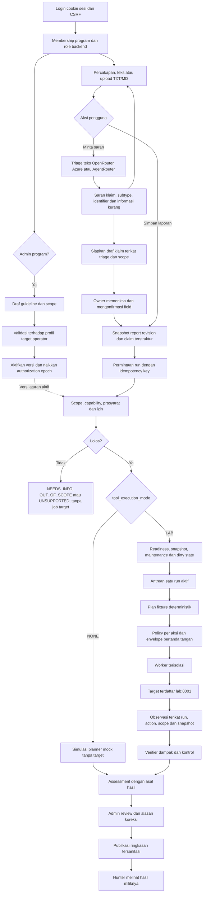
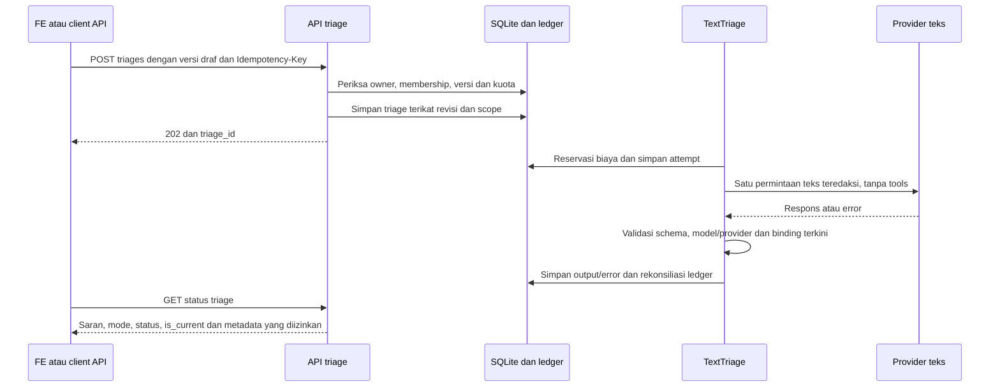

# Flowchart dan kontrak backend ValVuln AI

Source dan integrasi **13 November 2026**. Fokus backend, tanpa redesign FE. Snapshot schema API tersedia pada [api/openapi.json](api/openapi.json): **36 path / 38 operasi** diekspor dari source tanpa startup/database. [Hasil integrasi AI](ai-validation-integration.md). Hak role mengikuti [roles.md](roles.md); daftar usulan di sana tidak otomatis berarti endpoint-nya sudah ada.

## 1. Kesimpulan orkestrasi

**Scope submission:** intake/triage teks, draf klaim AI dengan konfirmasi owner, scope backend, pemeriksaan fixture terdaftar, evidence/verifier dan review admin. AI kini mengisi field klaim, tetapi tidak membuat run atau menjalankan PoC bebas. `Workflow.execute_lab` tetap memakai `validator.plan(claim)` serta `MockTransport` untuk planner deterministik.

Tiga jalur berikut independen. Mengaktifkan key/model teks tidak mengganti planner lab menjadi model live. Admin maupun hunter memasukkan klaim terstruktur melalui alur snapshot sebelum meminta run.

## 2. Alur keseluruhan

Panah kembali ke draf berarti pelapor dapat memperbaiki informasi. Persiapan klaim tidak membuat run; konfirmasi owner dicatat dengan source_triage_id dan binding diperiksa ulang. Tidak ada dispatch otomatis dari model ke worker. Kirim chat/upload sendiri tidak memanggil inference. Mengaktifkan scope dapat membatalkan pekerjaan lama yang izinnya dicabut.

## 3. Alur triage AI

`SUCCEEDED` pada triage berarti schema saran diterima, bukan kerentanan terkonfirmasi. `target_execution_allowed=false` dan `verdict=null` pada projection. Cancel/recovery menghentikan pekerjaan lokal dan mempertahankan attempt; respons biaya yang hilang tetap `COST_UNKNOWN`.

## 4. Komponen dan state

| Komponen | Source utama | Tanggung jawab |
| --- | --- | --- |
| Auth/role | `app/auth.py` | Cookie sesi, CSRF, membership, ownership/admin |
| Scope dan intake | `app/api/routes.py`, `app/policy/targets.py` | Draf/aktivasi scope, percakapan, upload dan revisi |
| Triage teks | `app/agent/text_triage.py`, `app/providers/` | Siklus inference terpisah, output schema dan provider tetap |
| Dispatcher lab | `app/agent/workflow.py` | Antrean, state, plan fixture dan verifikasi |
| Handoff | `app/transport.py`, `boundary/contracts.py` | Envelope/observasi ditandatangani, sequence/expiry/snapshot |
| Worker | `worker/service.py`, tools HTTP/browser/upload | Otorisasi aksi, batas resource, dirty/cancel/replay protection |
| Penilaian | `app/agent/bac.py`, `xss.py`, `upload.py` | Kontrol dan dampak sesuai subtype terdaftar |
| Hasil | `app/api/runs.py`, `observation_summary.py` | Review/publikasi dan projection bukti sesuai role |
| Benchmark | `evaluator/text_benchmark.py`, `text_context.py`, `text_dispatch.py` | Konteks A/B, freeze, attempt dan scoring; tanpa tindakan target dari model |

Proses triage, keputusan scope, capability, queue, review dan verdict merupakan state terpisah. Kondisi run yang gagal/timeout tidak dikonversi menjadi REFUTED. Target dirty atau maintenance menghentikan run LAB hingga tindakan operator yang sesuai; tombol cancel tidak mengembalikan perubahan target yang sudah terjadi.

## 5. Kontrak API untuk FE

Gunakan origin aplikasi yang dikonfigurasi, bukan origin lab manual. Aplikasi utama/preview dan lab manual mempunyai cookie, akun dan tujuan yang berbeda. Preview 8010 yang app-only tidak mempunyai worker/lab hanya karena halaman bisa dibuka.

| Kebutuhan | Endpoint utama | Catatan integrasi |
| --- | --- | --- |
| Login | `GET /api/auth/csrf`, `POST /api/auth/login` | Kirim cookie dan token CSRF; Origin harus sama dengan public_origin |
| Identitas/program | `GET /api/me`, `GET /api/programs` | Role ditentukan server per program |
| Aturan publik | `GET /api/programs/{id}/guidelines` | Tampilkan versi; file report tidak menggantikan guideline |
| Scope admin | `POST/GET /api/programs/{id}/scope-drafts`, `POST .../{scope_id}/activate` | Hanya admin; simpan draf berbeda dari aktivasi |
| Draf dan teks | `POST/GET /api/programs/{id}/conversations`, `GET /api/conversations/{id}`, `POST .../messages` | Owner untuk mutasi; expected_draft_version mencegah update stale |
| Upload report | `POST /api/conversations/{id}/attachments` | TXT/MD UTF-8, batas 128 KiB; berbeda dari upload target lab |
| Saran model | `POST /api/conversations/{id}/triages`, `GET /api/triages/{id}`, `POST .../cancel` | Aksi eksplisit, idempotency, poll terbatas, is_current; tangani CONFIGURATION_REQUIRED |
| Draf klaim dari AI | `POST /api/triages/{id}/validation-draft` | Owner saja, versi/scope/schema terkini; tanpa model call atau job; memerlukan konfirmasi |
| Snapshot laporan | `POST /api/conversations/{id}/reports` | Claim terstruktur dan expected_draft_version; lihat schema aktual |
| Pemeriksaan | `POST /api/reports/{id}/runs`, `GET /api/runs/{id}`, `POST .../cancel` | execution_mode planner masih mock; tool_execution_mode NONE/LAB terpisah |
| Review/publikasi | `POST /api/runs/{id}/review`, `POST .../publish` | Admin; hunter menerima projection hasil yang dipublikasikan |
| Observasi/ekspor | Endpoint pada schema OpenAPI untuk run | Ownership dan role mengikuti hasil; jangan mengambil raw trace sebagai jalan pintas |

Mutasi setelah login membawa `X-CSRF-Token`; request start/triage mengikuti `Idempotency-Key` yang diperlukan. Client lintas origin memerlukan keputusan CORS/cookie yang eksplisit; backend sekarang berorientasi same-origin dan tidak menyediakan izin CORS bebas. Untuk FE terpisah, pilihan awal adalah dev/reverse proxy pada origin yang sama. Jangan mengubah PUBLIC_ORIGIN tanpa menyesuaikan cookie/Origin secara konsisten.

Backend schema006 sudah mempunyai evaluator terpisah. Triage R1 bukan endpoint prediksi biner benchmark. Review rekaman bisnis manual yang masih ada hanya menilai konsistensi rekaman; tidak menjadi validator BUSINESS_LOGIC atau jalur agent baru.

## 6. Temuan yang perlu diselesaikan sebelum klaim produk penuh

| Prioritas | Temuan aktual | Implikasi/tindak lanjut |
| --- | --- | --- |
| Batas desain | Plan LAB berasal dari validator tetap; AI mengisi draf klaim melalui konfirmasi owner | Produk triage AI + pemeriksaan terdaftar; bukan agent yang mengeksekusi PoC bebas |
| P1 konfigurasi | Profil OpenRouter historis tidak mengiklankan structured outputs; source kini require_parameters=true | Pilih endpoint kompatibel sebelum smoke/freeze; key valid tidak membuktikan dukungan schema |
| Selesai kode | Cap4096 diselaraskan pada request, tes, snapshot evaluator/triage dan checker | Runtime app kini4096/triage-v2; planner mock1024 terpisah |
| P1 | Smoke nyata pada model saat ini timeout; biaya respons tidak diketahui | LIVE_VERIFIED tetap false; simpan reservasi, jangan benchmark/retry membabi-buta |
| Selesai kode | Script smoke lama mengarah ke smoke API/ledger bersama | Default tidak mengirim request tanpa --execute; unknown tidak diubah menjadi0 |
| Selesai kode | Dispatcher mencatat error_type dan run_id yang relevan | Tanpa raw exception message/credential; status kegagalan per run tetap tersimpan |

Audit awal dan timeout/biaya historis tetap di [backend-audit-2026-11-13.md](backend-audit-2026-11-13.md). Penyelesaian kode sesudah audit ada pada [ai-validation-integration.md](ai-validation-integration.md). Tidak memperluas M6 atau mengklaim smoke yang gagal berubah menjadi sukses.
