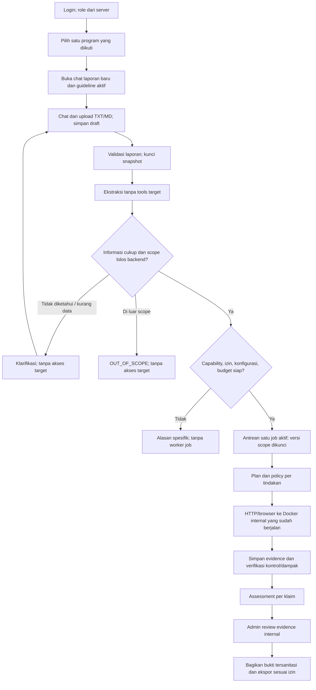

# Alur pengguna dan kondisi proses

**Fokus fitur role 13 November 2026:** lihat [roles.md](roles.md) untuk rancangan izin admin dan bug hunter. Dokumen role tidak menentukan UI atau memperluas kapabilitas lab; diagram/status lama di bawah tetap dibaca sesuai scope aktif dan hasil implementasi aktual.

**Alur aktif13 November2026:** login -> pilih program -> kirim report -> Minta saran AI -> Siapkan validasi dari saran AI -> preflight scope/prasyarat -> konfirmasi field -> snapshot/run -> worker fixture -> verifier -> review/publikasi admin. Draf AI terikat owner, versi laporan dan scope; model tidak membuat job atau instruksi worker. OpenRouter prioritas1/Azure2 dipilih operator; live menunggu key/profil yang lolos. [Integrasi dan hasil](ai-validation-integration.md), [review manual terakhir](manual-final-review.md).

Status 5 November 2026: BAC M3 dan XSS-08 fixture tetap M4b sudah melalui UI → worker → evidence/verifier → review/publikasi/ekspor lokal. [Hasil M4b](m4b-verification.md), [M3](m3-verification.md). Klaim terstruktur dan planner mock; model live belum tersedia. UI XSS mengunci rute tanpa script/nonce/fixture bebas. Prototipe simulasi tetap terpisah. [Desain](design.md), [kontrak](architecture.md), [pemeriksaan](security-review.md).

## 1. Aktor dan batas

Alur tambahan yang tersedia 6 November: **review rekaman bisnis manual**. Pelapor menekan Siapkan review bukti bisnis untuk membuat snapshot tanpa run. Admin mengunggah JSON pada revisi tersebut, melihat hasil/file privat, menulis catatan dan membagikan ringkasan tetap. Pelapor hanya melihat hasil yang dipublikasikan; review ulang menarik publikasi. UI menampilkan versi snapshot dan menyatakan rekaman bukan pengujian langsung/verdict kerentanan. [Langkah pemakaian dan batas](business-record-review.md). Ini terpisah dari alur worker di bawah.

| Aktor | Tugas | Batas |
| --- | --- | --- |
| Bug hunter | Chat/upload report, melengkapi prasyarat, mulai/hentikan run sendiri | Hanya report sendiri, guideline publik dan hasil tersanitasi |
| Admin program | Semua kemampuan submit ditambah review laporan program dan aktivasi guideline | Hanya program yang diikuti; bukan operator/evaluator |
| Agent | Ekstraksi, rencana, adaptasi dan assessment | Model tidak menetapkan izin, role, binding target atau GT |
| Worker | HTTP/browser terstruktur | Job sah yang sudah lolos scope; target terdaftar saja |
| Operator/evaluator | Akun platform, binding target, kondisi/seed/reset lab dan scoring GT | Control plane terpisah; bukan tool model atau menu admin program |

Satu orang dapat menjalankan beberapa peran saat pengembangan, tetapi identitas, data dan izin runtime tetap dipisah. Role requester/approver pada portal target bukan role login platform.

## 2. Persiapan program oleh admin dan operator

1. Operator menyiapkan akun demo, membership, satu program dan binding alias ke portal Docker yang sudah berjalan. Tidak membuat container target per report.
2. Admin login, membuka program, masuk menu Guideline dan mengunggah TXT/MD atau mengisi draf manual.
3. Ekstraksi AI opsional hanya menghasilkan usulan. Tidak ada tools target atau perubahan izin otomatis dari file.
4. Admin memeriksa in-scope, out-of-scope, prasyarat dan aturan bisnis; backend memvalidasi terhadap binding operator.
5. Admin mengaktifkan versi. File sumber/hash, aktor dan waktu aktivasi dicatat. Versi publik tersedia bagi bug hunter.
6. Evaluator secara terpisah memeriksa health/seed/kondisi target. Worker tidak menerima GT/reset endpoint.
7. Mode mock/replay/live serta batas resource dikonfigurasi jelas. Live tanpa key/budget/token cap tidak boleh mulai atau diam-diam berpindah mock.

## 3. Alur utama chat

Bug hunter dapat melihat status serta ringkasan teknis tersanitasi setelah tersedia; rincian evidence menunggu publikasi admin. Model tidak dapat mengubah scope dari instruksi chat. Intake OOS/UNKNOWN tidak membuat job atau request health check ke target. Perubahan scope membatalkan job lama yang antre dan menghentikan tindakan run aktif sebelum memakai versi baru pada run baru.

## 4. Interaksi saat pemeriksaan berjalan

- Kirim pesan tidak otomatis mengeksekusi tools. Tombol Validasi mengunci satu revisi; pengiriman/double-click berulang memakai idempotency key dan tidak menggandakan biaya.
- Pesan tambahan tetap dapat tersimpan sebagai draft revisi berikutnya; run aktif memakai snapshot awal. Permintaan perubahan memerlukan run baru setelah run lama selesai/dibatalkan.
- Setiap tindakan memeriksa scope version, izin, tujuan, akun alias, budget/deadline serta status cancel. Rencana boleh berubah dalam batas yang sama; izin tidak boleh meluas.
- Status ditarik lewat polling yang terotorisasi; evidence baru tidak otomatis menjadi publik.
- Hentikan menutup aktivitas yang sedang berlangsung dan mencegah aksi/model call berikutnya; artefak yang sudah tersimpan dipertahankan. Efek perubahan target yang sudah terjadi tidak dianggap otomatis dibatalkan.
- Reset kondisi/seed target hanya evaluator. Tidak ada remediasi/reset otomatis melalui chat.

## 5. Review dan publikasi admin

1. Buka Laporan program; backend memeriksa membership/program pada report dan seluruh objek turunannya.
2. Baca klaim, versi scope, hasil model dan evidence/kontrol internal teredaksi.
3. Terima hasil atau simpan koreksi manusia dengan alasan dan evidence reference; simpan hasil agent mentah terpisah.
4. Periksa ringkasan bagi pelapor. Host internal, credential, data akun lain, screenshot/DOM mentah tidak dikirim ke bug hunter.
5. Bagikan ringkasan/bukti teks yang sudah disetujui. Ekspor mengikuti projection dan izin yang sama; tidak memberikan raw trace sebagai alternatif unduhan.

## 6. Kondisi gagal dan pemulihan

| Kondisi | Perilaku | Pemulihan |
| --- | --- | --- |
| Belum login/session habis | Tolak API; jangan kirim data objek | Login ulang; draft tersimpan di server |
| Bukan anggota/akses report orang lain | Tolak tanpa membocorkan isi/metadata | Admin/operator memeriksa membership, bukan ubah role di client |
| Guideline belum aktif | Belum bisa menguji target | Admin menyiapkan/mengaktifkan aturan |
| Upload format/ukuran salah | Tolak sebelum ekstraksi/run | Tampilkan TXT/MD dan batas; pertahankan draft |
| Report mengklaim aturan program berbeda | Tetap memakai scope aktif | Tunjukkan aturan publik; tidak mengaktifkan guideline report |
| Scope ambigu/prasyarat kurang | UNKNOWN/NEEDS_INFO; nol akses target | Minta informasi spesifik |
| Target/aset di luar aturan | OUT_OF_SCOPE; nol akses target | Rujuk program dan aturan yang benar |
| Kategori belum didukung | UNSUPPORTED; tanpa pengujian | Review manual, bukan label laporan salah |
| Queue penuh/rate limit/budget kurang | Tidak ada dispatch atau tagihan baru | Tunggu batas pulih/konfigurasi operator; tidak auto-buy |
| Key/config live belum siap | CONFIGURATION_REQUIRED | Siapkan konfigurasi; mock hanya jika dipilih eksplisit |
| Model refusal/outage | Catat refusal/error, retry sesuai batas | Tidak memberi verdict REFUTED karena error |
| Provider awal mengalami gangguan sebelum respons sukses pertama | Cadangan terkonfigurasi dapat dipakai dengan event/provenance dan cap yang sama; quota habis hanya ke FREE_TIER terverifikasi | Tampilkan provider/model aktual; benchmark tidak fallback |
| Provider gagal setelah respons pertama digunakan | Hentikan run dengan sebab dan trace; tidak pindah model atau replay tools otomatis | Run baru memakai izin/biaya baru sesuai kebijakan; mutasi ambigu menunggu reset evaluator |
| Redirect/aksi keluar binding | Blok sebelum koneksi | Tidak mencoba jalur alternatif untuk mengakali policy |
| PoC tidak berhasil | INCONCLUSIVE kecuali kontrol memberi bukti penyangkal | Periksa prasyarat, jangan otomatis tandai laporan palsu |
| Target tidak sehat | Gagal/belum pasti dengan sebab lingkungan | Evaluator memperbaiki; run lama tetap tercatat |
| Scope/izin dicabut atau run dibatalkan | Hentikan dispatch dan I/O aktif | Run baru memerlukan izin/versi terbaru |
| Evidence rusak/tidak ada | Jangan klaim CONFIRMED | Perbaiki capture dan pertahankan kegagalan |

Run ulang mempunyai ID dan ledger biaya baru. `COMPLETED` berbeda dari verdict; OOS berbeda dari klaim terbantahkan. Error, refusal dan abstention tidak dikeluarkan dari benchmark supaya angka terlihat baik.

## 7. Evaluasi 20 laporan

1. Implementasikan/verifikasi titik lab dan kontrol manual; development memakai empat titik cadangan yang terpisah.
2. Asisten menyusun 20 draf berdasarkan endpoint nyata; pengguna memeriksa setiap GT dan mengunci 10 valid/10 tidak valid. Draf bukan label final otomatis.
3. Freeze teks, grup akar masalah, target, prompt, model/provider dan tools. Parafrasa/kondisi perbaikan dari akar sama tetap satu grup.
4. Evaluator menjalankan baseline A dan sistem B, melakukan reset yang diperlukan di luar tools agent. Budget global tetap berlaku.
5. Simpan output mentah, evidence, error/refusal, usage dan waktu sebelum melihat label/scoring.
6. Hitung metrik serta hasil per kategori/grup; ekspor agregat yang boleh ditampilkan. GT tetap privat dan tidak masuk chat/runtime agent.

Dataset berisi 20 teks, bukan 20 bug unik. Lab menargetkan 24 titik; BAC-08 dan XSS-08 development sudah direproduksi operator, 22 lainnya belum tersedia. Report final berlabel dan metrik belum tersedia. Detail ada pada [evaluation.md](evaluation.md).

## 8. Potongan implementasi pertama

Mulai dari login dua bug hunter dan satu admin demo, satu program/scope aktif, chat draft serta tes akses silang. Sambungkan satu BAC development (BAC-08) ke worker setelah gate terbukti. UI membuktikan bahwa OOS/UNKNOWN menghasilkan nol request target, kasus sesuai scope bisa menuju kontrol/reproduksi, dan evidence internal tidak bocor melalui akun lain/ekspor. Setelah itu tambah keluarga bug dan polish layar.
