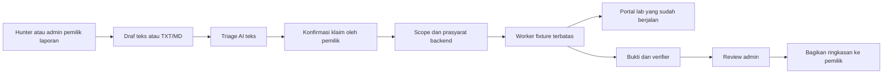

# Handoff frontend ValVuln AI dan portal pengadaan lab

Tanggal pemeriksaan source: **14 November 2026**. Dokumen untuk developer FE/BE yang melanjutkan working tree saat ini, termasuk perubahan Groq, reset dua mode dan akses manual bersama yang belum tentu ada pada commit GitHub terakhir.

## 0. Cara membaca dan batas pekerjaan

Dokumen ini memuat dua aplikasi dengan akun, database dan tujuan berbeda:

1. **ValVuln AI**: hunter mengirim laporan; admin mengelola program, meninjau bukti dan membagikan hasil.
2. **Portal pengadaan/logistik lab**: aplikasi sintetis yang dipakai sebagai target validasi dan pengujian manual. Akun A/B adalah pemohon dengan data berbeda.

| Label | Arti |
| --- | --- |
| **ADA** | Route/perilaku ditemukan pada source saat audit; bukan klaim semua kombinasi sudah diuji runtime |
| **BARU / BELUM ADA** | Kebutuhan yang diminta pengguna dan kontrak yang harus diimplementasikan; jangan panggil sebagai endpoint tersedia |
| **OPSIONAL** | Boleh ditunda setelah demo utama berfungsi |

Permintaan register hunter dan register lab dimasukkan sebagai kebutuhan baru. Batch ini membuat dokumentasi, **belum mengimplementasikan endpoint register atau desain FE baru**. Tidak mengubah sesi, data, mode lab, API key atau container berjalan.

Sumber kebenaran implementasi: [schema app](app/schemas.py), [auth app](app/auth.py), [route app](app/api/routes.py), [run](app/api/runs.py), [triage](app/api/triage.py), [reset](app/api/lab_reset.py), [lab](lab/main.py), [fitur katalog](lab/xss_catalog.py), [upload lab](lab/uploads.py), [kontrol bisnis](lab/business.py), dan [Compose](compose.yaml). [OpenAPI app](docs/api/openapi.json) membantu integrasi; respons dinamis yang tidak diberi response_model perlu dibaca dari source di atas.

## 1. Infrastruktur yang perlu dipahami FE

### 1.1 Container, port dan database

**Tiga container tetap** untuk penggunaan normal. Tidak perlu container database atau frontend terpisah pada MVP.

| Service | Tugas | Akses | Penyimpanan | Limit memori Compose |
| --- | --- | --- | --- | --- |
| `app` | FastAPI, autentikasi, UI AI, scope, report, triage/provider, antrean, evidence dan review | Host `http://127.0.0.1:8000` | SQLite `/data/valvuln.sqlite3` pada `app_data` | 512 MiB |
| `worker` | Eksekusi HTTP/browser/upload fixture yang sudah dibatasi | Tidak punya port host; peer internal `172.30.74.2` | `job_inbox` read-only dan `job_outbox`; Chromium sementara | 1 GiB |
| `lab` | Portal pengadaan sintetis, target worker sekaligus manual | Host `http://127.0.0.1:8001`; target internal `172.30.74.3:8001` | SQLite `/data/lab.sqlite3` pada `lab_data` | 512 MiB |

Limit di atas bukan angka penggunaan RAM total Docker; browser/host juga memerlukan RAM. Satu job worker aktif. SQLite app dan lab terpisah; tidak ada PostgreSQL/Redis/vector database yang perlu disiapkan FE.

Lima named volume normal: `app_data`, `lab_data`, `job_inbox`, `job_outbox`, `lab_control`. Kanal `lab_control` hanya app/lab untuk reset dan sesi manual; worker tidak mendapat kanal reset. App tidak masuk jaringan target dan tidak memegang Docker socket. Key provider hanya pada sisi server yang memerlukan, tidak dikirim ke browser/worker/lab.

Service `evaluator` hanya dijalankan eksplisit dengan profile `evaluation`, bukan container keempat yang selalu hidup. Salinan lab lama pada [compose.manual-lab.yaml](compose.manual-lab.yaml) opsional port8002, saat ini jalur lama yang dipertahankan; **target utama FE/manual adalah8001**.

### 1.2 Menjalankan dan mengembangkan FE

Setelah setup `.env`, secret, seed dan binding operator sesuai [README](README.md), startup normal:

```sh
docker compose up -d --build
```

Perintah itu menjalankan service normal, bukan registrasi/seed/reset/benchmark otomatis. Jangan memakai `docker compose down -v` untuk memperbarui FE; itu menghapus data volume. Jangan menyalin API key ke source atau bundle FE.

Stack FE existing: Jinja2 + JavaScript/CSS disajikan FastAPI. Entry AI: [workspace.html](app/templates/workspace.html), [app.js](app/static/app.js); entry portal: [manual.html](lab/manual.html), dengan halaman fitur HTML dari handler lab. Tidak wajib migrasi React/Next.js hanya untuk handoff ini.

Rekomendasi MVP: tetap sajikan masing-masing UI dari origin backendnya. Bila developer memilih Vite/React untuk authoring, hasil build harus disajikan origin yang sama atau memakai proxy dev yang benar-benar menjaga kontrak Host/Origin/cookie/CSRF. **CORS belum dikonfigurasi untuk localhost:3000/5173**; mengganti fetch baseURL saja tidak cukup. Jangan membuka wildcard CORS sebagai solusi.

Gunakan `127.0.0.1` secara konsisten. `localhost` dianggap origin berbeda. `Origin` dikirim browser, bukan header yang bisa disetel bebas dari JavaScript.

### 1.3 Dua alur yang tidak boleh tercampur



OOS/unsupported/prasyarat kurang menghentikan jalur target sesuai policy. Lolos in-scope belum otomatis memberi izin eksekusi; kesiapan worker, snapshot, kondisi target dan batas aksi tetap diperiksa server. Triage tidak mengirim request ke target. Tombol menyiapkan draf juga tidak mengeksekusi target.

## 2. Web AI: role dan hak akses

### 2.1 Matriks fitur

| Fitur | Hunter `BUG_HUNTER` | Admin `PROGRAM_ADMIN` |
| --- | --- | --- |
| Daftar akun sendiri | **BARU**, selalu role hunter | Tidak ada pendaftaran admin publik |
| Login/logout dan baca profil | Ya | Ya |
| Membaca program/guideline aktif | Sesuai membership | Sesuai membership |
| Membuat percakapan/draf/laporan | Milik sendiri | Milik sendiri; dapat menyalin laporan dari kanal lain |
| Mengirim pesan / upload / membuat revisi | Milik sendiri | Milik sendiri, tidak menimpa draf hunter |
| Melihat daftar/detail laporan | Milik sendiri | Seluruh laporan dalam program yang dikelola |
| Meminta triage dan menyiapkan draf dari AI | Milik sendiri | Milik sendiri |
| Melihat/cancel triage | Milik sendiri | Dalam program, mengikuti akses objek server |
| Memulai validasi | Milik sendiri | Lihat catatan perbedaan izin di bawah |
| Melihat/cancel run | Milik sendiri | Run program yang dikelola |
| Membaca evidence internal | Tidak | Ya, tetap teredaksi |
| Review / override beralasan / publish | Tidak | Ya |
| Melihat hasil sebelum publikasi | Status proses; assessment LAB bisa null | Hasil verifier dan review internal |
| Ekspor run | Proyeksi yang boleh dilihatnya | Proyeksi admin |
| Membuat/aktivasi guideline dan scope | Tidak | Ya, dalam batas target operator |
| Pilih rentan/kontrol, reset dan akses manual | Tidak | Ya, jika idle dan guard lolos |
| Ganti API key/budget/target bebas/GT | Tidak | Bukan kewenangan admin program |

**Perbedaan source dengan rancangan lama:** `POST /api/reports/{report_id}/runs` saat ini memakai akses `owned()` yang juga mengizinkan admin program membaca objek hunter, tanpa pemeriksaan owner-only tambahan pada create_run. Jadi **BE sekarang dapat menerima start run oleh admin atas report hunter**. UI existing membatasi aksi validasi ke pemilik. Pertahankan UI pemilik pada handoff ini; bila owner-only hendak dijadikan aturan keamanan backend, tambahkan enforcement dan tes BE tersendiri. Jangan mengklaim menyembunyikan tombol sudah membatasi endpoint. Ini memperjelas ketidaksesuaian dengan target izin di [roles.md](docs/roles.md), bukan perubahan izin lewat dokumen.

Admin memasukkan laporan eksternal sebagai pemilik akun admin, bukan otomatis atas nama akun hunter lain. Field atribusi/sumber khusus dan transfer kepemilikan belum tersedia; tulis atribusi pada teks untuk MVP tanpa menganggapnya delegasi akses.

### 2.2 Halaman dan komponen web AI

Rute UI berikut merupakan **rancangan navigasi**, bukan endpoint HTTP UI yang semuanya sudah ada. Existing UI bekerja pada `/` dengan panel/dialog.

| Halaman/panel | Isi wajib | Sumber data / aksi |
| --- | --- | --- |
| Masuk | Nama akun, password, error field, loading | Auth existing |
| Daftar hunter | Nama akun, password, ulang password, label hunter | Kontrak register baru pada bagian4 |
| Workspace | Sidebar program/laporan, chat/draf, upload, saran AI, status | Programs/conversations/messages/triage |
| Aturan program | Guideline, in-scope, OOS, versi aktif | GET guidelines |
| Konfirmasi validasi | Klaim utama, subtype, path, akun, kontrol, informasi kurang | validation-draft lalu snapshot/run |
| Hasil | Scope, capability, status proses, hasil verifier/review dan asal model | GET run + observations-summary |
| Inbox admin | Laporan program, pemilik, detail dan riwayat run | Daftar conversations/reports; filter lokal sesuai data tersedia |
| Review admin | Evidence sebagai teks, controls, limitations, override dan catatan | Evidence/review/publish |
| Pengaturan program | Draf guideline, tabel rule dan aktivasi eksplisit | Scope endpoints |
| Kondisi lab | Pilihan rentan/kontrol, reset, progress, snapshot, akses manual | Lab-reset/manual-session |

Search/sidebar existing dapat difilter lokal. Jangan membuat pagination, statistik/global count, timestamp atau field judul di response daftar report yang tidak tersedia; ambil dari conversation/detail atau tandai kebutuhan BE baru. Tidak ada endpoint dashboard statistik khusus saat ini.

Gaya visual baseline: grafit gelap + aksen sage, chat sebagai area utama. Status memakai teks/ikon, tidak hanya warna. UI tetap bisa diperbaiki tanpa mengubah kontrak. Selalu tampilkan provider/model di samping saran, misalnya `LIVE · groq · openai/gpt-oss-120b`, dari respons API. Pisahkan model **diminta** (`requested_model`) dengan model **dilaporkan provider** (`attempts[].metadata.resolved_model`) bila tersedia; jangan mengarang nama atau menampilkan fallback yang tidak terjadi.

Label status provider dari readiness merupakan pemeriksaan konfigurasi, bukan bukti live. `live_provider: CONFIGURATION_REQUIRED` lama mengacu jalur engine live, bukan otomatis berarti triage teks mati. Untuk badge triage gunakan `triage_mode`, `text_provider`, `triage_provider` dan `triage_requested_model`. Planner LAB saat ini mock/deterministik, meskipun triage teks live. Tidak ada chat umum/tool-agent bebas atau streaming SSE/WebSocket pada alur ini.

## 3. Web AI: endpoint yang ADA

Semua path di bagian ini relatif terhadap **port8000**. `{...}` diganti ID dari respons server; jangan hardcode UUID.

### 3.1 Auth dan kondisi sistem

| Method | Endpoint | Akses dan hasil |
| --- | --- | --- |
| GET | `/api/health` | Publik; status dan schema_versions |
| GET | `/api/readiness` | Publik; konfigurasi triage, model, worker/lab dan kemampuan UI |
| GET | `/api/auth/csrf` | Publik; nonce login single-use600detik, cookie `valvuln_login`, body csrf_token |
| POST | `/api/auth/login` | Origin+nonce+X-CSRF-Token; JSON login_name/password; balasan identitas+csrf_token sesi |
| GET | `/api/me` | Sesi; user_id, login_name, memberships dan csrf_token |
| POST | `/api/auth/logout` | Sesi+CSRF; revoke sesi dan hapus cookie app |
| GET | `/api/programs` | Sesi; array program_id, display_name, active_scope_version_id dan role |

Alur login: GET csrf → simpan token di memori → POST login dengan token → gunakan token sesi yang baru dari balasan. Login gagal dapat mengonsumsi nonce; ambil nonce baru sebelum mencoba lagi. Refresh halaman: GET me untuk memulihkan identitas/token, lalu programs/readiness. Session app configurable1–8jam, default8jam.

Cookie app `valvuln_session` HttpOnly; `valvuln_csrf` juga HttpOnly, jadi ambil token lewat JSON, bukan document.cookie. Simpan password/token hanya sementara untuk aksi yang diperlukan. Cookie tidak dipisahkan berdasarkan port browser; nama cookie app dan lab berbeda. Jangan menganggap port8000/8001 memisahkan cookie seperti domain yang berbeda.

Untuk request JSON mutasi authenticated gunakan `credentials: "same-origin"`, `Content-Type: application/json`, `X-CSRF-Token`. Untuk multipart gunakan FormData dan **jangan set Content-Type manual**. Server memeriksa role/membership/ownership untuk setiap objek, bukan mempercayai role FE.

### 3.2 Guideline dan scope

| Method | Endpoint | Akses / fungsi |
| --- | --- | --- |
| GET | `/api/programs/{program_id}/guidelines` | Member; aturan ACTIVE, source_text, rules dan versi; NOT_CONFIGURED jika kosong |
| GET | `/api/programs/{program_id}/scope-drafts` | Admin; maksimal20 draf terbaru, rules_json berupa string JSON |
| POST | `/api/programs/{program_id}/scope-drafts` | Admin;201 membuat versi DRAFT, belum mengubah ACTIVE |
| POST | `/api/programs/{program_id}/scope-drafts/{scope_id}/activate` | Admin; aktivasi eksplisit dan retire versi lama |

Contoh bentuk payload draf, **bukan daftar lengkap rule yang cukup menjalankan semua validator**. Pakai aturan aktif sebagai dasar; validator BAC/upload membutuhkan path kontrol dan langkah tambahan yang juga diizinkan:

```json
{
  "source_text": "Aturan program sintetis yang ditetapkan admin.",
  "in_scope_rules": [
    {"asset_alias":"portal","path_template":"/notifications/preview","methods":["GET"],"capabilities":["XSS"]}
  ],
  "out_of_scope_rules": [],
  "business_rules": "",
  "business_rules_version": null
}
```

source_text1–32.000karakter dan maksimal128KiB UTF-8; in_scope_rules1–24, out_of_scope_rules0–24; methods enum GET/POST/PUT/PATCH/DELETE; capabilities BAC/XSS/UPLOAD/BUSINESS_LOGIC. Path dibatasi profil target operator. OOS menang atas in-scope pada pemeriksaan. Guideline teks saja tidak mengganti rule terstruktur.

FE sebaiknya menyediakan form tabel rule, preview JSON terlipat dan konfirmasi sebelum aktivasi. Aktivasi scope membatalkan pekerjaan program yang masih pending/aktif sesuai backend serta membuat saran lama tidak current. Jangan memanggil aktivasi otomatis saat mengetik.

### 3.3 Percakapan, upload dan laporan

| Method | Endpoint | Akses / bentuk |
| --- | --- | --- |
| POST | `/api/programs/{program_id}/conversations` | Member;201 conversation_id dan draft_version0 |
| GET | `/api/programs/{program_id}/conversations` | Hunter sendiri/admin program; maksimal100 terbaru |
| GET | `/api/conversations/{conversation_id}` | Akses objek; draf, messages, attachment, report_id, run_ids dan latest_claim/triage |
| POST | `/api/conversations/{conversation_id}/messages` | Owner-only;201 tambah pesan dan naikkan draft_version |
| POST | `/api/conversations/{conversation_id}/attachments` | Owner-only;201 satu file multipart bernama `file` |
| GET | `/api/attachments/{attachment_id}` | Owner/admin; hasil unduhan teks laporan |
| POST | `/api/conversations/{conversation_id}/reports` | Owner-only;201 snapshot/revisi immutable; bisa mengembalikan snapshot existing |
| GET | `/api/programs/{program_id}/reports` | Hunter sendiri/admin program; report_id, conversation_id, owner_user_id |
| GET | `/api/reports/{report_id}` | Akses objek; revisions berisi judul, teks, attachment_text, hash dan submitted_at |

Pesan **menambahkan** teks ke draf, bukan PATCH/replace isi lama. Tidak ada endpoint edit/delete pesan, hapus/replace attachment atau hapus report. Jangan membuat tombol tersebut seolah BE mendukung. Satu lampiran per conversation; perlu draf baru bila hendak mengganti file pada implementasi saat ini.

```json
{"body":"Isi laporan pengguna","title":"Judul laporan","expected_draft_version":0}
```

Pesan1–32.000karakter, judul1–200; gabungan teks draf dan attachment maksimal32.000karakter. File hanya TXT/MD UTF-8, maksimal128KiB, tanpa NUL; satu field file dan tanpa field owner/role/purpose tambahan. PDF/DOCX/gambar laporan belum diterima. Upload juga menaikkan draft_version; selalu gunakan versi respons terbaru.

Contoh snapshot XSS dari formulir konfirmasi, ganti ID/teks berdasarkan data asli:

```json
{
  "expected_draft_version": 1,
  "source_triage_id": "ID_TRIAGE_YANG_CURRENT",
  "claim": {
    "asset_alias":"portal",
    "path":"/notifications/preview",
    "method":"GET",
    "category":"XSS",
    "account_aliases":["requester-a","requester-b"],
    "primary_claim":"Klaim utama yang telah diperiksa dan dikonfirmasi pemilik laporan.",
    "claim_count":1,
    "control_path":null
  }
}
```

Untuk snapshot manual source_triage_id boleh null/diabaikan. Gunakan triage ID hanya jika benar-benar current dan berasal dari conversation yang sama. Snapshot sukses mengembalikan report_id dan report_revision_id. Satu klaim utama per run; beberapa klaim membutuhkan klarifikasi. Mengirim ulang klaim berbeda pada draft_version yang sama dapat menghasilkan SNAPSHOT_CONFLICT; buat revisi draf yang jelas.

### 3.4 Triage AI dan draf validasi

| Method | Endpoint | Akses / fungsi |
| --- | --- | --- |
| POST | `/api/conversations/{conversation_id}/triages` | Owner-only;202, JSON expected_draft_version, header Idempotency-Key |
| GET | `/api/triages/{triage_id}` | Owner/admin program; status, suggestion, provider/model, is_current dan attempts |
| POST | `/api/triages/{triage_id}/cancel` | Akses objek; pembatalan proses, bukan bukti provider belum memproses |
| POST | `/api/triages/{triage_id}/validation-draft` | Owner-only; mengisi calon Claim dan keputusan policy, tidak membuat run |

Polling triage sampai SUCCEEDED/FAILED/CANCELLED; PENDING/RUNNING masih aktif. Rekomendasi interval1–2detik, hentikan ketika terminal/tab disembunyikan/objek berpindah/logout. Gunakan identitas view/request agar respons lambat tidak menimpa conversation yang baru dibuka. Tidak otomatis retry POST inferensi saat reload/network error.

Suggestion berisi primary_claim, category, subtype, missing_information, scope_suggestion, capability_suggestion, reason dan validation_fields. Subtype otomatis hanya BAC-08/XSS-08/UP-04, sisanya UNKNOWN/UNSUPPORTED. Triage tidak mengembalikan verdict valid/tidak valid. `is_current=false` berarti tampilkan sebagai riwayat dan nonaktifkan penggunaan sebagai draf; jangan menghapus respons lama.

validation-draft mengembalikan claim, expected_draft_version, source_triage_id, scope_version_id, scope_decision, capability_decision, policy_status, missing_information dan requires_confirmation=true. Lengkapi field yang kosong melalui form; jangan diam-diam mengarang ID objek atau akun. Backend tetap mengecek lagi saat start run.

Prioritas konfigurasi saat audit: Groq → OpenRouter → Azure Foundry, dipilih operator; **tidak ada fallback otomatis** atau model picker end-user. Model Groq yang sudah dipakai proyek: openai/gpt-oss-120b; badge selalu baca respons server. Jangan meletakkan key provider di localStorage/frontend atau menghubungkan FE langsung ke provider.

### 3.5 Validasi, evidence dan review

| Method | Endpoint | Akses / fungsi |
| --- | --- | --- |
| POST | `/api/reports/{report_id}/runs` | Akses report;202, Idempotency-Key wajib; catatan izin admin pada2.1 |
| GET | `/api/runs/{run_id}` | Owner/admin; status dan assessment sesuai proyeksi role |
| GET | `/api/runs/{run_id}/export` | JSON proyeksi yang sama, bukan endpoint unduh file otomatis |
| GET | `/api/runs/{run_id}/observations-summary` | Owner/admin; admin fakta terstruktur, hunter menunggu/publikasi |
| POST | `/api/runs/{run_id}/cancel` | Owner/admin; pembatalan dengan semantik outcome backend |
| GET | `/api/evidence/{evidence_id}` | Admin; metadata dan untuk kind tertentu observation JSON teredaksi |
| POST | `/api/runs/{run_id}/review` | Admin; catatan wajib, optional override, raw result tetap tersimpan |
| POST | `/api/runs/{run_id}/publish` | Admin; review wajib sebelum publikasi ke pemilik |

Start validasi LAB existing:

```json
{"report_revision_id":"ID_REVISI","execution_mode":"mock","tool_execution_mode":"LAB"}
```

`mock` di sini adalah planner deterministik, **bukan berarti HTTP/browser lab ikut disimulasikan**. Pilihan NONE melakukan simulasi tanpa target. Jangan mengganti execution_mode menjadi live karena triage memakai Groq live; jalur engine live belum menjadi validator bebas.

Idempotency-Key format1–128karakter `[A-Za-z0-9_.-]`; gunakan crypto.randomUUID() per aksi logis. Jika respons start hilang, gunakan key+payload identik untuk rekonsiliasi, bukan membuat validasi baru otomatis. Jangan menggunakan key lama untuk payload/revisi baru.

Run projection meliputi process_status, queue_status, scope_decision, capability_decision, execution_mode, tool_execution_mode, model_id, inference_provider, counters, error_code, created_at, finished_at dan validation_kind. claim_origin bila ada menunjukkan saran live/provider/model yang **dikonfirmasi pemilik**, bukan bahwa planner worker live. Jangan menafsir counters.model_calls pada run sebagai total seluruh triage sebelumnya.

| Dimensi | Nilai penting | Tampilan FE |
| --- | --- | --- |
| Scope | IN_SCOPE, OUT_OF_SCOPE, UNKNOWN | Badge terpisah dari hasil teknis |
| Capability | SUPPORTED, UNSUPPORTED, UNKNOWN | Tidak didukung bukan laporan palsu |
| Proses berjalan | RECEIVED, PARSED, SCOPE_CHECKED, PLANNED, POLICY_CHECKED, RUNNING, VERIFYING | Tahap/progress berdasarkan respons, tanpa persen rekaan |
| Proses terminal | COMPLETED, NEEDS_INFO, OUT_OF_SCOPE, UNSUPPORTED, POLICY_BLOCKED, PROVIDER_REFUSED, FAILED, CANCELLED, CONFIGURATION_REQUIRED | Aksi lanjutan sesuai sebab |
| Queue | QUEUED, LEASED, FINISHED, NOT_ENQUEUED | Antrean terpisah dari proses; kode lain tetap ditampilkan aman |
| Verdict | CONFIRMED, REFUTED, INCONCLUSIVE | Bukti mendukung, kontrol menyangkal, atau bukti belum cukup |
| Review | PENDING, REVIEWED | Sistem selesai tidak otomatis sudah direview |
| Publication | PRIVATE, PUBLISHED | PUBLISHED artinya dibagikan ke pemilik sesuai akses; bukan publik internet |

Admin mendapat assessment.raw_model, system_verified, review/publication status, analyst_override dan reviewer_note. Hunter tidak mendapat raw evidence/admin note; assessment LAB bisa null dan awaiting_review=true. Tampilkan “Menunggu review admin”, jangan mengubah null menjadi REFUTED. Observations-summary adalah proyeksi aplikasi, bukan penjelasan AI baru; HTTP200 saja bukan bukti celah.

Review payload:

```json
{"analyst_override":null,"reviewer_note":"Alasan peninjauan bukti oleh admin."}
```

Override boleh CONFIRMED/REFUTED/INCONCLUSIVE; note1–2000karakter. Review ulang mengembalikan hasil ke PRIVATE dan menghapus ringkasan publikasi sebelumnya; publish ulang harus aksi eksplisit. Tampilkan hasil verifier asli dan keputusan analis secara terpisah.

### 3.6 Kontrol lab dari admin AI

| Method | Endpoint | Akses / fungsi |
| --- | --- | --- |
| GET | `/api/programs/{program_id}/lab-reset` | Admin; status reset, target, applied_condition/applied_coverage, objects, manual_active/url |
| POST | `/api/programs/{program_id}/lab-reset` | Admin;202, reset data+mode dengan backup/health/ack snapshot |
| POST | `/api/programs/{program_id}/lab-manual-session` | Admin; membuka sesi manual eksklusif1jam pada snapshot saat ini |

```json
{"confirm":"RESET_DEMO_LAB","condition":"vulnerable"}
```

condition hanya vulnerable/fixed. “Lab kontrol diperbaiki” adalah konfigurasi pembanding, bukan AI remediation. Cakupan saat ini ALL_IMPLEMENTED: BAC-08, XSS-01..08, UP-01..04. Otomasi tetap3 subtype. Jangan menganggap fixed menjamin seluruh aplikasi aman.

Polling GET sampai SUCCEEDED/FAILED; cek applied_condition dan applied_coverage ALL_IMPLEMENTED yang cocok snapshot, bukan hanya nilai dropdown. Nilai UI pilihan belum berarti mode telah diterapkan. Reset lama tanpa coverage perlu diterapkan ulang. Jangan retry reset otomatis saat timeout/UNKNOWN.

```json
{"confirm":"OPEN_SHARED_MANUAL_LAB"}
```

Untuk manual: reset ke mode pilihan → tunggu lab siap → aktifkan pengujian manual → buka tautan8001 → login akun lab. Membuka manual memasang maintenance/dirty supaya worker tidak memakai target yang sedang disentuh manusia. Selesai manual: kembali ke app dan reset lagi untuk mencabut sesi, seed/health dan membuka validasi otomatis. Label “TARGET_DIRTY” saat sesi manual adalah kondisi yang disengaja, bukan AI gagal memperbaiki target.

Reset menghapus data lab termasuk session/ID objek/upload/payload; laporan/evidence/review/ledger **app** dipertahankan. BAC/upload perlu memakai ID snapshot baru dalam klaim; jangan menjalankan laporan ID lama tanpa revisi. XSS-08 memakai path tetap sehingga cocok membandingkan laporan pada kedua mode.

### 3.7 Endpoint tambahan yang sudah ada tetapi bukan fokus demo

Review rekaman bisnis **bukan validator BUSINESS_LOGIC otomatis**. Bisa disembunyikan dari navigasi utama agar FE fokus3 subtype.

| Method | Endpoint | Akses / fungsi |
| --- | --- | --- |
| GET | `/api/reports/{report_id}/business-records` | Hunter hanya published miliknya/admin seluruh yang diizinkan |
| POST | `/api/reports/{report_id}/revisions/{revision_id}/business-records` | Admin; multipart satu file JSON, maksimal128KiB dan schema khusus |
| GET | `/api/business-records/{review_id}/record` | Admin; JSON rekaman asli |
| GET | `/api/business-records/{review_id}/workflow` | Admin; langkah/konteks review administratif |
| POST | `/api/business-records/{review_id}/review` | Admin; reviewer_note |
| POST | `/api/business-records/{review_id}/publish` | Admin; bagikan ringkasan review |

Hasil konsistensi rekaman ini memiliki vulnerability_verdict/ground_truth=null, tanpa request target/model baru. Jangan memasukkannya ke diagram sebagai otomatisasi celah bisnis yang selesai.

## 4. Register hunter — BARU, perlu implementasi BE dan FE

### 4.1 Form dan perilaku

Form: nama akun, password, ulang password. Ulang password hanya validasi FE, tidak dikirim. Tidak perlu email/OTP untuk demo lokal; jangan menampilkan klaim email telah diverifikasi. Tidak ada dropdown admin. Setelah sukses arahkan ke login, bukan mengasumsikan sesi sudah dibuat.

| Method | Endpoint BARU | Kontrak yang direncanakan |
| --- | --- | --- |
| POST | `/api/auth/register` pada8000 | Nonce pra-auth dari GET /api/auth/csrf, Origin dan X-CSRF-Token;201 akun hunter |

```json
{"login_name":"hunter-demo","password":"CONTOH_PASSWORD_JANGAN_DIPAKAI"}
```

```json
{"user_id":"UUID_SERVER","login_name":"hunter-demo","role":"BUG_HUNTER","registration_status":"CREATED_LOGIN_REQUIRED"}
```

Respons di atas **usulan kontrak**, bukan respons endpoint existing. Role final UI setelah login tetap dari memberships pada /api/me/programs.

### 4.2 Aturan BE yang wajib untuk register

1. Nama akun lowercase1–64karakter, `[a-z0-9._-]+`; tolak nama seed admin/hunter-a/hunter-b dan nama yang sudah dipakai. Password12–128karakter, di-hash Argon2 memakai helper pwdlib existing, tidak disimpan plaintext.
2. Input hanya login_name/password. Tolak role, program_id, user_id, enabled, budget, membership dan field tambahan. Role selalu BUG_HUNTER yang ditetapkan server, mengikuti enum database existing.
3. Provision user dan membership atomik pada **satu program MVP yang ditentukan operator/server**, bukan program kiriman browser. Bila tidak ada program eligible atau konfigurasinya ambigu,503 REGISTRATION_NOT_CONFIGURED; jangan membuat akun setengah jadi.
4. Pakai nonce pra-auth single-use dan kedaluwarsa; konsumsi nonce melalui mekanisme server, validasi Origin sebelum mutasi. Dokumentasikan bahwa nonce dipakai login atau register, bukan bisa diulang.
5. Rate limit register di server; usulan awal3/IP/jam untuk demo, batas akun demo configurable dan maksimum yang masuk akal. Jangan membuka public signup melalui tunnel tanpa keputusan deployment terpisah.
6. Username duplikat409 USERNAME_UNAVAILABLE, input422, rate limit429. Respons jangan menggemakan password/hash. UI ambil nonce baru sebelum percobaan berikutnya sesuai konsumsi nonce.
7. Audit registrasi tanpa password; tidak memanggil provider, worker, target/reset atau memberi saldo baru. Tetap ledger/budget bersama. Tidak membuat endpoint publik untuk menjadi admin.

Tes penerimaan register: akun baru login dan punya membership hunter; bisa buat laporan; tidak dapat baca laporan orang lain, mengaktifkan scope, review/publish atau reset; payload role admin ditolak; duplikat/CSRF/Origin/rate limit/rollback diperiksa. Ini tes yang perlu dibuat ketika implementasi, bukan hasil pengujian batch dokumen.

## 5. Portal lab: akun A/B dan haknya

### 5.1 A dan B bukan tingkat privilege

| Aktor seed | Identitas dan kepemilikan | Penugasan |
| --- | --- | --- |
| Akun A | `requester-a`, unit-1; request, lampiran seed, catatan katalog dan supplier milik sendiri | Pemilik request A |
| Akun B | `requester-b`, unit-2; kumpulan objek sendiri | Secara seed ditugaskan reviewer **request A** |

Penugasan reviewer satu arah, **A tidak otomatis reviewer request B**. Reviewer konten bukan petugas approval bisnis. Akun A/B tidak memiliki role admin app dan bukan approver. Kredensial portal terpisah dari akun admin/hunter app; simpan pada file privat operator, jangan hardcode pada halaman publik.

| Fitur portal | A | B |
| --- | --- | --- |
| Lihat permintaan sendiri dan lampiran seed sendiri | Ya | Ya |
| Mengubah alasan/comment permintaan | Request sendiri | Request sendiri |
| Mengubah nama profil | Profil sendiri | Profil sendiri |
| Mengubah catatan katalog / supplier | Objek sendiri | Objek sendiri |
| Membaca halaman katalog/supplier bersama dengan ID | Ya | Ya |
| Membaca review alasan request A | Tidak hanya karena owner; handler butuh penugasan reviewer | Ya, karena penugasan seed |
| Membaca comments dan daftar nama upload request A | Sebagai owner | Sebagai reviewer |
| Upload file ke request | Request sendiri | Request sendiri |
| Preview/download isi upload baru | Uploader sendiri | Uploader sendiri; reviewer daftar bukan izin semua isi |
| Pencarian, tracking, panel fragment, notifikasi | Ya | Ya |
| Approve/fulfill bisnis | Tidak secara default | Tidak secara default |
| Reset mode/seed | Tidak | Tidak |

BAC-08 sengaja membuat DELETE lampiran seed lintas kepemilikan bisa lolos pada mode vulnerable; itu **perilaku celah**, bukan izin normal dalam role. GET lampiran tetap membatasi pemilik. Mode fixed menegakkan owner pada DELETE. Jangan “merapikan” BE dengan menghilangkan celah yang disengaja.

### 5.2 Sesi manual dan autentikasi portal

Semua endpoint berikut relatif terhadap **port8001**. Selain GET `/` dan GET `/api/health`, request manual memerlukan sesi pengujian1jam yang **diaktifkan admin app** dan cocok snapshot. Ini bukan sesi login akun: login akun lab hanya **300detik/5menit**. Jika manual habis/mode direset, jangan mencoba login berulang tanpa mengaktifkan sesi manual lagi.

| Method | Endpoint ADA | Kontrak |
| --- | --- | --- |
| GET | `/` | Portal entry/manual UI, publik |
| GET | `/api/health` | Publik; status dan seeded |
| POST | `/api/auth/login` | JSON login_name/password, Origin lab wajib; cookie lab_session HttpOnly dan csrf_token di JSON |
| GET | `/manual/objects` | Akun terautentikasi; alias, objects milik sendiri, snapshot_id dan purpose |

Login lab saat ini tidak memakai nonce pra-login app. Setelah login mutasi POST/PATCH/DELETE/PUT memakai Origin lab dan X-CSRF-Token dari balasan lab. Token app8000 tidak bisa dipakai untuk mutasi lab. Ketika reload, token lab saat ini tidak dapat dipulihkan lewat /api/me karena endpoint itu belum ada; FE existing perlu login ulang atau token sesi yang masih disimpan di memori.

Error gate manual:409 dengan error_code MANUAL_SESSION_REQUIRED dan detail. Error handler lab lain umumnya format FastAPI `{"detail":...}`, berbeda dengan envelope app. Jangan mengasumsikan semua error lab punya message/request_id.401 minta login;403 akses/CSRF;404 objek tak tersedia atau bukan haknya. Server memberi Cache-Control:no-store.

Browser membagikan cookie berdasarkan host, **bukan tab/port**. Dua tab portal pada profil yang sama tidak dapat login A dan B secara independen. Untuk demo pakai dua profil browser berbeda atau Chrome dan Firefox; jangan membuat dropdown alias yang hanya mengganti teks sambil cookie masih akun lain.

## 6. Portal lab: endpoint fitur yang ADA dan layar yang disarankan

### 6.1 Beranda, permintaan dan lampiran privat seed

| Method | Endpoint | Data/aksi dan UI |
| --- | --- | --- |
| GET | `/api/requests` | `{requests:[{id,title,attachment_id}]}`; daftar request milik akun; maksimal128 baris |
| GET | `/manual/objects` | objects.requests/attachments/catalog_items/suppliers berupa array ID sendiri; bukan seluruh objek tenant |
| GET | `/api/attachments/{attachment_id}` | Lampiran seed sendiri yang belum dihapus; filename/content |
| DELETE | `/api/attachments/{attachment_id}` | Hapus lampiran seed; CSRF; owner check mengikuti mode BAC-08 |

Tampilkan beranda dengan nama akun/unit bila endpoint baru tersedia, kartu permintaan dan lampiran, aksi buka/hapus dengan konfirmasi. Tombol request menampilkan ID singkat dan copy ID; jangan membuat angka jumlah/aktivitas dari data mock tanpa label. Empty/error/loading states wajib.

**Dua jenis objek lampiran berbeda:** GET/DELETE `/api/attachments/{attachment_id}` mengacu tabel lampiran seed BAC; upload POST `/api/attachments` menghasilkan **upload_id baru** dari tabel uploads, yang dibaca melalui preview/download di6.4. Jangan memasukkan upload_id baru ke GET lampiran seed atau menganggap ada DELETE upload baru.

### 6.2 Katalog, catatan, alasan review dan komentar

Semua input `TextInput` JSON `{"value":"teks pengguna"}`,1–1024karakter.

| Method | Endpoint / parameter | Fungsi dan izin |
| --- | --- | --- |
| GET | `/catalog/search?q=...&view=result` | Hasil pencarian HTML; view=text kontrol aman; q maksimal1024 |
| PATCH | `/api/catalog/items/{item_id}/note` | Owner item; mengubah note dan field description kontrol |
| GET | `/catalog/items/{item_id}?field=note` | Halaman catatan bersama; field=description kontrol aman |
| PATCH | `/api/requests/{request_id}/reason` | Owner request; mengubah alasan |
| GET | `/requests/{request_id}/review?view=review` | Reviewer yang ditugaskan; view=audit kontrol aman |
| PATCH | `/api/profile/display-name` | Pemilik sesi; mengubah display name sendiri |
| POST | `/api/requests/{request_id}/comments` | Owner request; mengganti satu comment miliknya pada request itu, hasil comment_id |
| GET | `/requests/{request_id}/comments?field=name` | Owner/reviewer request; comment terbaru, field=body kontrol aman |

Rancangan layar katalog: search bar, halaman hasil, kartu item, detail dengan form catatan dan tautan deskripsi teks. Existing search adalah renderer query sintetis, **belum mesin pencarian daftar katalog penuh**; jangan klaim data search dari DB jika handler hanya merefleksikan q. Daftar katalog JSON yang lebih lengkap termasuk kebutuhan BE baru pada bagian8.

Rancangan request detail: alasan dapat diedit pemilik, komentar+nama pembuat, lampiran, tab review bagi reviewer yang berhak. Comments handler hanya menampilkan entri terbaru, bukan thread lengkap/pagination. Tampilkan alur menulis → menyimpan → membuka viewer, sehingga input stored memang tercatat sebelum diuji manual.

### 6.3 Pemasok, tracking dan notifikasi

| Method | Endpoint / parameter | Fungsi |
| --- | --- | --- |
| PATCH | `/api/suppliers/{supplier_id}/name` | Owner supplier; TextInput, menyimpan name dan code kontrol |
| GET | `/suppliers?supplier_id=...&field=name` | Membaca supplier dengan ID; field=code kontrol aman |
| GET | `/tracking?ref=...&view=tracking` | Halaman input atribut tracking; ref maksimal1024; view=text kontrol aman |
| GET | `/requests/view?view=detail#FRAGMENT_ENCODED` | Panel detail DOM; view=text kontrol aman |
| GET | `/notifications/preview#FRAGMENT_ENCODED` | Pratinjau notifikasi DOM; sink mengikuti mode XSS-08 |

Rancangan layar: daftar pemasok/detail+edit nama, halaman pelacakan dengan input referensi, panel detail permintaan, pusat notifikasi dengan input pratinjau. Label portal berupa fitur pengadaan biasa. ID XSS/UP dan mode jangan menjadi konten utama portal pengguna atau input agent; dokumentasi/operator boleh memakai pemetaannya.

Fragment setelah `#` tidak dikirim ke server. FE membentuk URL dengan encodeURIComponent(input) dan membuka/memuat ulang halaman tujuan. Implementasi DOM existing membaca fragment saat load; hanya mengganti hash pada halaman yang sudah terbuka **belum tentu merender ulang**. Saat mengubah input, navigasikan/reload dengan sengaja. Menautkan tanpa mengisi fragment tidak akan otomatis memperlihatkan demonstrasi XSS.

### 6.4 Upload dan viewer

| Method | Endpoint | Fungsi/izin |
| --- | --- | --- |
| POST | `/api/attachments` | Upload fixture ke request sendiri; JSON UploadInput |
| POST | `/api/requests/{request_id}/attachments` | Alias upload, path request_id harus sama body |
| GET | `/attachments/{upload_id}/download` | Uploader sendiri; unduh application/octet-stream |
| GET | `/attachments/{upload_id}/preview` | Uploader sendiri; SVG viewer, media_type harus image/svg+xml |
| GET | `/documents/{upload_id}/preview` | Uploader sendiri; HTML viewer, media_type harus text/html |
| GET | `/documents/{upload_id}/text` | Uploader sendiri; viewer teks aman |
| GET | `/requests/{request_id}/attachments` | Owner/reviewer; daftar nama upload terakhir, sink mengikuti UP-04 |
| GET | `/requests/{request_id}/attachment-labels` | Owner/reviewer; label teks aman |

Upload lab adalah **JSON base64**, berbeda dari multipart upload laporan AI:

```json
{
  "request_id":"UUID_REQUEST_SENDIRI",
  "filename":"catatan.txt",
  "media_type":"text/plain",
  "content_base64":"VGVrcyBzaW50ZXRpcy4="
}
```

Konten1–1024byte setelah decode; filename1–256karakter tanpa slash/backslash/NUL/CR/LF; media_type hanya text/plain, text/html, image/svg+xml. Body lab dibatasi4096byte, string base64 maksimal1368karakter; total64 upload dalam snapshot. FE perlu validasi sebelum encoding dan tetap menampilkan error BE.

Respons memuat upload_id, request_id, filename, media_type, content_sha256 dan size. Simpan upload_id dari respons untuk tombol preview/download. Viewer daftar nama hanya nama terbaru; bukan daftar lengkap file. Preview bukan upload otomatis. Pada SVG/HTML mode rentan konten disajikan aktif di origin lab; pada fixed ditampilkan sebagai teks. Download/kontrol teks tetap aman. Gunakan file sintetis, jangan unggah dokumen pribadi.

### 6.5 Workflow bisnis yang tersedia sebagai kontrol normal

| Method | Endpoint | Payload / izin |
| --- | --- | --- |
| GET | `/api/business-rules` | Aturan publik terautentikasi, version procurement-controls-v1 |
| GET | `/api/items` | Barang/stok bisnis; berbeda dari catalog_items untuk catatan XSS |
| POST | `/api/requests` |201; `{title,item_id,quantity}`, quantity integer1–1000 |
| GET | `/api/requests/{request_id}` | Detail **business request** dan events; owner atau staff unit |
| PATCH | `/api/requests/{request_id}` | Owner/DRAFT; `{item_id,quantity,expected_version}` |
| POST | `/api/requests/{request_id}/submit` | Owner; `{expected_version}` |
| POST | `/api/requests/{request_id}/approve` | Staff unit, tidak boleh self-approval; `{expected_version}` |
| POST | `/api/requests/{request_id}/fulfill` | Staff unit, stok cukup; `{expected_version}` |

Alur DRAFT → SUBMITTED → APPROVED → FULFILLED, perubahan memakai version terbaru, stok dikurangi atomik pada fulfillment. Ini kontrol bisnis yang sudah dibuat, bukan empat celah BL yang sudah diterapkan.

**Prasyarat penting:** reset demo standar mengosongkan business_items/business_staff/business_requests; seed request A/B biasa bukan otomatis business request. Karena itu `/api/items` bisa kosong dan GET detail bisnis untuk ID seed bisa404. Provisioning bisnis terpisah oleh operator melalui [business_setup.py](lab/business_setup.py); jangan jalankan dari FE atau otomatis demi menampilkan menu. Bila fitur tidak diprovision, tampilkan “Modul pengadaan lanjutan belum dikonfigurasi” atau sembunyikan aksi buat/approve/fulfill. Jangan memberikan staff privilege ke A/B atau akun baru.

### 6.6 Pemetaan fitur pengujian untuk developer/operator

Tabel ini **bukan runtime context agent**. Pertahankan13 mekanisme yang sengaja ada; jangan memberi klaim13 akar masalah independen atau13 validator otomatis.

| Titik | Fitur sumber / viewer | Kontrol |
| --- | --- | --- |
| BAC-08 | Hapus lampiran seed berdasarkan ID | Mode fixed memeriksa uploader |
| XSS-01 | Pencarian katalog view=result | view=text |
| XSS-02 | Edit catatan item → detail field=note | field=description |
| XSS-03 | Edit alasan A → reviewer B membuka review | view=audit |
| XSS-04 | Nama profil/comment → daftar field=name | field=body |
| XSS-05 | Nama pemasok → daftar field=name | field=code |
| XSS-06 | Tracking ref di atribut | view=text |
| XSS-07 | Panel request dari fragment | view=text |
| XSS-08 | Pratinjau notifikasi dari fragment | Mode fixed textContent |
| UP-01 | Upload SVG → SVG preview | Download/fixed text |
| UP-02 | Upload HTML → document preview | /text/fixed text |
| UP-03 | Upload dengan nama sama, namespace penyimpanan | Mode fixed kunci unik |
| UP-04 | Nama file → daftar lampiran request | attachment-labels |

## 7. Desain portal lab yang lebih seperti aplikasi nyata

Bagian ini spesifikasi perubahan FE yang diminta, **belum desain baru yang diimplementasikan**.

### 7.1 Susunan layar

- **Login/daftar**: branding “Portal Pengadaan”, form yang jelas, indikator akun sesi dan pesan akses manual bila belum dibuka admin. Tetap beri label kecil “Lingkungan demo sintetis”.
- **Sidebar**: Ringkasan, Katalog, Permintaan Saya, Review Ditugaskan, Lampiran/Dokumen, Pemasok, Pelacakan, Notifikasi, Profil. Fitur tanpa data/API cukup memakai empty state; jangan membuat statistik rekaan.
- **Ringkasan**: request sendiri dan aktivitas berdasarkan data yang memang tersedia. Tombol tindakan utama mengarah ke form, bukan “jalankan exploit”.
- **Katalog**: input pencarian, hasil, detail catatan/deskripsi, edit item sendiri. Kontrol view teks menjadi tautan sekunder yang jelas.
- **Permintaan**: daftar → detail → alasan, komentar dan lampiran. Pisahkan request seed sederhana dengan workflow bisnis agar404 tidak membingungkan.
- **Review**: daftar penugasan dari endpoint baru; B melihat request A. Owner/reviewer/staff merupakan relasi berbeda, tidak disamakan.
- **Lampiran**: pilih request sendiri, file sintetis, metadata, progress, hasil upload dan tautan viewer yang tepat. Beri status sesi kedaluwarsa bila gagal.
- **Profil**: edit nama tampilan. Pergantian akun berarti login nyata, bukan mengganti label alias.

### 7.2 Menjaga fixture ketika mempercantik tampilan

Dashboard AI selalu escape data laporan/evidence; **portal lab punya sink sengaja rentan pada route tertentu**. Menaruh semua HTML response di React text node akan membuat demonstrasi manual terlihat tidak rentan. Sebaliknya menaruh raw HTML ke dashboard AI menambah celah pada aplikasi yang salah.

Rekomendasi: UI portal membentuk form yang memanggil API penulisan existing, lalu navigasi ke viewer HTML existing di origin8001 untuk hasilnya. Bila viewer didesain ulang di server, pertahankan switch mode, sink, kontrol, data-testid/ID fixture `probe`/`preview`, dan dataset.ready yang dipakai worker. Uji selector worker sebelum mengubah markup fixture. Jangan menambahkan CSP sandbox, sanitizer atau iframe sandbox pada viewer rentan sehingga makna pengujiannya berubah tanpa penyesuaian validator.

Hindari memasukkan HTML lab ke innerHTML dashboard AI atau iframe pada origin8000. Buka fitur lab melalui navigasi/tautan yang sesuai di origin8001. Mode hanya dipilih admin app; akun lab tidak menerima API reset atau toggle vulnerable lewat query parameter. Jangan memperluas worker menjadi browser/tool bebas demi desain portal.

Desktop dan mobile: sidebar responsif, formulir satu kolom pada layar kecil, fokus keyboard terlihat, label/error terhubung field, tombol disabled saat submit dan konfirmasi hapus. Beri tautan kembali supaya fitur tidak menjadi halaman mentah buntu. URL hasil/bookmark harus mempertahankan query/fragment yang dimasukkan pengguna.

## 8. Register lab dan kebutuhan API pelengkap — BARU

### 8.1 Kontrak daftar akun lab

Terpisah dari register hunter. Memiliki akun lab tidak otomatis memberi akun/membership ValVuln AI, dan sebaliknya.

| Method | Endpoint BARU pada8001 | Kontrak yang direncanakan |
| --- | --- | --- |
| GET | `/api/auth/csrf` | Nonce pra-register single-use, expiring; cookie/token **khusus lab**, jangan memakai nama app |
| POST | `/api/auth/register` | Origin+nonce CSRF;201 akun pemohon biasa, tanpa staff/role pilihan |
| GET | `/api/me` | Akun sesi lab, display_name, unit, capabilities/penugasan yang memang diberikan, snapshot_id dan csrf_token sesi |
| POST | `/api/auth/logout` | Sesi+CSRF lab; revoke sesi dan hapus lab_session |

GET csrf/register/me/logout ini **belum tersedia**. Jangan mencampur kontrak pra-register baru dengan login worker existing yang memakai Origin dan kredensial tanpa nonce pra-login; kompatibilitas worker perlu dipertahankan bila auth diperluas.

```json
{"login_name":"pemohon-demo","display_name":"Pemohon Demo","password":"CONTOH_PASSWORD_JANGAN_DIPAKAI"}
```

Usulan respons201:

```json
{"user_id":"UUID_SERVER","account_alias":"pemohon-demo","registration_status":"CREATED_LOGIN_REQUIRED","snapshot_id":"SNAPSHOT_AKTIF"}
```

Aturan BE baru:

1. Register hanya aktif dalam sesi manual admin yang valid pada snapshot saat ini. Pakai lock/reset guard yang sama, sehingga register tidak berlomba dengan reset/worker. Portal tetap target lokal, bukan layanan registrasi internet.
2. Nama akun1–64lowercase `[a-z0-9._-]+`, display_name1–1024karakter sesuai batas field profil existing, password12–128; hash Argon2. Tolak requester-a/requester-b/approver_a/nama terpakai. Batasi jumlah akun dan rate limit register; usulan32 akun tambahan per snapshot dan3registrasi/IP/jam.
3. Server memberi unit/identitas biasa sendiri; tolak user_id, unit, staff, reviewer_id, role, seed_alias dan flags kondisi dari browser. Tidak boleh menjadi approver/reviewer hanya karena menulis parameter.
4. Dalam transaksi, buat akun dan objek demo miliknya (request biasa, lampiran seed sintetis, item catatan, supplier) supaya akun langsung bisa memakai fitur existing. Kembalikan hanya ID miliknya melalui /manual/objects setelah login. Jangan membuat penugasan reviewer lintas pengguna otomatis.
5. Akun baru **tidak ditambahkan ke alias worker/secret lab_accounts/target profile**. Worker tetap requester-a/b. Tidak memberi akses ke reset/model/key/GT atau data akun A/B.
6. Data akun baru merupakan data lab disposable: reset standar saat ini menghapus seluruh users/session/objek dan menanam ulang akun A/B. Form/login harus menjelaskan akun demo hilang setelah reset. Kebutuhan mempertahankan akun lab antar-reset adalah pekerjaan BE terpisah, bukan janji FE.
7. Duplikat409 USERNAME_UNAVAILABLE, schema422, gate manual409, quota/rate429, tanpa echo password/hash. Audit tanpa secret. Jangan mengubah flag celah atau memberi ownership berbeda demi membuat register lolos.

Setelah register → login existing → GET me baru + manual/objects → render fitur milik akun. Skenario lintas akun demo yang stabil tetap memakai A/B; jangan mengubah fixture pembuktian karena penambahan register.

### 8.2 API pelengkap supaya portal nyaman dipakai

Ini usulan terurut, **bukan route yang sudah bisa dipanggil**. Tidak perlu mengubah3 container atau menambah DB untuk semuanya.

| Prioritas | Endpoint BARU | Alasan dan batas data |
| --- | --- | --- |
| P1 | `GET /api/catalog/items` | Kartu katalog dengan item_id/nama/metadata; tambahkan schema seperlunya, ownership edit jelas; jangan mengira business_items sama dengan catalog_items |
| P1 | `GET /api/suppliers` | JSON daftar pemasok yang boleh dibaca; metadata siap untuk UI, tanpa mengambil alih viewer HTML `/suppliers` |
| P1 | `GET /api/reviewer/requests` | Hanya request yang ditugaskan ke sesi aktif; supaya B membuka A tanpa menyalin UUID dari admin; bukan daftar seluruh tenant |
| P1 | `GET /api/requests/{request_id}/summary` | Detail sederhana request seed maupun biasa: judul, hubungan owner/reviewer dan metadata sesuai izin; tidak mengganti detail bisnis yang mempunyai schema sendiri |
| P2 | `GET /api/requests/{request_id}/uploads` | Metadata upload sesuai owner/reviewer, tanpa membocorkan konten/token; preview/download tetap memeriksa uploader sesuai kontrak existing |
| P2 | `GET /api/capabilities` | Status provisioning modul bisnis dan aksi sesi yang sah; status ini bukan label vulnerable/fixed/GT |

Raw note/nama/HTML di JSON tambahan harus diperlakukan sebagai teks pada list biasa. Viewer fixture tetap sumber demonstrasi kondisi sink. Buat response schema dan periksa hak server; jangan membuat daftar global semua user/request agar UI mudah menguji.

## 9. Error, pembatasan dan perilaku integrasi

### 9.1 Error app8000

```json
{
  "request_id":"UUID_REQUEST",
  "error_code":"DRAFT_STALE",
  "message":"Muat ulang versi draf terbaru.",
  "field_errors":[],
  "retryable":false
}
```

| Kondisi | Tindakan FE |
| --- | --- |
|401 SESSION_REQUIRED | Hentikan polling; minta login ulang; simpan draft belum terkirim di memori dengan hati-hati |
|403 CSRF_DENIED/ORIGIN_DENIED | Jangan spam retry; periksa sesi/token/origin dan minta login ulang bila perlu |
|404 NOT_FOUND | Tampilkan objek tidak tersedia, tidak menebak apakah milik orang lain |
|409 DRAFT_STALE/TRIAGE_STALE/SNAPSHOT_CONFLICT | Muat konteks terbaru, pertahankan input pengguna, minta konfirmasi kembali |
|409 TARGET_DIRTY | Hunter diarahkan menunggu admin; admin diarahkan panel reset; jangan otomatis reset |
|409 RUN_ACTIVE/TRIAGE_ACTIVE/RESET_BUSY/WORKER_BUSY | Tampilkan pekerjaan aktif; buka/poll yang relevan tanpa membuat POST berulang |
|413/415/422 | Jelaskan batas file/format/field; tampilkan field_errors tanpa raw secret |
|429 RATE_LIMIT/QUEUE_LIMIT | Ikuti Retry-After bila ada, disable sementara; tidak mengakali dengan akun/key baru |
|503 CONFIGURATION_REQUIRED/DEPENDENCY_NOT_READY/WORKER_NOT_READY | Tampilkan konfigurasi/operator belum siap; tidak fallback mock diam-diam |
|ACTION_OUTCOME_UNKNOWN | Hasil tindakan belum pasti; tidak retry tindakan target otomatis atau mengubah menjadi REFUTED |

Limit app yang relevan saat audit: chat10/menit/pengguna, upload5/menit/pengguna, triage3/jam/pengguna, start run3/jam/pengguna; satu triage aktif global dan satu run pending/aktif per pemilik, antrean maksimum5. Server tetap sumber kebenaran; jangan mengulang smoke inferensi hanya untuk refresh badge.

### 9.2 State FE dan rendering aman

Pisahkan state identitas+role, program, conversation+draft_version, triage+is_current, snapshot, run, review dan lab-maintenance. Simpan draft belum terkirim agar navigasi tidak menghilangkan tulisan; jangan menyimpan API key/password atau raw evidence sensitif di localStorage. Respons lambat untuk view lama harus diabaikan. Disable submit selama request yang sama, dengan pesan jika gagal.

Di **app AI**, pesan/laporan/guideline/model output/evidence selalu textContent atau renderer Markdown yang tidak mengizinkan raw HTML/URL berbahaya. Jangan memakai dangerouslySetInnerHTML untuk bukti lab. Ekspor JSON dibuat dari respons yang sudah difilter server, bukan mengunduh raw server filesystem. App CSP default-src self memerlukan JS/CSS asset lokal; hindari CDN/inline script baru tanpa meninjau kontrak header.

Jangan menganggap OOS, unsupported, laporan belum lengkap, refusal, timeout dan “AI slop” sebagai label yang sama. Tidak ada pendeteksi pasti teks buatan AI. Produk menguji klaim dalam batas validator yang tersedia; tidak mengumumkan semua laporan AI palsu atau semua kerentanan didukung.

## 10. Urutan handoff dan checklist selesai

### 10.1 Urutan pengerjaan yang disarankan

1. FE AI sambungkan auth/role/program dan daftar/detail draf memakai endpoint ADA.
2. Sambungkan pesan/upload → triage → konfirmasi → snapshot → run → review/publish. Pertahankan badge asal model dan batas planner.
3. Pertahankan panel reset/manual yang sudah berfungsi dan bedakan state manual dengan state siap agent.
4. FE portal perbaiki navigasi/form/tautan viewer existing tanpa mengganti semantik13 sink dan kontrolnya.
5. BE+FE tambahkan register hunter, register lab dan me/logout lab mengikuti kontrak BARU, dengan tes auth terarah.
6. Tambahkan API daftar/detail pelengkap P1 bila diperlukan agar portal tidak bergantung copy ID manual. Modul bisnis/provisioning tambahan P2 dapat ditunda.
7. Pengguna meninjau UI dan pengujian manual kerentanan; rekam demo2–3 validator yang didukung dan satu contoh klaim yang tersangkal dengan kontrol memadai.

### 10.2 Kriteria penerimaan FE AI

- Hunter baru terdaftar hanya BUG_HUNTER, login dan langsung menjadi member program yang ditentukan server.
- Hunter hanya melihat draf/report sendiri, tidak mendapat tombol/akses scope/review/reset atau evidence internal.
- Admin dapat membaca laporan program, membuat scope DRAFT lalu ACTIVE, memasukkan laporan sendiri, meninjau dan publish.
- Upload benar-benar TXT/MD sesuai batas; versi draf tidak tertinggal setelah upload/pesan.
- Saran AI menampilkan provider/model, status stale/missing info dan tidak dianggap verdict.
- Start LAB hanya setelah konfirmasi dan prasyarat; menyiapkan draf tidak membuat request target.
- Hunter menunggu publikasi; admin melihat bukti, hasil asli dan override terpisah. Review ulang menarik publikasi sesuai server.
- Reset menampilkan mode/cakupan yang **terpasang**, manual mengunci agent, reset kembali membuka agent setelah health/snapshot lolos.
- Loading/empty/error/focus/mobile dan pencegahan submit ganda berfungsi; tidak ada raw HTML report dieksekusi di dashboard.

### 10.3 Kriteria penerimaan portal lab

- A/B adalah sesi browser nyata terpisah; A owner request A, B reviewer request A, bukan dua admin.
- Login berakhir5menit ditangani jelas; sesi manual yang habis/mode direset ditangani berbeda.
- Form catatan, alasan, profil/comment, supplier, search/tracking/fragment dan upload punya alur simpan→viewer yang bisa digunakan manual.
- ID dari snapshot baru, bukan hardcode. Upload baru memakai upload_id, lampiran seed memakai attachment_id sesuai route masing-masing.
- Viewer rentan mengikuti mode; route kontrol teks tetap aman pada kedua mode. Menaikkan kualitas desain tidak diam-diam menutup fixture.
- Register akun biasa tidak memberi staff/reviewer/alias worker, dan menjelaskan akun hilang saat reset lab.
- Modul bisnis yang belum diprovision menampilkan empty/not configured, bukan error404 tanpa penjelasan atau data dummy yang tampak live.
- Tidak ada key/kredensial seed hardcode, reset dari lab, akses Docker socket atau request eksternal otomatis.

### 10.4 Validasi dan status handoff ini

Dokumen disusun dari inventaris route dan schema lokal; perubahan file ini tidak memerlukan uji exploit, inferensi model atau pengulangan suite historis. Periksa link/fence Markdown dan cocokkan inventaris route source. Saat implementasi register/izin/fixture berubah, jalankan tes pada area terdampak, lalu catat hasil aktual.

Hasil runtime batch sebelumnya:23 tes terarah reset/cakupan/manual lulus, smoke dua mode memeriksa13 flag dan escaping teks inert katalog,14 tabel app termasuk68 ledger identik terhadap backup. Itu **bukan** verifikasi exploit13 titik, bukan tes register baru dan bukan benchmark. Rincian [lab-reset-ui.md](docs/lab-reset-ui.md).

Referensi operasional: [README](README.md), [kontrak role](docs/roles.md), [alur backend](docs/backend-flow.md), [operasi manual](docs/manual-lab.md), [reset UI](docs/lab-reset-ui.md), [provider](docs/provider-setup.md), [Groq](docs/groq-setup.md), [arsitektur](docs/architecture.md) dan [review final](docs/final-review.md). Bila ada catatan lama mengenai reset hanya3 titik atau lab8001 salinan terpisah, gunakan steering14 November dan kontrak terkini13 titik/target bersama.
