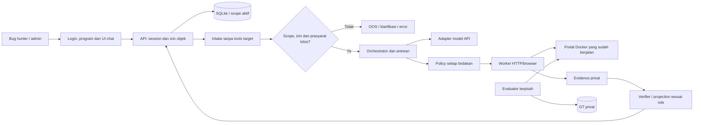

# Rencana proyek Kartika Cyber Hackathon 2026

**Checkpoint7 November, integrasi Azure:** atas permintaan pengguna, adapter Foundry teks, wiring UI/evaluator, private config/checker dan overlay preview diselesaikan dengan148 tes terarah lulus. Akses akun/key/endpoint/deployment/tarif/kuota belum tersedia; berikutnya pengguna mengisi `.env.azure`, lalu smoke teks aktual melalui ledger setelah konfigurasi lengkap. CODE_TESTED terpisah dari LIVE_VERIFIED=false. [Panduan](docs/azure-setup.md), [review](docs/final-review.md). M6 tetap DEFERRED; tidak ada publikasi/submit.

**Checkpoint review terbaru:** kode independen R3b–R3f dan persiapan R4 tersedia untuk review sekaligus; [indeks hasil/file/input pengguna](docs/final-review.md), [verifikasi](docs/r3-r4-verification.md). Runner/projection A/B, ledger006, gate freeze, laporan pending dan paket/media lokal sudah disiapkan. GT/bukti kandidat dan konfigurasi/smoke live/freeze/benchmark tetap pending. M6 DEFERRED; tidak ada publikasi/submit. Status R3a di bawah adalah riwayat persiapan sebelum checkpoint ini.

**Instruksi paling baru 7 November:** selesaikan pekerjaan independen sisa R3 sampai persiapan paket/artefak R4, lalu serahkan untuk review pengguna sekaligus. Checkpoint bukan permintaan izin rutin atau batas berhenti setiap sub-tahap. [Prompt aktif](docs/execution-prompt.md) mengatur penanganan GT/key/bukti pending, pengujian terarah dan laporan akhir review tanpa klaim palsu. Publikasi/submit menunggu review pengguna; M6 tetap DEFERRED.

**Status terbaru 7 November:** R1/R2 tetap CODE_TESTED. [R3a persiapan CODE_TESTED](docs/r3-verification.md): peta kemampuan, 20 kandidat teks/GT kosong dan scorer offline; 26 tes terarah lulus. Berikutnya R3b review GT pengguna, bukti B, integrasi prediksi/runner, freeze/live. R3 belum selesai; tidak ada hasil benchmark. Tidak mengulang suite historis atau mengejar M6 yang DEFERRED.

R3a tidak mengubah aplikasi/worker/database/ledger/service. Paket privat tidak di-overwrite; angka 20 adalah kandidat variasi teks yang kelayakannya belum diterima pengguna, bukan 20 bug/skenario independen. Perhitungan metrik hanya diverifikasi melalui aritmetika sintetis. Model/GT nyata tidak digantikan hasil offline.

**Hasil R2:** 13 tes terarah lulus, QA desktop/mobile flow baru lulus; label konfigurasi diperiksa ulang secara terpisah setelah diperjelas. UI memakai triage R1, tanpa perubahan izin atau dispatch worker. Ringkasan observasi bersifat read-only buatan aplikasi, tanpa inference tambahan/verdict baru. Kode/schema/data provider R1 dipakai ulang; source schema tetap 005, tanpa update service/data/ledger aktif. R3 belum menyusun dataset final atau menjalankan benchmark.

**Keputusan aktif 7 November 2026:** pengguna menyetujui penyempitan scope submission setelah review M6. Pemilik cakupan: [submission-scope.md](docs/submission-scope.md). Prioritas R1 adapter/triage teks tanpa dispatch target dari model, R2 UI/ringkasan bukti, R3 functional-v2 dan R4 paket. Target 24 titik menjadi backlog; M6 asli tetap sebagian 13/24 dan BUSINESS_LOGIC belum didukung. Target 20 teks 10/10 tetap, alokasi aktif 8 BAC/8 XSS/4 upload pada tiga jalur produk tersedia. Perbandingan aktif A dokumen/B dokumen+bukti mengukur prediksi model pada mekanisme dikenal, bukan generalisasi akar masalah baru. [Protokol aktif](docs/evaluation.md), [protokol lama](docs/evaluation-v1.md), [prompt R1](docs/execution-prompt.md).

**Hasil batch R1 7 November:** [CODE_TESTED](docs/r1-verification.md), adapter OpenRouter dan triage API teks independen, schema/redaksi/error/cancel/ledger serta upgrade/recovery diuji. Suite R1 final 77 lulus dalam 87,09 detik; 86 regresi lama lulus pada suite sebelumnya. Satu kegagalan selector tes diperbaiki dan artefak/retest dipertahankan; total 163 kasus unik terverifikasi lintas run. LIVE_VERIFIED belum karena CONFIGURATION_REQUIRED. Tidak memperbarui service/data/ledger aktif atau mengubah worker/katalog; berikutnya R2. Perubahan kontrak hanya menambahkan mode triage dan schema app 005, bukan izin transport dari model.

Bagian berikut mempertahankan rencana lengkap/hasil sebelum penyempitan. Ketentuan 24 titik sebagai gate submission, alokasi 8/8/2/2, agent adaptif dan held-out ketat di sana adalah rencana awal/backlog; tidak menggantikan keputusan aktif di atas. Budget, keamanan, pemisahan GT dan field submission tetap berlaku. Model live dan evaluasi belum diverifikasi.

**Tim:** ukas and codex vs everbody  
**Pelaksana:** solo  
**Tanggal rencana:** 3 November 2026, Asia/Bangkok (UTC+7)  
**Status:** M1-M5 selesai teknis lokal; M6 sebagian. Review rekaman bisnis dan workflow langkah admin tersedia, 172 tes serta QA desktop/mobile lulus. App Compose diperbarui, 37 riwayat run/ledger utuh; worker/lab tetap M5. Konteks workflow administratif tidak memberi izin eksekusi target/model. Katalog tetap 13/24, 11 PLANNED, grouping belum siap; validator BUSINESS_LOGIC LAB, GT manusia dan model live/benchmark belum tersedia. [Panduan dan bukti](docs/business-record-review.md).
**Nama produk untuk draf pendaftaran:** ValVuln AI: Agen Validasi Laporan Kerentanan; nama kerja, belum dinyatakan telah didaftarkan  
**Kategori yang direkomendasikan setelah membaca rulebook:** Penindakan

Batch lanjutan 6 November: [M6d](docs/m6d-verification.md) parser dan [M6e](docs/m6e-verification.md) rekaman event kontrol normal selesai defensif lokal; 97 tes terarah serta trace ASGI dua lifecycle lulus. M6 tetap sebagian; tidak mengubah target 24 titik, pembagian dataset atau hasil historis. Gate katalog tetap exit 2, validator BUSINESS_LOGIC produk belum tersedia.

Review lanjutan [M6f](docs/m6f-verification.md): 21 tes grouping lulus; riwayat development sistem kini diperiksa terpisah dari alokasi. Keputusan belum freeze karena HTML UP-04/XSS dan kekurangan kandidat empat area XSS. Target 20 laporan 10/10, 8/8/2/2 dan 24 titik tetap; tidak mengubah katalog atau menganggap penggantian label menyelesaikan independensi split.

## 1. Tujuan dan keputusan utama

Membangun purwarupa yang menerima laporan kerentanan beserta langkah PoC, memeriksa kecocokan scope dan konteks aset, melakukan reproduksi terkontrol pada target lab internal, lalu menyajikan kesimpulan beserta bukti untuk analis.

Pitch kerja:

> Dari laporan kerentanan menjadi hasil reproduksi berbukti di lingkungan internal.

| Bagian | Keputusan awal |
| --- | --- |
| Lingkup penggunaan | Pengujian terhadap aplikasi lab milik sendiri dan data sintetis |
| Posisi kategori | Penindakan; inti produk adalah reproduksi aktif klaim kerentanan |
| Keluarga bug | IDOR/BAC, XSS, file upload, business logic |
| Dataset evaluasi utama | 20 laporan berbeda: 10 valid dan 10 tidak valid setelah verifikasi manual |
| Kerentanan di target | Rencana 24 titik kerentanan nyata di lab sendiri, masing-masing punya fitur dan kontrol pembanding |
| Penyusunan laporan | Asisten menyusun draf 20 laporan setelah fitur/endpoint lab tersedia; pengguna memverifikasi GT |
| Model utama | Qwen3-Coder, ID `qwen/qwen3-coder` |
| Gateway/provider model | OpenRouter awal; Gemini direct cadangan gratis; OpenAI API/xAI opsional, belum aktif |
| Model pembanding | Gemini 3.5 Flash-Lite; eksperimen tambahan jika waktu, akses, dan budget cukup |
| Agent | Satu workflow Python dengan state machine dan tools terstruktur |
| Eksekusi | Worker HTTP/browser di lab lokal; satu job aktif |
| Target | Portal pengadaan/logistik dummy dengan mekanisme marketplace |
| Perangkat | Laptop RAM 16 GB; model utama berjalan pada layanan API |
| Hosting/distribusi | Aplikasi dijalankan lokal; Link Karya repo GitHub publik + paket rilis/petunjuk; tanpa live web, Pages atau VPS |
| Keputusan akhir operasional | Analis; hasil agent menjadi rekomendasi berbukti |
| Stack yang dikonfirmasi pengguna | Python + FastAPI |
| Topologi MVP yang direncanakan | Tiga container: app, worker, lab; UI di app, Chromium di worker; evaluator CLI di host |
| Database yang direncanakan | Dua file SQLite terpisah, milik app dan lab; tanpa container database |
| Startup aplikasi normal | Satu perintah Compose setelah setup/config/seed telah diuji M1-M2. Reset/evaluator tetap terpisah |
| Waktu yang tersedia | Sekitar 3 jam/hari untuk 10 hari kerja, total sekitar 30 jam |
| Budget total API yang dikonfirmasi | Maksimal Rp50.000; API key belum tersedia |
| Skill pentest eksternal | Repo belum ditemukan; bukan dependensi milestone awal |

Keputusan pengguna pada **4 November 2026** mengurangi target dari 40 menjadi **20 laporan utama, 10 valid dan 10 tidak valid**, agar beban GT/evaluasi lebih realistis. Target lab lebih dari 20 titik belum diubah; rancangan tetap 24 titik pada `docs/lab-vulnerabilities.md`. Pengurangan laporan tidak otomatis mengurangi pekerjaan membangun/verifikasi lab. Jumlah bug di aplikasi berbeda dari jumlah laporan evaluasi. Kontrak implementasi dirinci di `docs/architecture.md`, aturan target di `docs/lab-spec.md`, dan prosedur eksperimen di `docs/evaluation.md`. Pada tanggal yang sama pengguna menyatakan UI fix sebagai baseline untuk mulai backend, sambil membolehkan perbaikan berikutnya. Gate UI sudah terpenuhi; M1 lokal dieksekusi di chat baru mengikuti handoff, tanpa meminta persetujuan UI ulang. Tidak memulai backend pada turn konfirmasi/dokumentasi ini.

Desain layar dan label dirinci di `docs/design.md`, alur pengguna serta kondisi gagal di `docs/user-flow.md`, dan pelaksanaan M1-M10 beserta checkpoint di `docs/implementation.md`. Review terbaru ada di [security-review.md](docs/security-review.md). Kontrak terbaru memakai UI chat, login dua role dan satu program: guideline admin terversi, kepemilikan laporan, evidence sesuai role, serta gate backend sebelum akses ke Docker yang sudah berjalan. Ini menambah pekerjaan auth/configuration terhadap perkiraan 30 jam. Prototipe UI tersedia di [ui-prototype](ui-prototype/README.md), pemilihan referensi di [design-references.md](docs/design-references.md), dan status review di [ui-review.md](docs/ui-review.md). Tidak menganggap UI simulasi sebagai implementasi backend atau agen yang sudah bekerja.

PRD dan stack dirangkum pada [prd.md](prd.md), ditambahkan 4 November 2026 atas permintaan pengguna. Rancangan memilih app/worker/lab sebagai tiga container tetap, dua SQLite terpisah melalui aiosqlite, UI Jinja2/JavaScript pada app, dan evaluator host tanpa service tambahan. Ini memperjelas packaging dan pemilik data, bukan memulai implementasi. Topologi/maintenance di `docs/runtime.md` dan inventaris kandidat diperbarui; pin versi/resource baru dinyatakan terverifikasi setelah milestone terkait dijalankan.

Audit handoff 4 November memperjelas target startup `docker compose up -d --build` setelah setup/seed, tanpa reset/model call otomatis. M1 dipecah menjadi sub-batch fondasi yang diuji berurutan; tidak mengklaim tiga service siap saat baru app berjalan. Preflight menemukan Python/CLI/Compose tersedia, tetapi daemon Docker belum terjangkau. Diskusi deployment Azure/GCP adalah opsi masa depan, tidak mengganti keputusan submission lokal/GitHub atau mengotorisasi pembuatan resource cloud.

Penyelarasan rulebook: rekomendasi kategori diperbarui dari Core Infra/Dukungan Teknologi menjadi **Penindakan**, karena Bagian B rulebook memasukkan pengujian kerentanan dan tool pentest otomatis berbasis AI dalam kategori itu. Ini interpretasi kecocokan produk, bukan keputusan panitia bahwa kategori lain dilarang. Formulir harus memilih satu kategori. Draf isian berada di `docs/registration.md`; rincian aturan dan perbedaannya di `docs/rules-alignment.md`.

Penerimaan berbagai laporan tidak sama dengan kemampuan membuktikan seluruh jenis kerentanan. Kapabilitas yang didukung harus dinyatakan dan diuji per jenis bug.

## 2. Masalah, bukti, dan batas klaim

### 2.1 Masalah yang ditangani

Volume laporan kerentanan menambah pekerjaan untuk memahami klaim, memeriksa prasyarat, mereproduksi temuan, dan mengumpulkan bukti. Laporan dengan klaim keliru maupun laporan valid tetap menyita waktu pemeriksaan.

AI slop adalah salah satu sumber beban tersebut. Produk menilai klaim dan bukti teknis; provenance atau gaya bahasa penulis bukan penentu validitas.

### 2.2 Angka untuk proposal dan presentasi

| Temuan | Periode dan batas interpretasi | Sumber |
| --- | --- | --- |
| Laju report curl 4-5 kali dibanding 2024 dan sekitar dua kali dibanding 2025 | Pernyataan maintainer, 26 Mei 2026; khusus curl | [The pressure](https://daniel.haxx.se/blog/2026/05/26/the-pressure/) |
| Sekitar 5% submission merupakan kerentanan asli | Submission curl tahun 2025 hingga awal Juli; bukan angka seluruh industri | [Death by a thousand slops](https://daniel.haxx.se/blog/2025/07/14/death-by-a-thousand-slops/) |
| Sekitar 20% submission dianggap AI slop | Perkiraan maintainer dalam tulisan Juli 2025; tidak berarti 95% report dibuat AI | [Death by a thousand slops](https://daniel.haxx.se/blog/2025/07/14/death-by-a-thousand-slops/) |
| Pemeriksaan melibatkan sekitar 3-4 orang, masing-masing sekitar 30 menit hingga beberapa jam | Gambaran beban kerja maintainer, bukan rerata studi terkontrol | [Death by a thousand slops](https://daniel.haxx.se/blog/2025/07/14/death-by-a-thousand-slops/) |
| HackerOne menyebut lonjakan volume report 100%+ setelah perkembangan model/tools pada Februari | Pernyataan perusahaan, 29 Mei 2026; denominator dan metode tidak dirinci dalam artikel | [HackerOne: Navigating the AI Wave](https://www.hackerone.com/blog/ai-driven-report-volume-insights-and-actions) |

Pembaruan curl pada 22 Oktober 2026 menyatakan report halusinasi praktis menghilang sejak musim semi; tantangannya menjadi volume tinggi dengan kualitas tinggi. Sumber: [ignore the slop](https://daniel.haxx.se/blog/2026/10/22/ignore-the-slop/).

Kesimpulan untuk produk adalah kebutuhan bantuan validasi pada volume laporan yang meningkat. Angka eksternal menjelaskan masalah; angka tersebut tidak membuktikan efektivitas purwarupa ini.

### 2.3 Relevansi organisasi dan kebaruan

- Hipotesis pengguna: analis keamanan internal yang memeriksa laporan kerentanan terhadap aplikasi organisasi.
- Penerapan ke TNI AD adalah hipotesis yang perlu dikonfirmasi melalui pembekalan atau wawancara. Belum tersedia data beban laporan internal TNI AD.
- Tool triage AI dan layanan reproduksi sudah ada. Jangan mengklaim produk pertama atau bahwa HackerOne hanya mengecek dokumen. Referensi: [Hai Triage](https://www.hackerone.com/platform/triage).
- Pembeda yang ingin dibuktikan: integrasi konteks aset privat, pengujian melalui worker internal, jejak bukti per klaim, serta hasil yang dapat ditinjau analis.
- Demonstrasi menggunakan data sintetis dan skenario representatif, bukan sistem militer asli.

## 3. Kebutuhan lomba dan jadwal eksternal

Sumber: [website resmi](https://kartikacyberhackathon.id/), [rulebook](https://drive.google.com/file/d/1IN7FukytvtJBIbw2yPoSprEaTrZdbfMM/view), dan [syarat dan ketentuan](https://drive.google.com/file/d/1PWLGVasB0OahUCd5gL_UCElK8cnFdK4l/view). Dua PDF telah dibaca dari salinan lokal pada 3 November 2026. S&K menampilkan pembaruan 20 Oktober 2026; tanggal pembaruan rinci rulebook tidak dinyatakan. Tidak mengasumsikan hierarki antar-dokumen yang belum diumumkan panitia.

| Hal | Informasi |
| --- | --- |
| Format tim | Individu diperbolehkan; maksimal tiga anggota |
| Kategori yang direkomendasikan | Penindakan, sesuai pengujian aktif dalam rulebook Bagian B |
| Pembekalan berikutnya | Rencana kerja memakai 5 November 2026 dari rulebook/website; S&K lama menyebut 27 Oktober, perlu cek pengumuman resmi |
| Deadline submission | 15 November 2026 pukul 23:59 WIB (UTC+7), konsisten pada kedua PDF |
| Pengumuman finalis | 20 November 2026 |
| Final | 24 November 2026 |
| Paket submission | Link akses karya, thumbnail, screenshot, video YouTube maksimal 10 menit, slide, dan dokumentasi teknis |

Rubrik dan strategi pengerjaan:

| Komponen penilaian | Bobot | Bukti yang disiapkan |
| --- | ---: | --- |
| Relevansi/manfaat | 25% | Masalah terverifikasi dan alur kerja analis |
| Inovasi teknis/pemanfaatan AI | 25% | Peran model dalam memahami klaim, merencanakan uji, membaca bukti; S&K secara eksplisit menyebut pemanfaatan AI |
| Fungsionalitas | 25% | Demo reproduksi pada kondisi rentan dan perbaikan |
| Kelayakan implementasi | 15% | Instalasi lokal, penggunaan resource dan biaya |
| Dokumentasi | 10% | Petunjuk menjalankan, slide, video, hasil evaluasi |

Target internal submission: 14 November, sebelum deadline resmi. Rulebook Bagian G merinci thumbnail 1200 x 630 px, JPG/PNG/WebP maksimal 500 KB, screenshot maksimal lima gambar, dan video YouTube maksimal 10 menit. S&K Pasal 8.2 menambahkan dokumentasi teknis arsitektur, instalasi, dan penggunaan. Paket kerja memenuhi gabungan kelengkapan tersebut; ringkasan proposal mendukung komponen dokumentasi. Daftar periksa rinci ada di `docs/submission-checklist.md`.

S&K menetapkan tema AI untuk pengamanan IT/OT TNI AD. MVP menguji aplikasi web **IT**; kemampuan OT tidak diklaim. Library, API, model AI dan tools pihak ketiga diperbolehkan dengan lisensi sah serta atribusi. Komponen pre-existing wajib dideklarasikan; pekerjaan utama tim dilakukan selama periode program. Lihat `docs/third-party.md`.

Pengguna telah mengonfirmasi berusia 17 tahun atau lebih. Perbedaan persyaratan usia antara S&K dan rulebook dicatat, tetapi usia pengguna memenuhi minimum 17 yang tertulis pada S&K. Status WNI dan persetujuan pribadi tetap diisi sendiri pada formulir. Jika lolos final, peserta solo harus hadir sendiri di Jakarta pada 24 November; kedua PDF mewajibkan minimal satu perwakilan.

## 4. Scope produk

### 4.1 Fitur wajib

1. Login sebagai bug hunter/admin program sesuai membership server; pilih satu program MVP.
2. Chat dan unggah report TXT/MD berukuran terbatas. Admin mengelola guideline melalui menu terpisah; backend memakai versi scope aktif dan binding target operator, bukan scope dari pelapor.
3. Ekstraksi klaim, prasyarat, target, PoC, dan dampak yang dilaporkan.
4. Pemeriksaan scope oleh backend serta kesiapan prasyarat sebelum job pengujian; OOS/UNKNOWN tidak mengakses target. Docker portal sudah berjalan, tidak dibuat ulang per report.
5. Rencana uji terstruktur dengan tindakan, batas, dan hasil yang diharapkan.
6. Eksekusi langkah HTTP/browser melalui tools yang dibatasi.
7. Pengumpulan bukti, pemeriksaan kontrol, dan kesimpulan per klaim.
8. Tampilan timeline, alasan keputusan, batas pengujian, dan artefak bukti.
9. Peninjauan admin, pembatalan job, publikasi bukti tersanitasi dan ekspor JSON/Markdown sesuai kepemilikan/role.
10. Evaluasi terhadap dataset berlabel dengan hasil per kategori.

### 4.2 Batas MVP

- Validasi laporan yang sudah ada, bukan pencarian seluruh permukaan serangan.
- PoC dalam report diterjemahkan menjadi rencana HTTP/browser; script kiriman disimpan sebagai data dan tidak langsung dijalankan sebagai program bebas.
- Tools MVP tidak menyediakan terminal umum, `eval`, instalasi dependensi dari report, atau akses Docker socket.
- DoS, race condition, memory corruption, exploit chain kompleks, serta eksekusi shell/webshell tidak menjadi cakupan klaim kemampuan awal.
- PDF/OCR, integrasi email/HackerOne, multi-tenant, SSO, SIEM, dan auto-remediation ditunda.
- Deployment sepenuhnya offline belum tersedia saat model masih diakses melalui API.

Reproduksi PoC tetap merupakan inti produk: worker menjalankan tindakan pengujian yang merepresentasikan PoC, bukan hanya meminta LLM menilai teksnya. Dukungan script arbitrer membutuhkan rancangan isolasi tambahan dan pekerjaan terpisah setelah MVP.

### 4.3 Urutan pengembangan

BAC end-to-end menjadi milestone pertama. Tambahkan XSS, file upload, dan business logic secara bertahap setelah alur intake-scope-eksekusi-bukti berjalan. Arsitektur harus menerima validator tambahan melalui kontrak tools yang sama.

## 5. Target internal: portal pengadaan/logistik dummy

### 5.1 Fitur minimum target

- Akun pemohon A, pemohon B, petugas persetujuan, dan admin lab.
- Katalog barang, permintaan/pesanan, invoice, lampiran, dan catatan pengguna.
- Status transaksi: `DRAFT -> SUBMITTED -> APPROVED -> FULFILLED`, sesuai aturan di `docs/lab-spec.md`.
- Data seed sintetis dengan kepemilikan objek dan nilai yang mudah diperiksa.
- Aturan bisnis tertulis, misalnya pemohon hanya dapat membaca invoice miliknya dan satu permintaan tidak boleh diproses dua kali.
- Reset data otomatis antarkasus melalui fasilitas evaluator yang tidak dapat diakses agent.

UI target cukup sederhana. Dashboard validasi dan kualitas bukti mendapat prioritas lebih tinggi daripada kelengkapan fitur marketplace.

### 5.2 Kondisi rentan dan perbaikan

- Sediakan kondisi target rentan dan perbaikan yang dapat dipilih evaluator.
- Perubahan kondisi dan seed dilakukan sebelum run, lalu diverifikasi health check.
- Alias target yang terlihat agent bersifat netral; hindari nama host, header, atau banner yang membocorkan label `vulnerable`/`patched`.
- Label, mode target, source jawaban, dan script pemeriksa GT tidak masuk konteks model atau filesystem worker.
- Hasil menyebut versi/build target, konfigurasi relevan, seed ID, dan waktu pengujian.
- Kesimpulan hanya berlaku untuk lingkungan yang diuji; hasil staging tidak otomatis membuktikan keadaan production.

### 5.3 Dasar bukti per kategori

| Kategori | Yang perlu dibuktikan | Kontrol/negatif yang berguna |
| --- | --- | --- |
| IDOR/BAC | Identitas yang tidak berhak berhasil mengakses objek atau fungsi terlarang | Akses pemilik sah, akses bukan pemilik, peran berbeda, objek publik sesuai aturan |
| XSS | Eksekusi JavaScript dengan marker unik dalam konteks origin target yang relevan | Input di-escape, tampil sebagai teks, konteks tidak dapat dieksekusi |
| File upload | Dampak spesifik dalam klaim terjadi setelah upload, misalnya konten aktif dieksekusi pada origin yang relevan | File hanya tersimpan sebagai attachment, tidak dapat diakses, atau disajikan secara inert |
| Business logic | Aturan bisnis yang dinyatakan benar-benar dilanggar dan perubahan state terukur | Alur normal berhasil, alur penyimpangan diblokir, state sebelum/sesudah konsisten |

HTTP 200, file berhasil diunggah, adanya pantulan input, atau teks error saja tidak cukup sebagai bukti dampak. Business logic dinilai terhadap aturan aplikasi yang tersedia bagi agent, bukan asumsi tersembunyi evaluator.

OWASP Juice Shop boleh digunakan untuk smoke test awal; evaluasi utama memakai target yang dikendalikan sendiri agar kondisi dan label dapat diverifikasi. Jangan memberikan scoreboard atau walkthrough ke agent.

## 6. Arsitektur dan stack

### 6.1 Stack awal

| Komponen | Pilihan | Alasan |
| --- | --- | --- |
| Runtime | Python 3.11 | Tersedia di workspace saat pemeriksaan awal |
| API/UI chat | FastAPI, Jinja2, HTML/CSS dan JavaScript ringan | Satu aplikasi, login dua role dan proses build sederhana |
| Kontrak data | Pydantic | Validasi input, tool calls, output, dan verdict |
| HTTP | HTTPX | Session, timeout, dan request/response capture |
| Browser worker | Playwright dengan Chromium | Pemeriksaan XSS, navigasi dan bukti browser |
| Persistensi | SQLite dan direktori artefak privat per run | Demo lokal beberapa akun, satu program dan satu job aktif; bukan klaim skala produksi |
| Agent loop | State machine Python eksplisit | Status, retry, batas, dan jejak eksekusi mudah diperiksa |
| Model API | Adapter HTTP untuk OpenRouter; adapter terpisah untuk pembanding | Model dapat diganti tanpa mengubah tools |
| Lab | Docker Compose | Target dan worker dapat dijalankan/reset bersama |
| Pengujian | pytest dan skrip evaluasi dataset | Memeriksa batas akses, bukti, serta perhitungan metrik |

Pilih versi dependensi yang kompatibel saat bootstrap dan kunci versinya setelah smoke test. Tidak perlu fine-tuning, vector database, Kubernetes, atau framework multi-agent untuk MVP.

### 6.2 Diagram komponen



Schema, session, scope versioning dan rute dimiliki [architecture.md](docs/architecture.md), bukan diduplikasi seluruhnya di sini. Checklist keamanan pada [security-review.md](docs/security-review.md) masih BELUM DIUJI.

### 6.3 Pemisahan akses

- Browser pengguna mengakses dashboard pada loopback laptop.
- Orchestrator memiliki akses ke model API; worker tidak menyimpan API key model.
- Worker berada pada jaringan lab yang hanya dapat menjangkau target dan jalur job yang diperlukan.
- Target lab tidak dipublikasikan ke internet. Endpoint reset/admin evaluator tidak tersedia untuk worker.
- Akses keluar worker dan browser dibatasi pada host/port target yang diizinkan; subresource, redirect, WebSocket, dan navigasi baru ikut diperiksa.
- Pembatasan ditegakkan di backend dan jaringan. Prompt model tidak menjadi batas keamanan tunggal.
- Docker menjadi mekanisme packaging dan pembatasan lab. Jangan mengklaimnya cukup untuk mengeksekusi kode pihak luar yang arbitrer; fitur tersebut memerlukan isolasi VM dan desain tambahan.

## 7. Workflow agent

### 7.1 Status proses

```text
RECEIVED -> PARSED -> SCOPE_CHECKED -> PLANNED -> POLICY_CHECKED
         -> RUNNING -> VERIFYING -> COMPLETED

Cabang: NEEDS_INFO, OUT_OF_SCOPE, UNSUPPORTED, POLICY_BLOCKED,
        PROVIDER_REFUSED, FAILED, CANCELLED
```

Status proses, keputusan scope, dan verdict teknis adalah field berbeda. `COMPLETED` tidak otomatis berarti bug valid.

### 7.2 Tahapan

1. **Intake:** validasi format/ukuran, simpan report asli, berikan ID dan hash.
2. **Parse:** ekstrak klaim dan langkah; tandai informasi yang belum tersedia.
3. **Scope:** backend mencocokkan ekstraksi aset/klaim dengan binding dan versi scope aktif; aturan pelapor/keputusan model tidak memberi izin. UNKNOWN/OOS berhenti sebelum akses target.
4. **Prerequisites:** periksa akun, objek uji, aturan bisnis, dan kondisi lingkungan.
5. **Plan:** susun tindakan terstruktur, kontrol pembanding, kriteria sukses, dan batas run.
6. **Policy:** validasi tiap tindakan tepat sebelum dieksekusi. Tidak cukup memeriksa scope sekali di awal.
7. **Execute:** worker menjalankan request/browser action dan menyimpan artefak.
8. **Adapt:** agent dapat memperbaiki langkah sesuai hasil dalam anggaran yang sama; perubahan target/tindakan tetap melewati policy gate.
9. **Verify:** periksa bukti dampak dan kontrol. LLM tidak boleh menciptakan evidence ID atau menganggap narasinya sebagai observasi.
10. **Report:** hasil terstruktur, alasan, bukti pendukung/penyangkal, keterbatasan, dan pertanyaan lanjutan.
11. **Review:** admin menerima/mengoreksi rekomendasi dan membagikan bukti tersanitasi; simpan hasil agent asli. Bug hunter hanya dapat mengakses report sendiri dan projection sesuai role.

### 7.3 Tools awal

| Tool | Kontrak minimum |
| --- | --- |
| `get_target_context` | Scope dan aturan target yang disetujui; tidak berisi label jawaban |
| `http_request` | Target ID, method, path, akun alias, header/body terbatas |
| `browser_action` | Navigasi, isi form, klik, baca DOM, screenshot melalui operasi terbatas |
| `upload_test_fixture` | Fixture ID yang disediakan lab dan parameter upload; bukan path bebas |
| `compare_observations` | Membandingkan bukti yang sudah tersimpan |
| `submit_assessment` | Verdict per klaim dan referensi evidence ID yang benar-benar ada |

Pengujian XSS dapat memakai marker unik dan instrumentasi browser yang telah ditentukan. Jangan menambahkan browser-eval arbitrer hanya untuk mempermudah planner.

### 7.4 Batas awal per run

Angka ini adalah konfigurasi awal untuk dikalibrasi pada data pengembangan:

- Satu run aktif dan satu browser context aktif.
- Maksimal 12 panggilan model termasuk retry, 40 request jaringan target termasuk subresource browser, dan 30 aksi browser. Detail kuota, lease/recovery serta handoff worker di [runtime.md](docs/runtime.md); bagian HTTP/handoff/isolasi sudah diuji M2, browser/provider live belum.
- Timeout request 10 detik; timeout keseluruhan run 180 detik.
- Maksimal satu retry untuk error sementara; retry tetap memakai anggaran yang sama.
- Batasi ukuran report, body request/response, upload fixture, screenshot, dan total artefak.
- Hentikan run ketika target tidak sehat, batas biaya tercapai, atau pengguna membatalkan.
- Batas akses berlaku pada tujuan URL setelah resolusi dan redirect, bukan hanya string awal. Tolak metadata cloud, host di luar registry, serta tujuan jaringan yang tidak disetujui.

Nilai aktual dibekukan sebelum pengujian final. Timeout bukan bukti report salah.

## 8. Model, prompt, dan biaya

### 8.1 Pilihan model

- Utama: `qwen/qwen3-coder` melalui OpenRouter.
- Pin penyedia inference yang lolos smoke test jika tersedia; catat perubahan endpoint/fallback.
- Gunakan model ID spesifik, hindari router acak atau pemilihan model otomatis selama benchmark.
- Gemini direct: kandidat `gemini-3.5-flash-lite` Free Tier untuk cadangan dan opsi primary sebelum freeze bila akses Qwen tidak layak dalam budget. Pembanding berbeda hanya jika waktu/budget cukup.
- Rencana adapter OpenAI Platform API dan xAI/Grok ditambahkan sebagai opsi nonaktif sampai akses/pendanaan terverifikasi; bukan diasumsikan gratis karena pengguna berlangganan Plus/Codex atau dapat membuka Playground Grok.
- Azure for Students/Foundry ditambahkan sebagai kandidat kredit pada 4 November 2026; pengguna menyatakan mahasiswa aktif dengan email kampus dan 18+. Panduan apply di [azure-students.md](docs/azure-students.md). Aktivasi, saldo, cakupan biaya/model, quota dan tools masih perlu diverifikasi; tidak mengubah primary/fallback sebelum itu, tidak upgrade PAYG atau memindahkan lab ke Azure.
- Negara asal model tidak membuktikan kualitas, kebijakan penolakan, atau lokasi pemrosesan data.
- Ketersediaan tools/JSON, konsistensi, harga, dan penolakan pada tugas lab berizin diukur sebelum finalisasi.

Sumber kemampuan: [Qwen3-Coder](https://qwenlm.github.io/blog/qwen3-coder/), [model OpenRouter](https://openrouter.ai/qwen/qwen3-coder), [tool calling OpenRouter](https://openrouter.ai/docs/guides/features/tool-calling).

Revisi provider 4 November 2026 dimiliki bagian 3.1-3.2 [prd.md](prd.md), dengan sumber resmi gratis/billing/plan usage dan kontrak adapter pada architecture.md. Default rencana OpenRouter -> Gemini direct; provider cadangan wajib dikonfigurasi operator. Fallback terbatas sebelum respons model pertama digunakan/aksi target, berbagi cap/deadline/ledger, tidak untuk refusal, dan tidak aktif saat benchmark. Quota/kredit habis hanya dialihkan ke FREE_TIER terverifikasi, tanpa top-up/escalation paid. Setelah respons pertama, provider/model dikunci sepanjang run. OpenAI plan melalui OAuth adalah opsi lanjutan, belum diasumsikan kompatibel dengan cap output MVP.

### 8.2 Isi konteks model

- Tujuan validasi, batas scope dan tools yang tersedia.
- Report sebagai data tidak tepercaya, terpisah dari instruksi aplikasi.
- Akun menggunakan alias; worker menyelesaikan kredensial tanpa mengirim password/token mentah ke model.
- Aturan bisnis, prasyarat, dan observasi yang relevan.
- Riwayat ringkas dengan evidence ID; hindari mengirim ulang seluruh log browser setiap langkah.
- Instruksi menyatakan bahwa dokumen atau respons target tidak boleh mengubah otorisasi tools.

### 8.3 Kegagalan model

- Bedakan penolakan kebijakan, rate limit, error server, JSON tidak valid, dan klaim teknis yang salah.
- Penolakan model menjadi `PROVIDER_REFUSED` dan verdict belum pasti; bukan ground truth tidak valid.
- Gunakan retry terbatas untuk gangguan sementara, bukan pengulangan tanpa batas.
- Catat penolakan pada pengujian lab berizin sebagai metrik operasional.
- Pembandingan model dilakukan eksplisit; perpindahan model tidak boleh disembunyikan dalam hasil benchmark.
- Tema dan rubrik mencakup AI. Mock memadai untuk bootstrap, tetapi demo produk sebagai agen AI perlu menunjukkan integrasi model yang benar-benar berjalan, dengan trace live atau rekaman autentik yang diberi label. Kebutuhan akses live harus diselesaikan sebelum mengklaim fitur AI telah berfungsi.
- OpenAI mendokumentasikan kemungkinan pekerjaan keamanan sah ikut ditandai. Tidak ada bukti uji proyek ini bahwa Qwen bebas penolakan. Referensi: [official OpenAI documentation: Cybersecurity checks](https://developers.openai.com/api/docs/guides/safety-checks/cybersecurity).

### 8.4 Estimasi biaya

Pada 3 November 2026, halaman model OpenRouter menampilkan endpoint DeepInfra (Turbo) dengan input USD 0,30/juta token dan output USD 1/juta token. Periksa kembali endpoint dan tarif sebelum memakai kredit. Model pembanding pada [harga resmi Google](https://aistudio.google.com/docs/pricing#gemini-3.5-flash-lite) tercantum USD 0,30 input dan USD 2,50 output per juta token.

```text
biaya_model = (total_input_tokens / 1_000_000 * harga_input)
            + (total_output_tokens / 1_000_000 * harga_output)
```

Ilustrasi Qwen: total 20.000 input + 4.000 output untuk seluruh langkah satu run sekitar USD 0,01; 100 run sekitar USD 1 pada tarif tersebut. Ini perkiraan token, bukan biaya hasil pengukuran. Hitung token yang ditagihkan, termasuk thinking/retry jika ada, serta tarif endpoint aktual. Biaya pembelian kredit dicatat terpisah agar fee pembelian tidak dihitung lagi sebagai fee per request.

Budget total yang dikonfirmasi pengguna adalah **Rp50.000**, dan API key belum tersedia. Batas ini menggantikan usulan USD 10 sebelumnya. Aplikasi perlu batas token/run dan ledger biaya; tidak ada pembelian maupun pemanggilan API berbayar pada tahap dokumentasi.

Terms OpenRouter mensyaratkan pengguna minimal 18 tahun. Pada audit 3 November 2026 pengguna mengonfirmasi **18 tahun atau lebih**, sehingga syarat usia terselesaikan. Key, akses tools dan biaya awal tetap perlu diperiksa. Pemeriksaan akses dilakukan sejak M1 agar hambatan biaya tidak baru ditemukan saat benchmark; smoke test live hanya setelah konfigurasi dan budget tersedia.

**Minimum pembelian berbeda dari biaya pemakaian.** [Terms OpenRouter](https://openrouter.ai/terms), diperiksa 3 November 2026, mencantumkan minimum pembelian kredit USD 5 per transaksi. [Halaman pricing](https://openrouter.ai/pricing) juga mencantumkan tier gratis dengan batas akses. Biaya rupiah checkout, fee, dan akses akun aktual belum dipastikan; jangan menganggap estimasi USD 0,01/run berarti layanan berbayar dapat diaktifkan dengan nominal yang sama. Bila biaya awal melampaui Rp50.000, jangan melakukan top-up atau menaikkan budget secara otomatis.

Pengembangan awal memakai adapter simulasi berlabel `mock`, berbiaya API nol. Qwen/OpenRouter tetap pilihan awal; Gemini direct Free Tier adalah cadangan prioritas yang dapat dipilih sebagai primary sebelum freeze setelah akses/tools/limit diperiksa. Jangan menganggap `qwen/qwen3-coder:free` tersedia. Key/quota gratis belum diverifikasi pada akun pengguna, dan OpenAI/xAI bukan akses gratis yang sudah siap. Simulasi menguji plumbing dan tidak dihitung sebagai hasil model AI. Probe dari empat titik development cadangan, baseline A/B pada 20 laporan utama, dan model pembanding opsional dijalankan bertahap sesuai sisa budget; hasil eksperimen yang belum dijalankan harus tetap kosong.

### 8.5 Privasi dan skenario internal

Semua report, akun, dan isi target demo adalah sintetis. Akses model melalui provider terkonfigurasi (OpenRouter/Google, atau opsi OpenAI/xAI bila diaktifkan) berarti sebagian konteks diproses layanan eksternal. Jangan menyebut MVP sepenuhnya offline. Deployment operasional dengan data sensitif memerlukan evaluasi kebijakan data, penyedia inference, dan/atau model yang di-host organisasi sendiri.

## 9. Kontrak hasil dan evidence

### 9.1 Verdict teknis

| Verdict | Arti |
| --- | --- |
| `CONFIRMED` | Klaim didukung bukti dampak dan kontrol yang relevan |
| `REFUTED` | Ada bukti yang menyangkal klaim spesifik pada kondisi yang dinyatakan, atau perilaku terbukti sesuai aturan |
| `INCONCLUSIVE` | Bukti/prasyarat kurang, reproduksi belum berhasil, atau hasil ambigu |

`REFUTED` berlaku untuk klaim dan lingkungan tertentu. Menjalankan PoC lalu gagal tidak cukup untuk membuktikan ketiadaan kerentanan secara umum.

### 9.2 Field hasil minimum

```text
report_id, run_id, claim_id, target_id, target_build
scope_decision, capability_decision, process_status, verdict
claim_summary, prerequisites, checks_performed, limitations
supporting_evidence_ids, contradicting_evidence_ids
next_action, analyst_review
model_id, inference_provider, prompt_version, tool_version
started_at, finished_at, input_tokens, output_tokens, cost_estimate
```

Tidak perlu skor confidence numerik yang belum dikalibrasi. Gunakan alasan dan status kecukupan bukti.

### 9.3 Artefak

- Request/response yang relevan dengan redaksi session secret.
- Alias akun, identitas objek, dan aturan akses yang diuji.
- Screenshot, DOM excerpt, marker XSS, console/network trace secukupnya.
- State bisnis sebelum/sesudah dan kontrol pembanding.
- Hash artefak dan jejak waktu untuk mendeteksi perubahan setelah pengumpulan.
- Log tool yang menunjukkan tindakan diizinkan/ditolak dan alasannya.

Tampilkan HTML/report berbahaya sebagai teks yang di-escape di dashboard. Screenshot atau response body tidak boleh mengeksekusi konten kiriman dalam origin dashboard.

## 10. Dataset dan ground truth

### 10.1 Komposisi target utama

| Kelompok | Kasus | GT valid | GT tidak valid |
| --- | ---: | ---: | ---: |
| IDOR / BAC | 8 | 4 | 4 |
| XSS | 8 | 4 | 4 |
| File upload | 2 | 1 | 1 |
| Business logic | 2 | 1 | 1 |
| Total | 20 | 10 | 10 |

Ada 20 teks laporan berbeda, masing-masing berisi satu klaim utama pada kondisi target yang diketahui evaluator. Dua run dari satu teks report tidak dihitung sebagai dua laporan. Rancangan memasangkan satu klaim valid dan satu klaim keliru yang dapat dibantah pada setiap area evaluasi; pasangan berada dalam grup yang sama. Laporan negatif dapat menyasar field/jalur yang sudah aman, akses yang memang diizinkan, atau klaim dampak yang terbantahkan. Lab tetap dapat mengandung banyak bug lain ketika sebuah klaim tertentu tidak valid.

Asisten akan menyusun draf 20 laporan setelah endpoint, akun uji dan skenario siap. Draf tidak menjadi GT hanya karena ditulis asisten. Pengguna menetapkan label final melalui reproduksi manual, bukti dan kontrol. Target 24 titik lab terdiri dari 8 BAC, 8 XSS, 4 upload, 4 business logic; sepuluh area dipakai untuk 20 laporan utama, empat untuk development dan sepuluh lain tidak masuk benchmark utama. Grouping akar masalah diperiksa sebelum freeze; pembagian ID ada pada `docs/evaluation.md` dan `docs/lab-vulnerabilities.md`.

Pembagian 8/8/2/2 memprioritaskan BAC/XSS yang lebih dikuasai pengguna. Dua laporan pada masing-masing upload/business logic hanya pemeriksaan awal, bukan bukti keandalan kategori secara umum. Target lebih kecil mengurangi pekerjaan menyusun/GT laporan dan jumlah run terjadwal; tidak menjamin seluruh proyek selesai dalam 30 jam.

### 10.2 Variasi kasus

- Report valid yang ringkas, berantakan, maupun ditulis dengan bantuan AI.
- Report meyakinkan dengan klaim dampak yang tidak didukung.
- Klaim yang sudah diperbaiki atau tidak berlaku karena prasyarat terverifikasi tidak terpenuhi.
- Perilaku yang memang dibolehkan aturan aplikasi, misalnya akses objek publik.
- PoC tidak lengkap dapat diuji sebagai kasus tambahan, tetapi bukan otomatis diberi GT tidak valid.
- Variasi bahasa dan format dicatat sebagai turunan dari bug dasar yang sama.
- Jangan menghitung temuan upload-XSS sebagai dua bug independen tanpa alasan. Tentukan satu kategori utama dan tag sekunder.

Dataset ini menguji validasi klaim, bukan deteksi apakah tulisan berasal dari AI. Campuran 50:50 dipilih untuk eksperimen dan tidak mewakili prevalensi report di lapangan.

### 10.3 Penetapan GT

1. Tulis klaim, aturan bisnis/akses, dan dampak yang seharusnya dibuktikan.
2. Siapkan seed, akun, build, dan kondisi target yang dapat diulang.
3. Reproduksi manual untuk kondisi rentan serta perbaikan/kontrol yang relevan.
4. Simpan request/response atau bukti browser dan perubahan state.
5. Tetapkan `VALID` atau `INVALID` hanya jika ada dasar yang dapat diperiksa.
6. Tandai kasus ambigu sebagai `UNCERTAIN` dan keluarkan dari set biner utama sebelum freeze; jumlah dan alasan tetap dilaporkan.
7. Tambahkan assertion lab untuk mendeteksi seed/kondisi target rusak pada run berikutnya.
8. Simpan GT dan assertion evaluator terpisah dari input serta tools agent.

GT dibuat satu orang sehingga bias dan kesalahan label masih mungkin. Lakukan review ulang setelah jeda dengan checklist; jika ada reviewer eksternal yang bersedia, gunakan untuk subset, tetapi jangan mengklaim ada review independen sebelum dilakukan.

### 10.4 Pembagian data

- Set evaluasi utama adalah 20 laporan final. Pengembangan memakai empat titik lab cadangan, satu per kategori, dengan contoh/manual probe terpisah yang tidak dihitung sebagai bagian dari 20 laporan tersebut.
- Pembagian dikelompokkan berdasarkan `root_cause_group`, bukan acak per report.
- Seluruh parafrasa, akun/ID variasi, serta kondisi rentan/perbaikan dari akar masalah yang sama berada pada split yang sama.
- Utamakan pemisahan grup daripada kuota split persis; catat jumlah akhir per kategori dan label.
- Jangan menyebut 20 laporan sebagai 20 bug berbeda atau otomatis menyebut 24 titik sebagai 24 akar masalah independen. Catat jumlah titik lab, akar masalah, laporan dan pengulangan secara terpisah.
- Bekukan dataset, prompt, model/provider, tools dan batas run sebelum evaluasi held-out.
- Jika tuning dilakukan setelah melihat kegagalan held-out, tandai set itu sudah terpakai untuk pengembangan; hasil final memerlukan set baru atau pengungkapan keterbatasan tersebut.
- Agent tidak mendapat nama kondisi, label GT, catatan pembuat bug, atau script pembukti evaluator.

Tambahkan set operasional terpisah bila diperlukan untuk out-of-scope, kategori unsupported, report kurang bukti, serta instruksi berbahaya dalam report/respons target. Kasus tersebut tidak dijadikan pengisi 10 laporan tidak valid dan tidak dicampur dengan 20 laporan utama.

## 11. Rancangan evaluasi

### 11.1 Eksperimen

| Konfigurasi | Input dan tools | Pertanyaan |
| --- | --- | --- |
| A: baseline dokumen | Model/provider yang dibekukan (awal Qwen) + report + scope/aturan/prasyarat; tanpa akses hasil reproduksi | Bagaimana keputusan tanpa pengujian aktif? |
| B: sistem utama | Model/provider yang sama dengan A + konteks yang sama + tools validasi | Apakah reproduksi memperbaiki keputusan dan bukti? |
| C: pembanding opsional | Model berbeda + konteks/tools/batas yang setara dengan B | Bagaimana tradeoff kualitas, penolakan, waktu, dan biaya? |

Lakukan pemeriksaan awal model pada empat titik development cadangan, satu per kategori, dan periksa ledger biaya sebelum memperluas probe. Jangan memakai 20 laporan utama untuk tuning. Qwen merupakan pilihan awal; pembandingan model lain bersifat opsional dalam budget Rp50.000. Setelah keputusan model dibekukan, bandingkan A dan B pada 20 laporan final. C di held-out hanya dijalankan jika waktu/biaya cukup; jangan hanya memilih kasus yang menguntungkan satu model.

Untuk tiap run, reset target dan session. Jalankan urutan yang diacak tetapi dicatat. Prioritas minimum adalah satu run A dan satu run B per kasus held-out. Pengulangan sampai tiga kali hanya ditambahkan jika waktu dan budget tersisa; jika memakai subset, pilih subset tersebut sebelum melihat hasil dan laporkan terpisah. Jangan memperlakukan pengulangan sebagai kasus independen tambahan.

A menghasilkan prediksi dokumen `VALID/INVALID/ABSTAIN`, bukan verdict teknis yang memerlukan bukti eksekusi. B dinilai dari assessment setelah verifier; respons mentah dan koreksi admin tetap terpisah. Mapping keputusan dan perbandingan yang tidak menyamakan komputasi dirinci di [evaluation.md](docs/evaluation.md). Dua puluh laporan berarti **40 run A/B**; cap awal satu panggilan A dan 12 panggilan B dapat mencapai 260 panggilan sebelum development/chat, bukan janji biaya 40 panggilan saja.

### 11.2 Metrik utama

Set utama berisi kasus in-scope, kategori didukung, prasyarat lengkap, dan GT biner. Kegagalan agent mengklasifikasikan kasus tersebut sebagai unsupported tetap tercatat sebagai kegagalan sistem, bukan alasan mengeluarkannya setelah pengujian.

Definisi untuk deteksi temuan valid:

```text
TP = GT VALID dan keputusan POSITIVE
FP = GT INVALID dan keputusan POSITIVE
FN = seluruh GT VALID yang tidak mendapat POSITIVE
TN = GT INVALID dan keputusan NEGATIVE

precision = TP / (TP + FP)
recall = TP / (TP + FN)
F1 = 2 * TP / (2 * TP + FP + FN)
strict_accuracy = (TP + TN) / N_semua_kasus_utama
coverage = N_dengan_POSITIVE_atau_NEGATIVE / N_semua_kasus_utama
```

Dengan 20 laporan berlabel manual dan komposisi 10/10, recall memakai pembagi 10 dan strict accuracy pembagi 20. Precision tetap menggunakan `TP+FP`, bukan otomatis 10. Satu keputusan salah mengubah strict accuracy 5 poin persentase. Laporan tanpa keputusan tetap masuk denominator sesuai definisi di atas.

`INCONCLUSIVE`, refusal, timeout, unsupported yang keliru, dan error tidak dihitung sebagai keputusan benar pada strict accuracy. Kasus GT invalid yang tidak diputuskan bukan TN dan tetap ada dalam denominator. Karena ada abstention, empat hitungan TP/FP/FN/TN di atas tidak selalu membentuk tabel biner lengkap; sertakan matriks GT versus seluruh status keluaran.

Denominator nol ditampilkan `N/A`; F1 dihitung langsung dari TP/FP/FN. Jika TP=FP=0 dan FN=10, precision=N/A tetapi recall=F1=0. Hitung A dan B terpisah, masing-masing N=20; pemetaan output dan kasus batas mengikuti `docs/evaluation.md`. Accuracy pada subset yang diputuskan boleh menjadi tambahan dengan coverage yang jelas.

### 11.3 Metrik pendukung

- Precision, recall, F1, strict accuracy, dan coverage per kategori serta keseluruhan.
- Jumlah report, jumlah grup akar masalah, dan jumlah pengulangan.
- Macro-F1 agar kategori besar tidak menyembunyikan hasil kategori kecil; ungkap jika suatu kelas tidak dapat dihitung.
- False confirmation, false refutation, dan kasus belum pasti dengan contoh evidence.
- Proporsi tugas lab berizin yang ditolak model; bedakan refusal dari tool/policy block milik aplikasi.
- Keberhasilan tool call, error schema, timeout, dan kegagalan lingkungan.
- Durasi wall-clock, token, biaya per run, dan biaya per temuan yang benar dikonfirmasi.
- Kelayakan bukti: klaim didukung observasi, kontrol memadai, dan evidence ID benar.
- Jumlah tindakan keluar scope yang dicoba dan jumlah yang berhasil dieksekusi. Target keberhasilan eksekusi keluar scope adalah nol.

Laporkan angka mentah dan, bila dihitung, interval ketidakpastian berdasarkan grup kasus. Jangan menghitung ketidakpastian seolah semua parafrasa/pengulangan independen. Kategori dengan 6-14 laporan sangat sensitif terhadap satu kesalahan dan belum membuktikan generalisasi industri.

### 11.4 Penghematan waktu analis

- Ukur waktu kerja aktif manusia untuk membaca, menyiapkan uji, menjalankan, dan membuat kesimpulan.
- Ukur terpisah waktu meninjau bukti agent dan mengoreksi hasilnya.
- Bandingkan dengan baseline manual pada kasus setara atau blok yang diseimbangkan.
- Catat efek pembelajaran karena pembuat target merangkap evaluator.
- Jangan menyamakan waktu inference agent dengan waktu kerja aktif analis.
- Klaim penghematan hanya jika pengukuran sudah dilakukan dan keputusan tetap benar.

## 12. UI chat dan pengalaman demo

Spesifikasi visual/wireframe ada di [design.md](docs/design.md), alur di [user-flow.md](docs/user-flow.md). Layar utama berupa chat dengan lampiran report, daftar percakapan di kiri serta drawer bukti admin; tidak berpusat pada form/tabel dashboard.

Halaman minimum: login tanpa pilihan role, pilih satu program, chat laporan dan guideline publik hanya-baca. Admin mendapat laporan program, bukti internal, review/publikasi hasil serta editor guideline draf/aktivasi. Evaluator/GT/reset berada di luar UI program. Mulai dari satu alur BAC; hasil evaluasi baru ditampilkan setelah eksperimen benar-benar berjalan.

Tombol Kirim menyimpan pesan/draft; Validasi mengunci snapshot, memeriksa scope dan baru membuat job internal bila gate lolos. Tidak membuat container target per laporan. OOS/UNKNOWN tanpa akses target. Pembatasan kepemilikan dan field internal dilakukan server pada detail, polling, lampiran, evidence dan ekspor.

UI membedakan scope sesuai, proses selesai, dan klaim terbukti. Mock/replay/live selalu terlihat. Bukti internal bukan otomatis bukti untuk pelapor. Dua role/scope management menambah beban kerja; hindari statistik, registrasi publik dan streaming besar pada MVP.

## 13. Struktur repositori yang direncanakan

```text
plan.md
README.md
pyproject.toml
.env.example
.gitignore
compose.yaml
app/
  main.py
  api/
  templates/
  static/
  schemas/
  agent/
    workflow.py
    prompts/
  providers/
  policy/
  storage/
worker/
  service.py
  tools/
  Dockerfile
lab/
  portal/
  seeds/
  business_rules.md
profiles/
  lab.yaml
skills/
  SOURCES.md
evaluator/
  dataset/
  ground_truth/
  assertions/
  run.py
  metrics.py
tests/
docs/
  architecture.md
  evaluation.md
  demo-script.md
  submission-checklist.md
artifacts/                 # Lokal; tidak masuk konteks worker/model
```

Struktur ini mencakup target MVP. Pada M1 baru `app/`, `tests/`, `scripts/`, konfigurasi/dependensi, migrasi dan Compose app yang tersedia; M2 kemudian menambahkan worker/lab API, boundary handoff dan evaluator development; browser dan evaluator benchmark menyusul. Source evaluator/GT dapat berada di repo untuk transparansi setelah evaluasi, tetapi tidak dimount ke runtime agent. Artefak yang dipublikasikan harus diperiksa dan disanitasi; credential, database runtime, serta `.env` tidak masuk repo.

Jika menggunakan skill pentest dari GitHub, pilih repo secara eksplisit, periksa isi dan lisensinya, pin commit, catat sumber/modifikasi di `skills/SOURCES.md`, lalu adaptasi hanya langkah yang diperlukan. Skill tidak boleh mengubah kebijakan target dan tidak menjadi bukti kemampuan tanpa pengujian.

## 14. Perangkat dan resource

Pemeriksaan awal workspace menemukan executable Python, Docker, Node, dan Git. Pemeriksaan berikutnya membaca Python 3.11.9, Docker CLI 29.7.2, serta Git 2.55.0.windows.2. Docker CLI memberi peringatan akses konfigurasi pengguna; daemon dan kemampuan menjalankan container belum terverifikasi. Pembacaan kapasitas volume melalui `Get-Volume` ditolak izin, sehingga kapasitas disk belum diketahui. Chromium/playwright-core yang sudah ada pada host telah dipakai untuk QA prototipe UI; browser worker produk, GPU dan penggunaan RAM produk belum diperiksa.

- Gunakan laptop RAM 16 GB, SSD, satu target, dan satu worker.
- Tidak menjalankan model Qwen besar secara lokal.
- Mulai alokasi Docker sekitar 4-6 GB dan pantau pemakaian; naikkan hanya bila diperlukan.
- Batasi browser ke satu context; bersihkan setelah setiap run.
- Pakai SQLite; hindari Redis/Postgres tambahan sebelum ada kebutuhan.
- Simpan artefak penting, batasi log yang tidak relevan, dan pantau ruang disk.
- Keputusan submission memakai repo GitHub publik dan paket lokal; live web, Pages, tunnel laptop dan VPS tidak termasuk jalur ini.
- Juri dapat meninjau source, video, dan petunjuk menjalankan lokal. Jangan membuat target rentan terbuka di internet hanya untuk memenuhi link karya.

## 15. Rencana kerja solo: 10 sesi, sekitar 30 jam

Pelaksanaan dipecah menjadi milestone dan checkpoint dalam [implementation.md](docs/implementation.md). Setiap batch menghasilkan potongan yang dapat diperiksa, catatan pemeriksaan aktual, dan langkah berikutnya. Tabel sesi di bawah adalah anggaran waktu tingkat tinggi, bukan instruksi membuat seluruh aplikasi sekaligus.

Pengguna mengonfirmasi sekitar tiga jam/hari dan sisa sekitar sepuluh hari kerja. Gunakan sepuluh sesi berikut, dengan target artefak siap 14 November dan buffer sebelum deadline 15 November. Nomor sesi tidak mengubah tanggal lomba atau menjamin seluruh scope selesai dalam 30 jam.

| Sesi | Jam | Fokus | Hasil yang dapat diperiksa |
| --- | ---: | --- | --- |
| 1 | 3 | Bootstrap dan kontrak | Schema program/chat/scope, session/ownership, policy dasar, mock dan pemeriksaan Docker |
| 2 | 3 | Portal dan BAC | Akun/peran, BAC-08 development, mode target, reset evaluator, GT awal |
| 3 | 3 | BAC end-to-end | Intake/gate scope, worker HTTP, kontrol, evidence sesuai role, verdict dan UI chat minimum |
| 4 | 3 | XSS | Worker browser, marker unik, bukti eksekusi dan kontrol negatif |
| 5 | 3 | File upload | Fixture inert/aktif terkontrol dan validasi dampak yang dinyatakan |
| 6 | 3 | Business logic | Aturan eksplisit, state sebelum/sesudah, kontrol alur normal |
| 7 | 3 | GT dan dataset | Asisten menyusun 20 draf laporan; GT manual mengonfirmasi 10 valid/10 tidak valid, mapping dan grouping |
| 8 | 3 | Model live dan freeze | Smoke test jika key/budget siap, ledger, prompt dan konfigurasi dibekukan |
| 9 | 3 | Evaluasi | A/B held-out, matriks hasil, biaya dan kegagalan; batasi pengulangan |
| 10 | 3 | Submission | Hasil aktual, README, slide, video demo, sanitasi dan pemeriksaan link |
| Total | 30 | | |

Aktivitas GT dilakukan sejak setiap validator dibuat; sesi 7 adalah konsolidasi, bukan awal seluruh pemeriksaan manual. Jika akses live belum siap, sesi implementasi tetap berjalan dengan mock, sedangkan klaim evaluasi model live tetap belum terpenuhi. Pilihan mengurangi scope dilakukan sebelum freeze, bukan dengan menghapus kegagalan dari hasil.

### 15.1 Aturan pengurangan scope

- Jika BAC end-to-end belum selesai setelah sesi 3, alihkan sesi berikutnya untuk menyelesaikannya dan kurangi fitur pendukung.
- Jika satu kategori belum punya validator dan GT andal setelah sesi 6, kurangi cakupan kategori itu secara eksplisit sebelum freeze; jangan memberi label didukung hanya karena planner bisa membahasnya.
- Target adalah 20 laporan terverifikasi dengan 10 valid/10 tidak valid dan lab lebih dari 20 titik kerentanan. Jika waktu 30 jam tidak cukup, nyatakan kekurangan dan ubah scope secara eksplisit; jangan mengurangi jumlah diam-diam atau menganggap draf telah terverifikasi.
- Prioritas: bukti benar, batas eksekusi, evaluasi jujur, demo stabil, lalu penampilan UI.
- Jika provider bermasalah, gunakan bukti run yang tersimpan untuk presentasi dengan label rekaman; jangan menyajikannya sebagai eksekusi live.
- Penambahan DoS/race, raw script execution atau banyak agent menunggu MVP selesai. Hosting cloud/VPS memerlukan kebutuhan baru; tidak termasuk rencana submission GitHub saat ini.

## 16. Pemeriksaan implementasi dan kriteria selesai

### 16.1 Pemeriksaan yang diperlukan

- Policy gate menolak host/port, path fasilitas admin, redirect, dan tindakan di luar profil.
- Report atau respons target yang berisi instruksi tidak dapat mengganti scope maupun memperoleh tools tambahan.
- Worker tidak dapat membaca API key, GT, source jawaban, atau reset evaluator.
- Session akun terpisah; reset target dan bukti kontrol mencegah hasil dari state run sebelumnya.
- Marker XSS dan assertion business logic berasal dari eksekusi nyata; verdict merujuk artefak yang ada.
- File upload dinilai sesuai dampak, bukan sekadar diterima server.
- Timeout, refusal, bukti kurang, dan error lingkungan tidak menjadi report invalid otomatis.
- Dashboard meng-escape report/HTML target dan meredaksi secret pada log/ekspor.
- Perhitungan metrik diuji dengan contoh kecil yang hasilnya dapat dihitung manual, termasuk abstention dan denominator nol.
- Pembatalan job menghentikan kerja lanjutan dan mempertahankan audit log.

### 16.2 Definition of done MVP

- [ ] Report dapat dimasukkan, disimpan, dan diproses ulang sebagai run terpisah.
- [ ] Scope dan profil target tersedia serta ditegakkan per tindakan.
- [ ] Setiap kategori yang diklaim didukung memiliki bukti positif dan kontrol negatif.
- [ ] Agent melakukan pengujian nyata melalui HTTP/browser dan menyesuaikan langkah dalam batas yang ditetapkan.
- [ ] Keputusan teknis, status proses, dan kecukupan bukti dibedakan.
- [ ] Analis dapat melihat alasan, bukti, batas hasil, dan melakukan koreksi.
- [ ] Dataset aktual, GT, split, konfigurasi model, dan versi target dibekukan dan terdokumentasi.
- [ ] Baseline A dan sistem B telah dijalankan pada held-out yang sama.
- [ ] Precision, recall, strict accuracy, coverage, dan hasil per kategori tersedia dengan jumlah mentah.
- [ ] Kegagalan, refusal, biaya, serta keterbatasan sampel dicantumkan.
- [ ] Tindakan keluar scope berhasil dieksekusi: nol pada pemeriksaan yang dijalankan.
- [ ] Tidak ada klaim semua kerentanan, akurasi industri, sepenuhnya offline, atau adopsi TNI AD tanpa bukti.
- [ ] Petunjuk instalasi dan demo telah dicoba dari kondisi lingkungan yang bersih.
- [ ] Artefak submission lengkap, termasuk thumbnail, screenshot, YouTube, slide, dokumentasi teknis dan link yang dapat dicoba penilai.
- [ ] Peran model AI telah didemonstrasikan secara nyata dan penggunaan komponen pihak ketiga dicatat sesuai lisensi/atribusi.

Tidak menetapkan angka akurasi tinggi sebagai janji sebelum eksperimen. Jika hasil rendah, dokumentasikan penyebab dan persempit klaim sesuai kemampuan yang benar-benar terbukti.

## 17. Demo dan artefak presentasi

### 17.1 Alur demo utama

1. Tampilkan profil target dan aturan akses sintetis.
2. Masukkan report BAC development (BAC-08, penghapusan lampiran lintas akun); simpan kondisi sebelum/sesudah. Kasus invoice held-out tidak dipakai untuk latihan/tuning demo.
3. Tampilkan pemeriksaan scope, rencana, tindakan worker, dan bukti kontrol.
4. Tunjukkan `CONFIRMED` pada kondisi rentan.
5. Jalankan klaim yang sama terhadap kondisi perbaikan melalui evaluator; tampilkan hasil aktual beserta batasnya.
6. Tampilkan satu kasus XSS atau business logic dan satu kasus belum cukup bukti.
7. Tutup dengan hasil held-out, biaya, keterbatasan, dan rencana deployment internal.

Gunakan data sintetis yang sama dan penjelasan singkat. Jangan memakai panjang report atau gaya tulisan sebagai shortcut keputusan.

### 17.2 Isi slide

- Masalah dan satu-dua angka eksternal dengan sumber serta periode.
- Pengguna dan alur validasi saat ini.
- Alur produk dan letak worker internal.
- Demo bukti teknis.
- Evaluasi: dataset, grup bug, split, baseline, hasil dan kegagalan.
- Kelayakan laptop/API, biaya, dan batas deployment.
- Manfaat yang telah diukur dan pengembangan berikutnya.

### 17.3 Paket submission

- Field Link Karya: **URL repo GitHub publik**, tanpa live web. Repo ditetapkan ke [syahh-coder/kartikaHackathon_ValVulnAI](https://github.com/syahh-coder/kartikaHackathon_ValVulnAI), dengan push awal dokumentasi/UI diotorisasi 4 November 2026. Target README versi submission menyediakan paket release dan petunjuk setup lokal yang benar-benar diuji; source saja belum membuktikan aplikasi dapat dijalankan. Release aplikasi belum dibuat.
- Thumbnail 1200 x 630 px, JPG/PNG/WebP, maksimal 500 KB.
- Screenshot antarmuka maksimal lima gambar.
- Video karya di YouTube maksimal 10 menit; pastikan aksesnya tersedia untuk penilai.
- Slide latar belakang, manfaat, fitur, arsitektur, teknologi, hasil dan potensi implementasi.
- Dokumentasi teknis: arsitektur, instalasi, cara penggunaan, seed/reset, dan evaluasi aktual.
- Deklarasi komponen pre-existing, sumber pihak ketiga, lisensi dan modifikasi.
- Contoh report dan evidence yang telah disanitasi.
- Catatan versi model/provider, prompt, kode, dan target untuk reproduksi.

Satu submission per tim; pembaruan sebelum deadline diperbolehkan dan versi terakhir yang dinilai. Gunakan `docs/submission-checklist.md` untuk audit kelengkapan, bukan menganggap tiga link awal sudah cukup.

Rencana distribusi, akses model juri dan pemeriksaan rilis dimiliki [distribution.md](docs/distribution.md). Memilih repo untuk Link Karya tidak menghapus field video YouTube, slide publik, thumbnail dan screenshot. Push awal dokumentasi/UI sudah diotorisasi; M1 backend lokal kemudian selesai dengan mock, tanpa push backend/release/deployment. M2 dan M3 kemudian selesai lokal; M4a browser development juga lulus operator. M4b workflow/UI XSS-08 dan M4c tujuh titik XSS/kontrol kemudian lulus lokal. M5 upload kemudian selesai berdasarkan artefak runtime dan audit 6 November; fondasi kontrol aman M6a kini diuji lokal, M6 masih sebagian. Deployment tetap di luar scope.

## 18. Risiko dan mitigasi praktis

| Risiko | Tindakan |
| --- | --- |
| Scope terlalu besar untuk solo | Selesaikan satu alur vertikal; gunakan checkpoint pengurangan scope |
| Agent menyimpulkan bug dari narasi | Wajib evidence ID dan kriteria dampak per kategori |
| Report/PoC mengarahkan agent keluar tugas | Pisahkan data-instruksi; enforce scope di tools/jaringan |
| GT keliru atau bias pembuat target | Reproduksi manual, kontrol perbaikan, assertion, review ulang dan disclosure |
| Dataset bocor | Grup split, label di evaluator, alias target netral, freeze sebelum held-out |
| Model menolak atau endpoint berubah | Ukur refusal; kunci konfigurasi dan catat error/provider |
| Laptop kehabisan resource | Satu job/browser, batas waktu/artefak, model melalui API |
| Klaim penghematan tidak terbukti | Ukur waktu aktif analis; laporkan sebagai hipotesis sampai ada data |
| API eksternal tidak sesuai kebutuhan deployment | Data demo sintetis; on-prem model menjadi pekerjaan lanjutan |
| Demo gagal saat penjurian | Simpan rekaman dan bukti dengan label jelas; sediakan reset dan health check |

## 19. Hal yang masih perlu dipastikan

- [ ] Pendaftaran tim dan kelengkapan data "ukas and codex vs everbody".
- Deadline telah dikonfirmasi dari kedua PDF: 15 November 2026 pukul 23:59 WIB. Monitor perubahan resmi.
- [ ] Status WNI, data pribadi dan persetujuan S&K diisi sendiri oleh pengguna pada platform; tidak disimpan di repo.
- [ ] Konfirmasi kesiapan hadir final Jakarta 24 November jika terpilih.
- [ ] Kebutuhan operasional yang dapat dikonfirmasi pada pembekalan.
- Waktu telah dikonfirmasi: sekitar 3 jam/hari selama 10 hari kerja.
- Stack dan target telah dikonfirmasi: Python/FastAPI serta portal pengadaan/logistik sendiri.
- Budget telah dikonfirmasi: total Rp50.000; API key belum tersedia.
- [ ] API key, akses live, minimum checkout dalam rupiah, provider inference, dan ketentuan data yang sesuai budget.
- [ ] Versi Python/Docker yang aktif, kapasitas disk, serta health Docker daemon.
- Repo skill pentest belum ditemukan; tool dasar menjadi titik awal dan repo eksternal bukan prasyarat bootstrap.
- Draf nama produk: ValVuln AI: Agen Validasi Laporan Kerentanan. Belum ada bukti nama/kategori telah disubmit pada formulir.
- [ ] Verifikasi pengumuman webinar terbaru karena tanggal pada dua PDF berbeda.

## 20. Referensi teknis

Referensi ini mendukung rancangan; klaim hasil produk memerlukan eksperimen sendiri.

- [FastAPI](https://fastapi.tiangolo.com/)
- [HTTPX](https://www.python-httpx.org/)
- [Playwright Python](https://playwright.dev/python/docs/intro)
- [Docker Compose](https://docs.docker.com/compose/)
- [OWASP Juice Shop](https://owasp.org/projects/juice-shop)
- [OWASP Business Logic Security](https://cheatsheetseries.owasp.org/cheatsheets/Business_Logic_Security_Cheat_Sheet.html)
- [OWASP Testing: Upload of Malicious Files](https://owasp.github.io/www-project-web-security-testing-guide/stable/4-Web_Application_Security_Testing/10-Business_Logic_Testing/09-Test_Upload_of_Malicious_Files)
- [OWASP Testing: Process Timing](https://wstg.owasp.org/latest/4-Web_Application_Security_Testing/10-Business_Logic/04-Process_Timing/)
- [OWASP AI Agent Security](https://cheatsheetseries.owasp.org/cheatsheets/AI_Agent_Security_Cheat_Sheet.html)

## 21. Langkah implementasi pertama

UI baseline sudah disetujui 4 November 2026; M1 kini selesai secara lokal: bootstrap Python/FastAPI, schema, session/ownership, scope dan adapter mock. Hasil aktual: [verifikasi M1](docs/m1-verification.md). M2 BAC-08 development dan worker HTTP kemudian lulus pemeriksaan operator/isolasi/crash; hasil pada [verifikasi M2](docs/m2-verification.md). M3 report-worker-verifier dan UI API juga sudah diverifikasi lokal pada 5 November; lihat [hasil M3](docs/m3-verification.md). M4a browser worker/XSS-08, M4b workflow/assessment/UI serta M4c tujuh titik XSS/kontrol kemudian lulus lokal. M5 upload kemudian selesai berdasarkan artefak runtime dan audit 6 November; fondasi kontrol aman M6a kini diuji lokal, M6 masih sebagian. Planner live dan kategori berikutnya mengikuti dependensi milestone serta kesiapan akses/budget, tanpa memakai 20 laporan utama untuk tuning. Jangan meminta persetujuan UI ulang untuk M1; perbaikan UI yang relevan tetap boleh menyusul. Status implementasi mengikuti bukti per milestone; benchmark model belum dijalankan.
