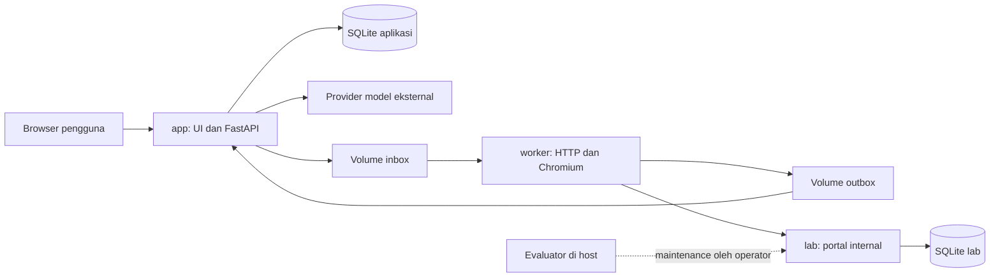

# PRD ValVuln AI

Tanggal: **4 November 2026**. Tim: **ukas and codex vs everbody**. Status: spesifikasi produk dan pilihan stack untuk MVP; belum ada backend, Compose, database produk atau model live yang dibangun/diuji. Prototipe UI masih simulasi, tetapi pengguna sudah menyatakan **fix sebagai baseline untuk mulai backend**, dengan perbaikan berikutnya tetap boleh. Gate UI terpenuhi; eksekusi M1 dilakukan di chat baru, bukan pada turn konfirmasi dokumen ini.

Dokumen ini menjadi ringkasan kebutuhan produk dan **pemilik keputusan tech stack**. Schema/izin/API berada di [architecture.md](docs/architecture.md), detail runtime di [runtime.md](docs/runtime.md), dan urutan implementasi di [implementation.md](docs/implementation.md). Tidak menggandakan seluruh kontrak ke PRD.

## 1. Masalah dan hasil yang dituju

Tim keamanan perlu memeriksa apakah klaim laporan bug hunter sesuai program dan dapat direproduksi. Bantuan AI dalam penulisan laporan dapat menambah beban triage; kualitas bahasa atau dugaan penulis AI tidak menentukan validitas kerentanan.

ValVuln AI menerima laporan, memeriksa scope terpercaya milik admin, lalu menggunakan tools terbatas untuk memvalidasi klaim pada portal pengadaan/logistik lab. Hasilnya berupa penilaian per klaim, bukti dan keterbatasan untuk ditinjau analis. Produk tidak menetapkan siapa penulis laporan atau membuktikan semua jenis kerentanan.

Keberhasilan MVP adalah satu alur lengkap yang benar-benar bekerja, diikuti perluasan kategori dan evaluasi yang transparan. Tidak menjanjikan angka akurasi, penghematan atau kesiapan operasional instansi sebelum dibuktikan.

## 2. Pengguna dan batas MVP

| Aktor | Kebutuhan |
| --- | --- |
| Bug hunter | Login, pilih program, chat/unggah laporan, validasi, lihat status dan hasil miliknya yang telah disanitasi |
| Admin program | Semua kemampuan submit; menyiapkan/aktifkan guideline, meninjau laporan program dan membagikan bukti yang disetujui |
| Operator/evaluator | Seed akun/binding, menyiapkan/reset lab, verifikasi GT dan menjalankan benchmark di luar agent |

Satu program, satu run pengujian aktif, akun demo sintetis. Login platform terpisah dari akun requester/approver di portal target. Role ditentukan server, bukan pilihan pengguna di browser.

Scope kategori: BAC/IDOR, XSS, file upload dan business logic pada subtype yang benar-benar diuji. DoS/race, raw script execution, multi-agent, fine-tuning dan orkestrasi cloud ditunda. Distribusi berupa repo GitHub publik dan paket lokal; live web/VPS bukan kebutuhan MVP.

## 3. Tech stack yang dipilih

| Lapisan | Pilihan MVP | Alasan dan penempatan |
| --- | --- | --- |
| Bahasa | Python 3.11 | Baseline proyek untuk app, worker, lab dan evaluator |
| API/web server | FastAPI + Uvicorn | App dan lab merupakan aplikasi terpisah; satu proses server masing-masing |
| Schema | Pydantic 2 | Validasi request, konfigurasi, tool, envelope dan output model |
| UI | Jinja2 + HTML/CSS + JavaScript biasa | Mengadaptasi prototipe grafit/sage; disajikan app, tanpa service frontend terpisah |
| Upload teks | python-multipart | Parsing form/file; pembatasan ukuran/UTF-8 tetap harus diimplementasikan aplikasi |
| Database | SQLite | Dua database terpisah untuk app dan lab, bukan server database tersendiri |
| Akses database | aiosqlite + SQL berparameter | Akses async dan transaksi pendek; tanpa ORM pada MVP |
| Migrasi | File SQL bernomor + catatan schema version | Migrasi eksplisit dan dapat diperiksa; prosedur bootstrap/backup diuji sebelum rilis |
| Password platform | pwdlib dengan Argon2 | Hash password; session opaque acak disimpan server-side, bukan JWT login MVP |
| Agent/workflow | State machine Python + adapter provider | Satu orchestrator; policy tidak diserahkan kepada prompt/model |
| Model/API | OpenRouter utama, Gemini direct cadangan; OpenAI API dan xAI opsional | Provider adapter terpisah, model/biaya eksplisit; mock dahulu, belum ada integrasi live |
| HTTP | HTTPX async | Client provider pada app; client target terpisah pada worker |
| Browser target | Playwright Python + Chromium | Hanya di worker; browser bukan container/service keempat |
| Antrean | SQLite pada app + satu dispatcher async | Tidak membutuhkan Redis/Celery; job/action dikirim melalui volume handoff |
| Packaging | Docker Engine/Desktop dengan Compose V2, Linux containers | Tiga service lokal; build awal memerlukan unduhan dependensi/browser |
| Pemeriksaan | pytest + pytest-asyncio, Playwright sesuai kebutuhan | Policy, auth, state, evidence, biaya, metrik dan alur UI yang relevan |
| Evaluator | CLI Python di host operator | GT dan scoring tidak menjadi tool/route model atau service yang terus berjalan |

Nama paket di atas adalah pilihan implementasi, **belum dependensi yang dipasang**. Patch/minor paket, Python image/digest dan build Chromium dikunci saat milestone terkait setelah kompatibilitas Python 3.11 diperiksa. Versi browser Playwright harus cocok dengan paketnya. Lisensi/notice aktual dicatat di [third-party.md](docs/third-party.md). Database SQLite menggunakan engine yang tersedia pada build Python; tidak memasang paket bernama sqlite3 dari PyPI.

Pemilihan SQLite didasarkan pada aplikasi lokal dengan penulisan terbatas; SQLite membatasi satu writer pada satu waktu. Antrean harus memakai transaksi pendek dan diuji terhadap double-submit/concurrency. Ini keputusan desain proyek, bukan bukti throughput aktual. Dasar: [SQLite appropriate uses](https://www.sqlite.org/whentouse.html) dan [aiosqlite](https://aiosqlite.omnilib.dev/en/stable/).

### 3.1 Provider AI dan status akses

Permintaan pengguna 4 November 2026 menambahkan pilihan provider dan fallback. Semuanya **rancangan adapter**, belum dipasang, diberi key, atau diuji live. Penambahan provider tidak menambah container dan tidak mengubah budget total Rp50.000.

| Profil provider | Model/akses rencana | Status gratis dan peran |
| --- | --- | --- |
| openrouter | Utama awal qwen/qwen3-coder; ID/penyedia inference eksplisit | Model utama belum dianggap gratis. Endpoint gratis terpisah hanya diaktifkan setelah ID, tools dan kuotanya diperiksa; tidak mengasumsikan varian :free tersedia |
| gemini | Gemini Developer API direct, kandidat gemini-3.5-flash-lite | Cadangan gratis prioritas: harga token Free Tier tercantum gratis, akses/limit project pengguna belum diverifikasi. Bisa dipilih sebagai primary sebelum freeze bila lebih layak dalam budget |
| openai | OpenAI Platform API key, model ID dipilih saat development | Opsional dan default nonaktif sampai akses/kredit/biaya diperiksa. ChatGPT Plus/Codex bukan pemberian kredit Platform API otomatis |
| xai | Grok melalui API resmi, model ID dipilih saat development | Opsional dan default nonaktif: API ditagih per token. Playground gratis tidak membuktikan free tier API; kredit promosi hanya dihitung bila benar-benar tersedia di akun |
| azure_foundry | Microsoft Foundry/Azure-hosted model; deployment/model/version dipilih setelah akses tersedia | Kandidat berbasis kredit Azure for Students, bukan free tier permanen. Pengguna menyatakan mahasiswa aktif + email kampus; aktivasi, saldo, billing eligibility dan quota belum diverifikasi. Default nonaktif |

Dasar status akses: [Gemini pricing](https://aistudio.google.com/docs/pricing#gemini-3.5-flash-lite), [batas project Gemini](https://aistudio.google.com/docs/rate-limits), [Grok API](https://x.ai/api) dan [OpenAI API credits](https://developers.openai.com/api/docs/guides/chatgpt-api-credits), diperiksa 4 November 2026. Benefit kredit OpenAI pada sumber tersebut ditujukan kepada Pro/Business yang eligible; pengguna menyatakan Plus, sehingga tidak diasumsikan mendapat benefit itu. Tidak ada akun/balance privat yang dibaca.

Panduan apply dan pemeriksaan model Azure ada pada [azure-students.md](docs/azure-students.md), berdasarkan sumber Microsoft yang diperiksa 4 November 2026. Azure merupakan provider/pendanaan terpisah dari OpenAI Platform maupun langganan Plus. Setelah hibah aktif dan deployment/tool/cakupan kredit lolos pemeriksaan, profil Azure dapat memakai tier PROMO_CREDIT dengan ledger saldonya sendiri dan cap proyek yang eksplisit; primary dipilih sebelum freeze. Tidak otomatis masuk chain fallback atau memerlukan pemindahan lab ke cloud.

Jalur **Sign in with ChatGPT** dapat memakai plan pengguna yang eligible melalui izin OAuth tersendiri pada aplikasi lokal/open-source. Ini opsi lanjutan, bukan fallback otomatis menggunakan akun Plus milik pengembang untuk semua user. Client registration, consent, kompatibilitas tool/streaming dan cap biaya/output harus terbukti lebih dulu; belum masuk integrasi MVP awal. Batas preview saat diperiksa tidak menerima max_output_tokens, sehingga cap 1.024 output tidak boleh diklaim bekerja pada jalur itu tanpa solusi terverifikasi. Rujukan: [plan usage untuk aplikasi OSS/lokal](https://developers.openai.com/siwc/token-sharing-open-source) dan [preview limitations](https://developers.openai.com/siwc/token-sharing-open-source/preview-limitations). Tidak mengambil token dari cache/login Codex atau memakai endpoint ChatGPT tidak resmi.

Gemini free tier dipakai hanya dengan data sintetis; ketentuan pemanfaatan data layanan tetap berlaku. Quota RPM/TPM/RPD adalah batas project dan model, bukan kuota pasti untuk 40 run. Tidak mengaktifkan paid tier atau top-up saat kuota gratis habis. Model kartu [Gemini 3.5 Flash-Lite](https://aistudio.google.com/docs/models/gemini-3.5-flash-lite) menyatakan dukungan function calling/structured output; adapter tetap harus lolos probe aktual. Hanya custom tools worker yang diizinkan; built-in search, code execution, computer use atau hosted tools provider tidak diaktifkan untuk melewati policy lab.

### 3.2 Pemilihan dan fallback

- Konfigurasi operator memilih primary dan urutan fallback yang sudah lolos pemeriksaan, beserta model, referensi credential, tier/cap biaya dan batas konteks/tools. Client/report/model tidak dapat menambah provider atau mengubah budget. Secret API hanya tersedia pada app.
- Default rencana tetap OpenRouter -> Gemini direct. Jalur gratis diutamakan untuk cadangan; OpenAI/xAI hanya masuk daftar aktif setelah key, pendanaan dan batas pengeluarannya tersedia. Jika primary belum terkonfigurasi, tampilkan CONFIGURATION_REQUIRED; operator dapat memilih Gemini secara eksplisit, bukan menyamarkan konfigurasi rusak sebagai keberhasilan primary.
- Fallback otomatis untuk gangguan sementara, misalnya 429 sementara/5xx/transport timeout, **sebelum respons model pertama berhasil diterima dan digunakan**, serta sebelum ada aksi target. Quota/kredit habis boleh dialihkan hanya ke profil FREE_TIER terverifikasi dalam daftar operator, bukan ke layanan berbayar. Respons sukses pertama mengunci provider/model sepanjang run. Sesudah itu kegagalan mengakhiri run; percobaan baru memiliki run ID baru, tanpa replay mutasi otomatis.
- Satu langkah model paling banyak dua dispatch total: satu awal dan satu retry atau fallback. Semua dispatch berbagi cap 12 panggilan, deadline aktif dan ledger run yang sama; beralih provider tidak mengulang jatah. Hormati Retry-After bila muat deadline. Usage yang tidak diketahui tetap COST_UNKNOWN.
- Auth/config error, schema tidak cocok, input berlebih, refusal dan policy block bukan alasan mencoba provider lain otomatis. Bila alasan quota/billing ambigu atau tidak ada cadangan gratis terverifikasi, berhenti dengan sebab yang jelas. Fallback tidak dipakai untuk mengejar verdict yang diinginkan. Provider cadangan tidak melonggarkan scope atau tools.
- Benchmark A/B mematikan fallback/auto-routing dan membekukan satu model/provider yang sama pada kedua arm. Error tetap dicatat; ganti konfigurasi eksperimen hanya secara eksplisit dengan hasil terpisah.
- UI menampilkan provider/model yang benar-benar dipakai dan kejadian perpindahan, termasuk alasan. Tidak mengganti mock/replay/live secara otomatis. Detail normalisasi respons/provenance dimiliki architecture.md.

## 4. Docker: tiga container yang berjalan terus

| Service rencana | Isi | Port/jaringan | Penyimpanan |
| --- | --- | --- | --- |
| app | UI, auth/API, workflow/dispatcher, adapter model dan verifier | Default UI host 127.0.0.1:8000; jaringan app dengan akses provider; tidak ikut jaringan lab | app_data dan kedua volume handoff sesuai haknya |
| worker | Tools HTTP, Playwright/Chromium, session akun target, capture | Tanpa port host; hanya jaringan lab_internal | Inbox read-only, outbox read-write dan konfigurasi/akun alias minimum read-only |
| lab | Portal dummy FastAPI/Jinja2, aturan bisnis dan kondisi target | Port internal 8001; tanpa port host; jaringan lab_internal | lab_data sendiri |

Port tersebut **default rancangan**, belum URL aplikasi yang bekerja; konflik port diperiksa pada M1. App bind di dalam container agar port mapping dapat melayani host, tetapi port host hanya loopback. Nama DNS service lab menjadi binding origin operator, bukan URL bebas dari report.

UI dan backend berada pada container app yang sama. Satu portal lab menampung rancangan 24 titik kerentanan; bukan 24 container. Jumlah container tidak bertambah ketika laporan baru dikirim. Browser hanya diluncurkan sesuai kebutuhan run dan dibersihkan setelah akun/run berganti.

### Menjalankan aplikasi dengan satu perintah

Target setelah Docker/Compose, konfigurasi dan seed awal disiapkan adalah `docker compose up -d --build` dari root repo. Pada MVP lengkap perintah ini menyalakan app/worker/lab tanpa perlu menjalankan Python, npm atau server lain pada host. Saat M1 baru fondasi, pemeriksaan Compose boleh hanya mencakup app; jangan membuat placeholder worker/lab untuk mengklaim tiga service sudah berfungsi.

Ini **kriteria yang harus dibangun/diuji**, bukan perintah produk yang sudah tersedia. Build awal dapat memerlukan internet. Seed akun/program serta reset/evaluasi merupakan operasi operator terpisah; evaluator host masih memerlukan Python dan bukan bagian startup aplikasi normal. Startup tidak memanggil model, menguji target atau mereset state/hasil secara otomatis. Detail readiness dan restart pada runtime.md.

Panah evaluator adalah jalur operator, bukan koneksi jaringan app/agent ke lab. Seed/reset dilakukan melalui maintenance CLI lab yang dipanggil operator lewat Docker CLI pada host; CLI evaluator dan manifest GT tidak dimasukkan ke image lab/worker. Tidak memasang Docker socket pada service mana pun. Maintenance dijalankan ketika run berhenti; tidak perlu container evaluator keempat yang terus berjalan.

Pemisahan network, mount, timeout, pembatalan dan crash recovery harus dibuktikan sesuai [runtime.md](docs/runtime.md) dan [security-review.md](docs/security-review.md). Konfigurasi internal network saja belum menjadi bukti isolasi. Worker berjalan sebagai user non-root dengan sandbox Chromium aktif; jika sandbox/egress gagal, perbaiki lingkungan sebelum browser diaktifkan. Dasar browser: [Playwright Docker](https://playwright.dev/python/docs/docker).

## 5. Database dan volume

| Database | Lokasi rencana | Isi | Pemilik akses |
| --- | --- | --- | --- |
| Aplikasi | app_data, file /data/valvuln.sqlite3 | User/session/membership, program/scope, chat/report, run/action, indeks evidence, assessment/review, ledger/audit | Hanya app; worker tidak membuka DB ini |
| Portal lab | lab_data, file /data/lab.sqlite3 | Akun target sintetis, katalog, permintaan, stok, invoice, lampiran/metadata dan state skenario | Hanya lab; operasi maintenance oleh operator |

Kedua file tidak berbagi tabel/session/credential. Reset lab tidak menghapus report, hasil atau budget aplikasi. Screenshot, upload dan capture disimpan sebagai file privat, dengan ID/hash/metadata pada DB app. Dataset, label GT dan hasil scoring evaluator berada di direktori host terpisah yang tidak dimount ke agent.

Empat named volume yang direncanakan:

| Volume | app | worker | lab |
| --- | --- | --- | --- |
| app_data | Read-write | Tidak | Tidak |
| lab_data | Tidak | Tidak | Read-write |
| job_inbox | Read-write | Read-only | Tidak |
| job_outbox | Read-only | Read-write | Tidak |

Konfigurasi policy dan credential target memakai mount/secret minimum read-only di worker, terpisah dari volume app. Key model hanya tersedia pada adapter app. Handoff bukan database bersama; validasi envelope, acknowledgment, deduplikasi dan impor artefak mengikuti runtime.md. Backup dilakukan saat storage konsisten; penghapusan volume tidak menjadi bagian startup/reset normal.

## 6. Kebutuhan fungsional dan penerimaan

| ID | Perilaku wajib | Kriteria penerimaan |
| --- | --- | --- |
| FR-01 | Login dan kepemilikan | Hunter A tidak dapat mengakses objek/ekspor Hunter B; role client tidak memberi akses admin |
| FR-02 | Guideline terpercaya | Upload admin menjadi draf; aktivasi terversi dan binding operator diperiksa; report tidak dapat mengubah izin |
| FR-03 | Chat/upload report | Draft dapat disimpan; Validasi mengunci revisi; TXT/MD UTF-8 dengan batas yang dideklarasikan |
| FR-04 | Gate scope | OOS, UNKNOWN, unsupported atau prasyarat kurang tidak membuat job/koneksi target |
| FR-05 | Eksekusi terbatas | Setelah gate lolos, tools hanya mengakses target/akun/metode yang diizinkan; policy berlaku per aksi |
| FR-06 | Bukti dan assessment | CONFIRMED didukung dampak; REFUTED didukung bukti penyangkal; timeout/refusal bukan otomatis laporan salah |
| FR-07 | Review dan ekspor | Hasil mentah tetap tersimpan; admin review/publikasi; pelapor hanya memperoleh projection tersanitasi miliknya |
| FR-08 | Batas dan pemulihan | Double-submit tidak menggandakan job/biaya; cancel/crash tercatat; mutasi ambigu tidak diputar ulang otomatis |
| FR-09 | Mode dan model jelas | UI menampilkan mock/replay/live dan model/provider aktual; live tanpa key menghasilkan error konfigurasi |
| FR-10 | Evaluasi terpisah | A adalah prediksi dokumen, B assessment berbukti; GT tidak masuk context/tools model |
| FR-11 | Provider dan fallback terkontrol | Hanya daftar operator yang aktif; perpindahan tercatat, cap bersama, provider terkunci setelah respons pertama; fallback mati saat benchmark |
| FR-12 | Startup aplikasi satu perintah | Setelah setup/seed, Compose menyalakan service yang sudah diimplementasikan; startup/restart mempertahankan data/ledger, tidak menjalankan validasi/model/reset otomatis, dan dependency belum siap ditampilkan dengan benar |

Detail pengujian dan checkpoint dimiliki security-review.md serta implementation.md; tabel ini tidak menyatakan satu pun sudah lulus.

## 7. Batas resource, waktu dan biaya

Perangkat sasaran laptop RAM 16 GB. Mulai anggaran Docker 4-6 GB dengan satu worker/run aktif. Pemakaian puncak RAM/CPU, kebutuhan disk/image dan stabilitas Chromium harus diukur pada development; tiga container bukan jaminan seluruhnya otomatis muat.

Batas request/browser, timeout, ukuran data, token dan artefak mengikuti runtime.md. API key belum tersedia dan total biaya maksimal Rp50.000. Tidak membeli kredit otomatis; chat/retry/benchmark memakai ledger yang sama. Hasil mock tidak memenuhi bukti fungsi model AI.

## 8. Evaluasi dan definisi selesai

Target aktif **20 laporan sintetis berbeda, 10 valid dan 10 tidak valid**, dengan GT manual: 8 BAC, 8 XSS, 2 upload, 2 business logic. Baseline A dan sistem B menghasilkan 40 run terjadwal; satu run dapat memakai banyak panggilan API. Jumlah kecil ini mengukur kasus lab, bukan akurasi industri. Pembagian/grup/rumus berada di [evaluation.md](docs/evaluation.md).

Target lab tetap 24 titik sesuai keputusan sebelumnya, dengan 10 area benchmark, 4 development dan 10 non-benchmark. Ini risiko pekerjaan yang belum diselesaikan oleh pengurangan laporan. Titik belum dihitung nyata sampai dampak/kontrol diverifikasi manual.

MVP siap diserahkan ketika alur yang diklaim benar-benar berjalan, batas akses relevan diuji, integrasi model nyata terbukti, hasil evaluasi/kegagalan disajikan jujur, serta paket lokal dapat dijalankan dari kondisi bersih. Kelengkapan lomba mengikuti [submission-checklist.md](docs/submission-checklist.md).

## 9. Tahap dan keputusan yang masih terbuka

Urutan tetap: UI baseline fix (sudah dikonfirmasi 4 November) -> M1 fondasi/mock -> M2 BAC development -> M3 alur lengkap -> kategori lain -> live/freeze/evaluasi -> paket submission. Prompt chat baru dapat memulai M1 tanpa konfirmasi UI ulang. Persetujuan baseline tidak mengubah status mock/live atau meluluskan checkpoint teknis; perbaikan UI tetap mengikuti kebutuhan implementasi.

Yang diperiksa saat implementasi: Docker daemon/disk, pin versi/image/browser, parameter hash/session, konfigurasi port, enforcement jaringan/sandbox, dan hasil pemakaian resource. Key/jalur model harus sesuai budget sebelum live. Lisensi kode asli dan URL repo ditetapkan sebelum publikasi. Tidak ada keputusan ini yang dinyatakan sudah diverifikasi oleh PRD.

## Rujukan stack

Sumber primer diperiksa 4 November 2026; dokumen produk ini memilih penerapannya untuk proyek, bukan menyalin semua rekomendasi deployment umum.

- [FastAPI dalam Docker](https://fastapi.tiangolo.com/deployment/docker/): dasar packaging app/server; proyek memilih satu proses agar dispatcher tidak ganda.
- [FastAPI templates](https://fastapi.tiangolo.com/advanced/templates/) dan [upload file](https://fastapi.tiangolo.com/tutorial/request-files/): dasar Jinja2 dan multipart, dengan validasi aplikasi tetap diperlukan.
- [FastAPI password hashing](https://fastapi.tiangolo.com/tutorial/security/oauth2-jwt/): rujukan pwdlib/Argon2; proyek memakai session server-side, bukan menyalin alur JWT tutorial.
- [Docker Compose networking](https://docs.docker.com/compose/how-tos/networking/): jaringan eksplisit dan penemuan service melalui nama; isolasi aktual tetap diuji.
